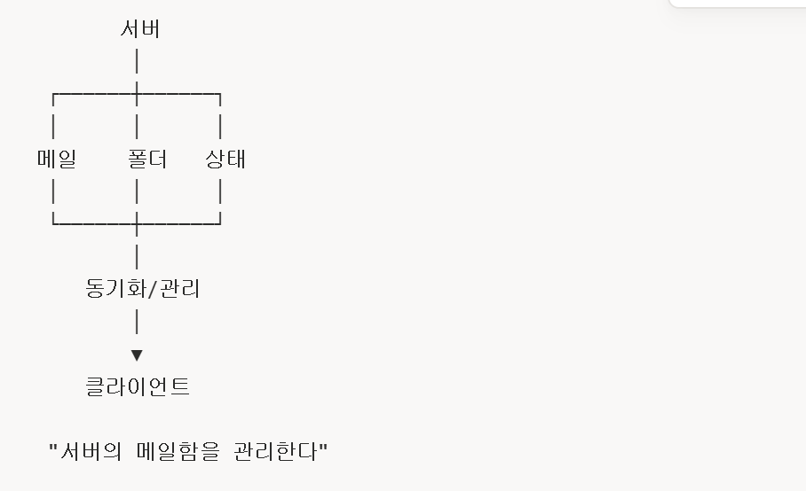

# 블로그 글쓰기 규칙

Jekyll + Chirpy 테마 블로그. 새 글을 쓰거나 기존 글을 다듬을 때 아래 규칙을 따른다.
기준 예시: `_posts/2026-09-13-mail-protocol.md`

## 파일 / Front matter

- 파일명: `_posts/YYYY-MM-DD-영문-슬러그.md` (슬러그가 URL이 됨: `/posts/영문-슬러그/`)
- 카테고리는 항상 소문자 (`challenge`, `security` …)
- 날짜는 KST: `date: 2026-09-13 21:29:41 +0900`
- Mermaid 다이어그램을 쓰면 `mermaid: true` 추가

```yaml
---
title: "글 제목"
date: 2026-09-13 21:29:41 +0900
categories: [security]
tags: [network]
mermaid: true   # 다이어그램 있을 때만
---
```

## 제목 계층

- 본문에 `#`(h1) 금지 — 글 제목이 h1이라 겹친다.
- 큰 단락 `##`, 하위 `###`, 꼭 필요할 때만 `####`. 단계를 건너뛰지 않는다 (`##` 다음 바로 `####` ✗).
- 제목은 줄 맨 앞에서 시작 (앞에 공백 금지).
- 짧은 소분류(정의, 특징 등)는 제목 대신 `**굵은 글씨**` 한 줄도 가능.
- 제목 위 여백은 CSS(`assets/css/jekyll-theme-chirpy.scss`)가 처리한다. 여백용 빈 줄 여러 개나 `<br>`을 넣지 않는다.

## 안내 박스 (Chirpy prompt)

인용문(`>`) 끝에 클래스를 붙인다. 박스 제목은 제목(`#`)이 아니라 첫 줄 `**굵은 글씨**`.

| 용도 | 클래스 | 색 |
| --- | --- | --- |
| 실무 팁, 핵심 결론/정리 문장 | `{: .prompt-tip }` | 초록 |
| 참고, 보충 설명, 용어 설명 | `{: .prompt-info }` | 파랑 |
| 주의사항, 흔한 오해 | `{: .prompt-warning }` | 노랑 |
| 위험/금지 (드물게) | `{: .prompt-danger }` | 빨강 |

```markdown
> **[참고] 제목**
> - 내용
{: .prompt-info }
```

- 말머리가 있으면 말머리가 색을 정한다: `[참고]` → info(파랑), `[실무]` → tip(초록). 말머리와 박스 색을 다르게 쓰지 않는다.
- **요약 섹션은 박스 없이** `## 요약` + 일반 목록.
- 절차(1,2,3…), 기능 나열 같은 본문 내용은 박스에 넣지 않는다 — 박스는 "강조해서 따로 볼 것"에만.
- 한 글에 박스는 꼭 필요한 곳에만 (남발하면 강조 효과가 사라짐).

## 다이어그램

- 글자로 그린 그림(ASCII) 대신 Mermaid:

  ````markdown
  ```mermaid
  flowchart TD
      S[Mail Server] ---|IMAP| P[PC]
  ```
  ````
- 노드 id는 영문, 라벨은 한글 가능. 원래 그림에 화살표가 없으면 `---`, 있으면 `-->`.
- Mermaid로 표현이 어려운 그림은 ` ```text ` 코드 블록에 넣는다 (인용문 안에 두지 않는다).

## 이미지

- 위치: `assets/img/posts/<슬러그>/01.png, 02.png …`
- 대체 텍스트 + 바로 아래 줄에 캡션:

  ```markdown
  
  _IMAP — 서버의 메일·폴더·상태를 동기화/관리_
  ```

## 마크다운 문법 주의 (kramdown)

- 줄바꿈 한 번 = 화면에서도 줄바꿈 (`hard_wrap: true`). 문단은 빈 줄로 나눈다.
- 목록·표·코드 블록 앞에는 빈 줄.
- 목록 기호는 `-`, 하위 목록은 2칸 들여쓰기. 번호 목록 `1.`과 `-` 목록을 붙여 쓰지 않는다 (사이에 빈 줄).
- 굵은 글씨 안쪽에 공백 금지: `** 텍스트**` ✗ → `**텍스트**`
- 맨 URL은 `<https://...>` 또는 `[이름](https://...)`로 감싼다.
- 줄이 `[텍스트]:`로 시작하면 링크 정의로 인식되어 사라진다 → `\[텍스트]:`
- 비교는 표로 정리하는 것을 우선 고려.
- 코드 블록에는 언어 지정 (` ```bash `, ` ```text ` …).

## challenge 글 작성

사용자가 "challenge 쓰자/작성해줘"라고 하면 양식을 따로 묻지 않고 아래대로 만든다.

1. `_posts/*-challenge-NN.md` 중 번호가 가장 큰 글을 복사해 기반으로 쓴다.
2. 파일명 `YYYY-MM-DD-challenge-(NN+1).md`, `title: "YYYY.MM.DD"`, `date: YYYY-MM-DD 23:00:00 +0900`. 날짜를 말하지 않으면 오늘 날짜를 쓴다.
3. `단기 목표`, `2주 목표`는 직전 글 그대로 둔다. 사용자가 새 내용을 줄 때만 바꾼다.
4. 사용자가 준 내용으로 `오늘 할 일`, `내일 할 일`만 교체한다.
   - 항목 사이는 빈 줄, `* 목표 뽀모도로 (n/8)`, `달성 % : n%` 형식을 유지한다.
   - 결과 표시(`- O`, `- X`, `- 완료`)는 오늘 할 일에만 붙인다. 내일 할 일에는 붙이지 않는다.
   - 붙여넣기로 하위 목록 들여쓰기가 사라졌으면 기존 글 형식(4칸)으로 되살린다.
5. 커밋/푸시는 사용자가 요청할 때만 한다.

## 기존 글 다듬을 때

- 작성자의 문장·표현은 바꾸지 않는다. 구조(제목 단계, 박스, 다이어그램, 캡션)만 정리한다.
- 확인: Docker로 로컬 미리보기
  `docker run --rm -p 4000:4000 -v "<repo>:/src" -v jekyll-bundle:/usr/local/bundle -w /src ruby:3.3 bundle exec jekyll serve -H 0.0.0.0`
