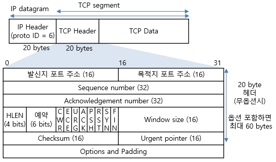
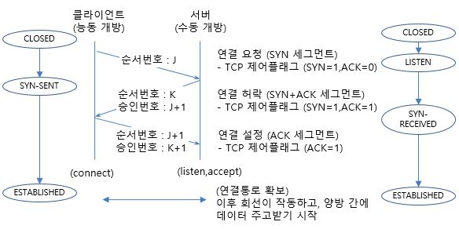
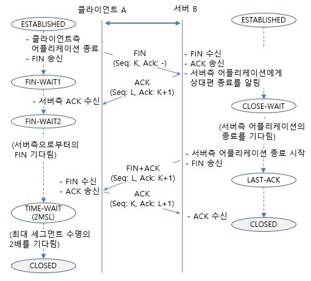
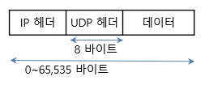
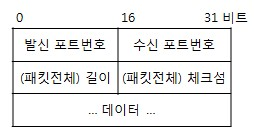

> #### 3줄 요약
> * 전송 계층에서는 프로세스간 논리적 통신을 제공하며 대표 프로토콜로 TCP와 UDP가 있습니다.
> * TCP는 종단 간 신뢰성을 보장하는 연결 지향형 통신 방식으로 순서 번호(Sequence), 흐름 제어(Window Size), 재전송(TimeOut)을 통해서 신뢰성을 보장합니다.
> * UDP는 연결 수립이나 오류 복구 과정이 없는 비신뢰성 프로토콜로, 전송 속도에 집중하는 **Best Effort** 방식입니다.

### 개요

전송 계층은 각기 다른 호스트에서 동작하는 프로세스 간의 논리적 통신을 제공합니다.

전송 계층 프로토콜 (TCP, UDP 등)은 네트워크 라우터가 아닌 종단 시스템(Host)에서 구현됩니다.

이번 글에서는, 전송 계층 프로토콜에 해당하는 TCP와 UDP에 대해서 정리해보려고 합니다.

### TCP 헤더 구조

- **Sequence Number** (순서 번호)
    - 송신하는 데이터 패킷에 부여되는 고유한 번호로 **올바른 전송 순서 보장** 및 **중복 방지**를 위해 사용됌.
    - 순서가 뒤바뀐 경우 TCP는 재전송 기능으로 신뢰성을 보장하는데, 이때 해당 필드가 사용됌.
- **Acknowledgement Number** (확인응답번호)
    - 수신자가 데이터를 **정상적으로 수신했음을 송신자에게 알려주는** 확인 응답 필드.
    - 송수신 양측이 패킷의 정상 도착 여부를 상호 검증하여 **데이터 전송의 신뢰성을 보장**하는 데 사용됨.
    - ‘마지막으로 수신받은 패킷의 순서번호 + 1’을 전송

- Source/Destination Port Number
    - 호스트 내 프로세스 식별을 위해 사용
- Header Length
    - TCP 헤더의 길이를 표시
- Window size
    - 수신측이 자신의 **남은 버퍼 용량**을 송신측에 알려주는 필드.
    - 통보받은 용량에 맞춰 송신 속도를 조절해 데이터가 넘치지 않게 막는 **흐름 제어(Flow Control)** 목적으로 사용됨.
- Checksum
    - 전송 중 데이터가 손상(오류)되었는지 확인하기 위한 필드
    - 송신측이 헤더와 데이터를 기반으로 체크섬 값을 계산하여 함께 전송하면, 수신측이 동일한 방식으로 재계산하여 값을 비교함. (값이 다르면 데이터 손상 간주, 해당 패킷 폐기 후 재전송)
    

### TCP 제어 플래그

- SYN (Synchronize)
    - 통신 양측이 최초로 연결을 시도하고 상태를 동기화할 때 사용
    - TCP 3-Way Handshake 과정에서 가장 먼저 전송되며, 본격적인 통신을 위한 "연결 요청"의 역할을 함.
- ACK (Acknowledgement)
    - 데이터 수신, 연결 설정(SYN), 종료(FIN) 등 대상 패킷을 성공적으로 수신했음을 송신자에게 보장하기 위해 사용
- URG (Urgent)
    - 긴급 상황에서 사용되며, Urgent Pointer 필드와 연계되어 동작됌.
    - Urgent Pointer 필드에 값이 채워져있음을 알리며, Urgent Pointer에는 긴급 데이터의 마지막 바이트 위치가 들어있음, 수신측은 순서에 상관없이 긴급 데이터를 우선적으로 처리하게 됌.
    - 현대 네트워크의 환경에서 해당 플래그비트가 발생하는 상황은 아직 없다고 함.
- FIN (Finish)
    - 정해진 프로세스(4-Way Handshake)를 거쳐 정상적으로 연결을 종료시키기 위한 플래그비트
- RST (Reset)
    - 비정상적인 오류가 발생했을 때, 남은 프로세스와 무관하게 연결을 즉시 강제로 종료(초기화)할 때 사용하는 플래그비트
    - 공격자(해커)가 통신을 강제로 끊고 세션을 가로채기 위해(세션 하이재킹 등) 의도적으로 RST 플래그를 악용하는 경우도 많다고 합니다.
- PSH (Push)
    - 버퍼(저장공간) 채워지기 전에 즉시 데이터를 전송하고자 할때 사용하는 플래그비트
    - 일반적인 데이터 통신은 즉시 전송되지 않고, **버퍼(저장 공간)가 가득 차야 전송**되는 특징이 있습니다(참고).

### TCP 연결 방식 3-way Handshaking

**개념:** 클라이언트와 서버가 신뢰성 있는 통신을 위해 **데이터 전송 전 연결을 맺는 3단계 과정**.

- **1단계 (SYN):** 클라이언트 → 서버
    - "연결하고 싶어!"라는 의미로 **SYN** 플래그 전송
- **2단계 (SYN + ACK):** 서버 → 클라이언트
    - "SYN 잘 받았고, 내 연결 요청도 받을래?"라는 의미로 **SYN과 ACK** 플래그 동시 전송.
- **3단계 (ACK):** 클라이언트 → 서버
    - "응답 잘 받았어!"라는 의미로 **ACK** 전송하며 연결 성립.

**참고**

- 2단계 과정이 이루어졌을 때부터 네트워크는 이미 연결이 성립이 되었다고 간주
- 그렇기 때문에 3단계에서 클라이언트는 ACK를 보냄과 동시에 데이터도 같이 전송이 가능

### TCP 의 연결 해제 방식 4-way Handshaking

**개념:** 클라이언트와 서버가 신뢰성 있는 통신을 위해 **데이터 전송 후 연결을 해제하는 4단계 과정**.

- **1단계 (FIN):** 클라이언트 → 서버
    - "연결 해제하고 싶어!"라는 의미로 **FIN** 플래그 전송
- **2단계 (ACK)**: 서버 → 클라이언트
    - “연결 해제하고싶다고? 아.. 일단 알겠는데 자암시만 기다려..!” 라는 의미로 **ACK** 플래그만 먼저 전송 (이후 아직 전송완료가 안된 데이터가 있을 수 있으므로 일정시간 WAIT를 통해 남은 데이터들이 있다며 보냅니다)
- **3단계 (FIN, ACK)**: 서버 → 클라이언트
    - “휴 다 보냈네 여기 나도 이제 할거 다 했으니 연결 끊읍시다그려” 라는 의미로 **FIN**과 **ACK** 플래그 전송
- **4단계 (ACK)** : 클라이언트 → 서버
    - “내가 먼저 FIN 보냈고 서버에게 FIN과 ACK를 모두 받았으니 나도 응답을 통해 최종 종료하겠다”라는 의미로 **ACK** 플래그를 서버에 전송
    - 클라이언트는 ACK를 보낸 후 바로 연결을 닫지 않고 일정시간 대기하는 상태를 갖음(TIME_WAIT)
        - 클라이언트가 보낸 마지막 ACK가 서버에게 유실됐을 경우, 서버는 자기가 보낸 FIN에 대한 응답을 못 받은 걸로 판단해서 FIN을 재전송할 수 있음. 이때 클라이언트가 이미 연결을 완전히 닫아버렸다면 이 재전송된 FIN에 응답을 못 해주는 상황이 생김. 그래서 클라이언트는 혹시 모를 재전송에 대비해 일정 시간(보통 MSL의 2배, 즉 2MSL) 동안 대기하다가 완전히 종료하게 됌.

**참고**

- 연결 해제 과정이 정상적으로 시작되었더라도, 서버 측에 부득이한 사정이 생겨 종료가 제대로 이루어지지 않는 경우가 있는데, 이런 상태를 **좀비 상태**라고 함
- 다만 TCP는 연결의 신뢰성을 보장하는 프로토콜이기 때문에 이 상태가 계속 유지되지는 않고, 일정 시간 대기 후 다시 정상 종료를 시도하여 안전하게 연결을 마무리함

### TCP 의 재전송 기능 (타임 아웃)
- 개념: 송신한 데이터가 수신자에게 정상적으로 도달하지 못했다고 판단될 때, TCP가 해당 데이터를 다시 전송하여 신뢰성 있는 데이터 전달을 보장하는 기능
- 재전송 발생 상황
    - 패킷이 네트워크 상에서 유실
    - 패킷의 순서가 뒤바뀌어 도착
    - 일정시간이 지나도 응답(ACK)가 도착하지 않음

RTT (Round Trip Time)

- 송신자가 패킷을 보낸 시점부터, 그에 대한 ACK 받기까지 걸리는 왕복 시간

RTO(Retransmission TimeOut)

- 송신자가 ACK를 못 받았을 때 “재전송을 해야겠다”고 판단하는 기준 시간(타임아웃 값)

즉 **TCP는 RTT를 계속 측정하면서 그에 맞는 RTO 값을 설정**해두고, **해당 시간 내에 ACK가 오지 않으면 유실로 판단하여 재전송을 수행**하여 신뢰성있는 전송을 보장함

### UDP 통신 방식 
UDP 패킷 구조는 TCP와 다르게 매우 간단합니다.

- 순서번호 관련, 확인응답기능 등의 TCP에 존재했던 기능들이 없다보니 TCP대비 UDP는 빠른 속도를 갖지만 비신뢰적이다는 특징을 갖습니다.
- UDP는 목적지까지 패킷을 보내는 것에만 집중하기 때문에 이런 통신 방식을 보고 Best Effort 방식이라고 합니다.

### UDP 의 헤더 구조 (체크섬 필드에서 TCP 와 차이점)

- Checksum
    - 전송 중 데이터가 손상(오류)되었는지 확인하기 위한 필드
    - 송신측이 헤더와 데이터를 기반으로 체크섬 값을 계산하여 함께 전송하면, 수신측이 동일한 방식으로 재계산하여 값을 비교함. (값이 다르면 데이터 손상 간주, TCP와 다르게 해당 패킷 폐기만 하고 재전송 없음)
    - TCP와의 차이점: UDP의 체크섬은 선택적으로 일어난다고 하므로 모든 송수신 과정에 대한 오류검출을 보장하지 않는다고 함.
