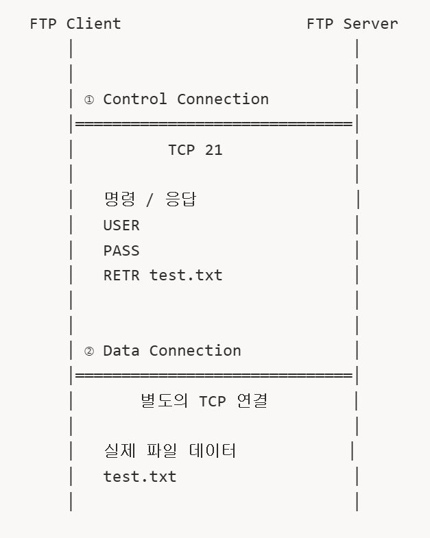
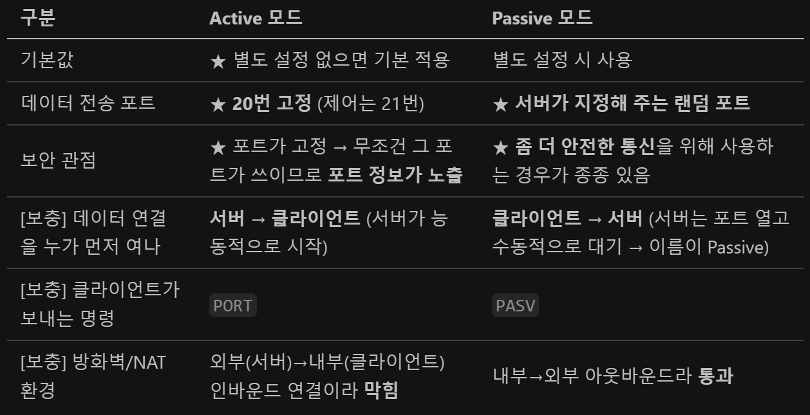

## FTP (File Transfer Protocol)

#### 정의

파일을 전송하고 관리하기 위한 애플리케이션 계층 프로토콜

[보충] 정확히는 "파일 전송 + 그 전송에 필요한 **원격 파일 관리**(로그인/인증, 디렉터리 이동·조회, 파일 삭제·이름 변경)"까지 포함하는 애플리케이션 계층 프로토콜

→ 즉 파일 전송 뿐 아니라 원격 서버의 파일 시스템을 다루는 명령어도 함께 정의함

#### 특징

목적에 따라 두가지 포트 번호를 함께 사용합니다.

일반 프로토콜은 TCP 연결 하나에서 다 처리하지만, FTP는 **목적에 따라 TCP 연결을 둘로 나눔**

- **제어 채널 (TCP 21)**: FTP의 **명령(Command)와 그에 대한 서버의 상태에 대한 응답(Response)을 주고 받기 위한 연결**
    - "무엇을 할 것인가"를 전달 (예: `RETR test.txt` 명령 자체)
- **데이터 채널 (TCP 20, Active 기준)**: 실제 파일 내용이나 디렉터리 목록 등의 **데이터를 전송하는 연결**
    - 데이터 연결 = 실제 파일 내용·디렉터리 목록 등 "진짜 데이터"를 전달 (예: test.txt의 내용)

#### 구조 

#### Active mode & Passive mode

FTP는 **'데이터 연결(Data Connection)을 누가 먼저 시작하는가’**를 기준으로 Active mode와 Passive mode를 구분해서 통신

- Active mode: 서버가 **능동적으로** 클라이언트에게 데이터 연결을 걸어옴
    - 서버 → 클라이언트 (default: 별도 설정 없을 시 Active mode)
- Passive mode: 서버는 포트를 열고 **수동적으로** 기다리고, 클라이언트가 걸어옴
    - 클라이언트 → 서버

(제어 연결은 항상 클라이언트 → 서버)

**모드 별 포트번호**

- Active mode : 서버의 20번 포트번호
    - 클라이언트가 PORT 명령으로 "내 이 포트로 와"라고 알려주면, **서버가 자기 20번 포트에서 클라이언트가 알려준 포트로** 데이터 연결을 시작
    - 기본값 / 서버 포트가 고정돼서 포트 정보 노출 / 서버→클라이언트 방향이라 방화벽·NAT에 막힘
- Passive mode: 서버 데이터 포트 **랜덤(임시)**
    - 클라이언트가 PASV 명령으로 Passive 모드를 요청하면, **서버가 임시 포트를 하나 열고 "이 포트에서 기다릴게"라고 알려줌** → **클라이언트가 그 포트로** 데이터 연결을 시작
    - 서버 포트가 매번 바뀌어 노출이 적음 / 클라이언트→서버 방향이라 방화벽·NAT 통과 → 상대적으로 안전

> 
> 실무에서는 FTP 를 보안에 취약한 프로토콜로 인식한다고 함.
> 그 이유는 회사에서 내부↔내/외부의 데이터 이동이 많은데, 이때 개인정보 등 여러 법령을 준수해야 함.
> - 파일 안에 **개인정보**가 있는지 검사
> - 파일에 **악성코드**가 있는지 검사
> 등의 검사를 FTP 절차를 적용할 방법이 없음.
> -> 그래서 대안으로 **망연계 시스템** 등을 사용한다고 함.

#### FTP 정리

1. **제어 채널(21)과 데이터 채널(20)을 둘 다 활성화**해야만 연결과 데이터 전송이 가능
2. FTP는 **두 가지 모드**. 별도 설정 없으면 **Active**, 서버가 지정한 포트를 쓰면 **Passive** → 구분 기준은 데이터 전송 포트와 누가 먼저 데이터 채널을 먼저 연결하는가
3. **FTP 서비스 자체는 취약한 서비스**. SFTP/FTPS로 보완해도 법령 준수까지는 못 하므로 여전히 취약하게 취급. 단, 무조건 금지가 아니라 인지 + 전환 계획이 있으면 권고·유예
