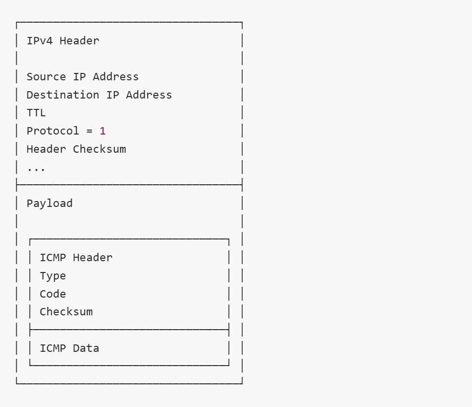
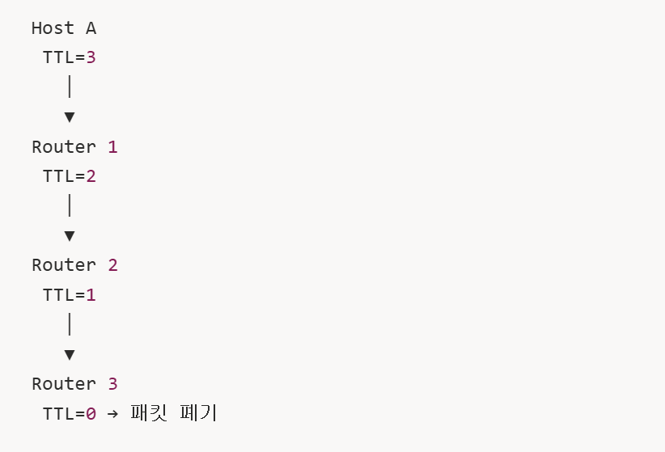
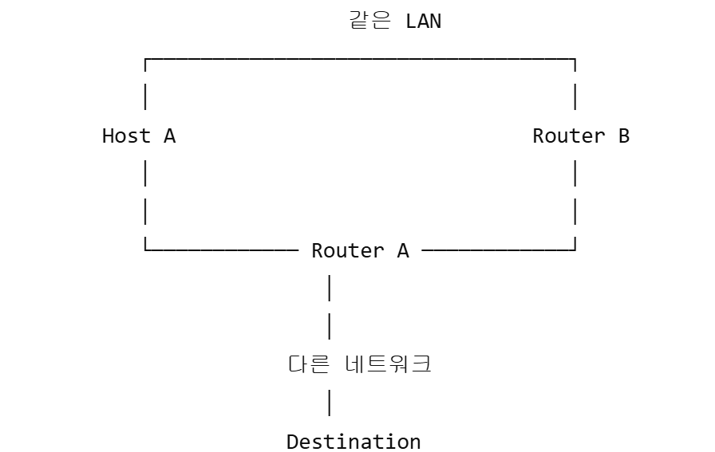
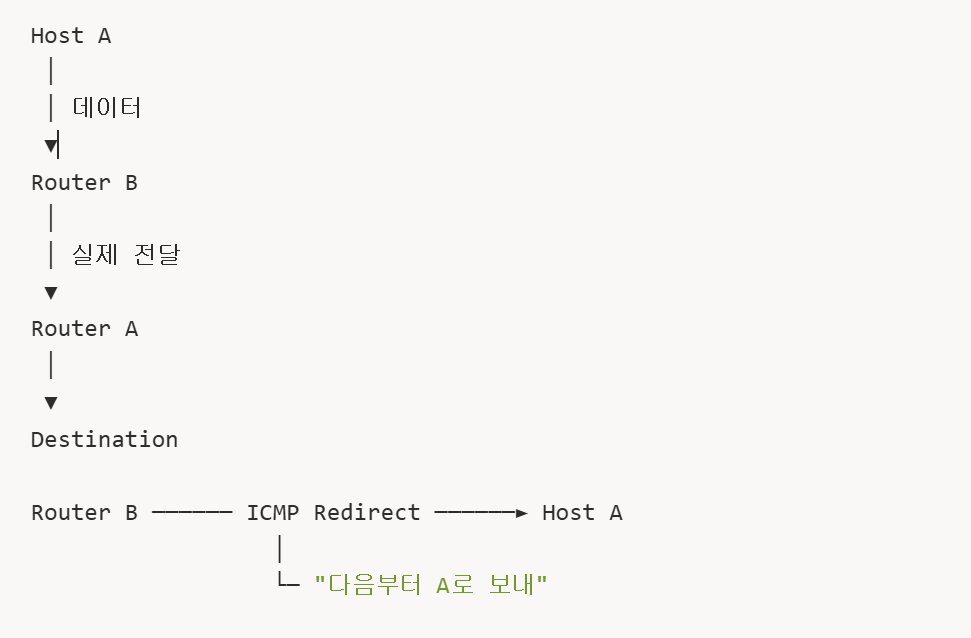
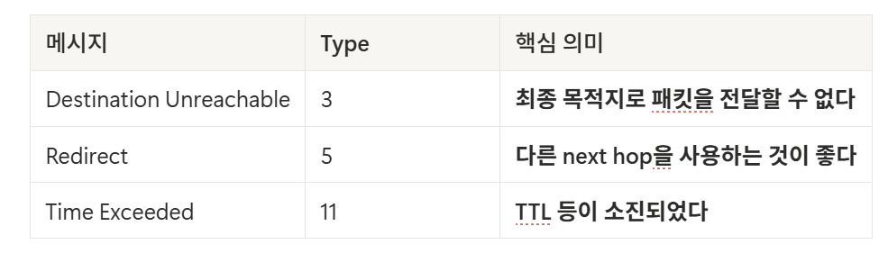

## ICMP (Internet Control Message Protocol)

### 정의

IP 네트워크에서 **IP 패킷의 전달 과정에서 발생한 오류나 네트워크 상태를 알리기 위한 인터넷 계층의 제어 메시지 프로토콜**

### ICMP가 하는 대표적인 역할

- **목적지까지 패킷을 전달할 수 없음을 알림**
- 패킷의 TTL이 만료되었음을 알림
- 더 적절한 다음 홉을 사용하도록 호스트에 알림
- `ping`과 같은 네트워크 진단 기능 제공

→ 즉 **IP의 전달 과정에서 발생한 상황을 알려주는 프로토콜**

### ICMP는 어떤 계층인가

- ICMP는 일반적으로 **TCP/IP 모델의 Internet Layer(인터넷 계층)**에 속하는 것으로 설명한다. (OSI 7 Layer 기준 3 Network Layer)
- IPv4에서 ICMP는 IP 패킷 내부에 들어가며, IPv4 헤더의 `Protocol` 필드 값 **1**로 ICMP임을 나타낸다

> (참고) IP 패킷의 페이로드에 실려 가지만 애플리케이션 데이터를 전달하는 것이 아니라 IP 통신 과정의 오류·상태를 알리는 역할을 하므로, TCP/UDP와 달리 IP와 같은 계층으로 분류한다. **그래서 ICMP에는 포트 번호가 없다.** (호스트(IP)까지만 다룬다 → 호스트 안의 프로그램을 고를 일이 없다)
{: .prompt-info }

### ICMP 메세지의 기본 구조

_IPv4 Header(Protocol = 1) + Payload(ICMP Header: Type·Code·Checksum + ICMP Data)_

- 위 그림은 IPv4 패킷 전체 구조를 보여주는 그림임
    - **IPv4 패킷 = IPv4 Header + Payload(ICMP 메시지)**
    - **ICMP 메시지** = ICMP 헤더 + ICMP Data → IP 패킷의 Payload 전체
    - **ICMP Data** = 그 메시지 안에서 헤더를 뺀 나머지 부분
- `Protocol = 1`은 무슨 역할인가?
    - IPv4 헤더의 `Protocol` 필드가 **"IP 패킷의 Payload가 어떤 상위 프로토콜의 데이터인지"** 알려줘.
    - 만약 Protocol = 6   → TCP

### Type, Code

- **Type** → 어떤 종류의 ICMP 메시지인가?
- **Code** → 해당 Type이 발생한 구체적인 이유는 무엇인가?

→ Type은 어떤 **오류 메시지인지를 구분**하며, 빈번하게 일어나는 3가지를 알아보겠다.

### Destination Unreachable

Destination Unreachable은 패킷을 목적지까지 전달할 수 없을 때 보내는 ICMP 오류 메시지다. (Type = 3)

- 목적지: 최종 목적지 주소(Destination IP)

패킷을 전달할 수 없는 구체적인 이유는 여러가지가 있을 수 있기 때문에 Code를 이용해 구체적인 원인을 구분한다.
(아래 표는 주요 코드 일부)

_Code 0 Network Unreachable · 1 Host Unreachable · 2 Protocol Unreachable_

### Time Exceeded

Time Exceeded는 IP 패킷의 TTL이 전달 과정에서 소진되었거나, IPv4 단편화된 패킷의 재조립 시간이 초과되었음을 알리는 ICMP 오류 메시지다. (Type = 11)

- **TTL**은 Time To Live(수명 시간)의 약자로, IP 패킷이 네트워크 상에서 무한히 맴돌지 않도록 방지하기 위해 설정하는  라우터(간석)를 거칠 수 있는 최대 횟수(Hop 수)를 의미

Time Exceeded의 Code는 두 가지가 있다.

_Code 0 TTL exceeded in transit · 1 Fragment reassembly time exceeded_

실제로 네트워크 공부에서 가장 많이 접하는 것은 **Code 0**이다.

Code 0 : TTL exceeded in transit

예를 들어:

_Host A(TTL=3)에서 출발해 라우터를 지날 때마다 TTL이 줄고, Router 3에서 TTL=0이 되어 패킷 폐기_

TTL이 소진되면 해당 라우터는 패킷을 버리고 원래 송신자에게 ICMP Time Exceeded를 보낼 수 있다.

( **송신자:** 처음 패킷을 만든 Host A의 주소)

### Redirect

ICMP Redirect는 호스트에게 특정 목적지로 패킷을 보낼 때 더 적절한 다음 홉(next hop)을 사용하도록 알려주는 메시지다. (Type = 5)

**Redirect가 발생하는 상황**

_같은 LAN에 Host A·Router B가 있고, Router A를 거쳐 다른 네트워크의 Destination으로 연결_

Host A의 기본 게이트웨이가 Router B라고 하자.

그런데 Host A가 Router B에게 패킷을 보냈더니 Router B가 판단하기에:
`Host A → Router B → Router A → 목적지`
보다
`Host A → Router A → 목적지`
로 바로 보내는 것이 적절할 수 있다.
그러면 Router B는 패킷 자체는 정상적으로 전달하면서 Host A에게:
"이 목적지로 갈 때는 Router A를 next hop으로 사용해라."
라는 ICMP Redirect를 보낼 수 있다.

**Redirect 구조도**

_데이터는 Router B → Router A → Destination으로 실제 전달되고, Router B는 Host A에게 ICMP Redirect("다음부터 A로 보내")를 보냄_

### Ping을 통한 ICMP 확인

- ICMP 사용은 정말 쉽게 해볼 수 있음: 커맨드 창(CMD) → `ping [IP 주소]` → 엔터
    - 정상이면 정상 메시지, 통신이 안 되면 오류 메시지가 보임
- 구글 IP **`ping 8.8.8.8`**로 실제 ICMP 메시지 형태를 확인 가능
- 실무에서는 내부 네트워크 간 통신이 되지 않을 때 ping으로 상태를 확인하고, 어떤 오류 메시지인지 파악해 빠르게 조치하는 용도로 쓴다고 합니다

### 정리

_Destination Unreachable(Type 3) · Redirect(Type 5) · Time Exceeded(Type 11)의 핵심 의미_

## 요약

- ICMP는 IP 전달 과정에서 생긴 **오류·상태를 알리는 3계층 제어 프로토콜**이다. 데이터를 전달하지 않으므로 포트 번호가 없다.
- 메시지는 Type(종류)과 Code(구체적 원인)로 구분한다. 중요한 것은 **오류 메시지**이며, 각 오류가 **어떤 상황에서 발생하는지 구분**하는 것이 핵심이다.
- 오류 메세지의 종류는 대표적으로 “Destination Unreachable (Type = 3): 패킷을최종 목적지로 전달할 수 없음”, “Time Exceeded (Type = 5): TTL 등이 소진되었다”, “Redirect (Type=11): 다른 경로(next hop)를 사용하는 것이 좋다”
