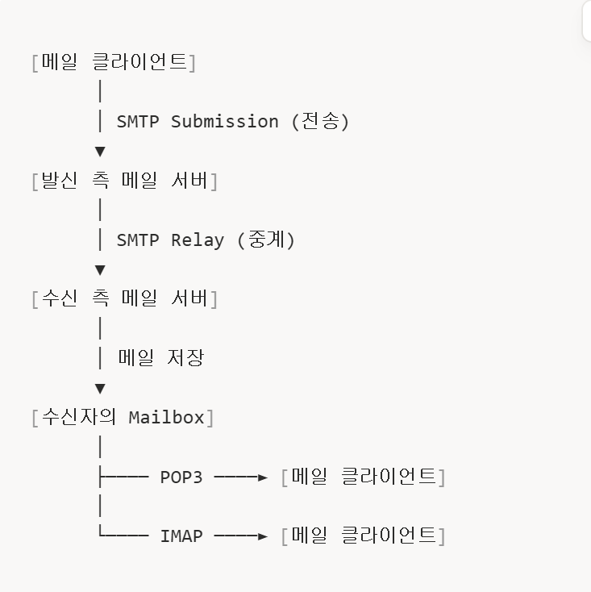
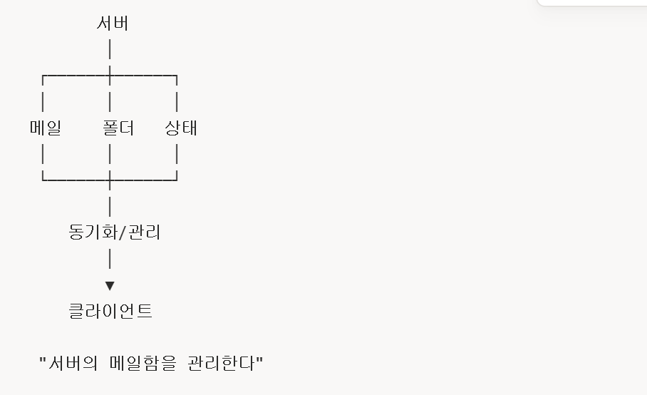
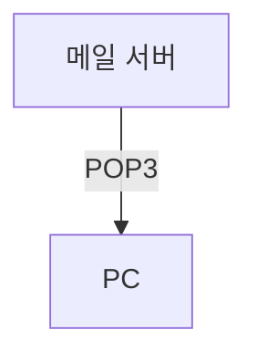
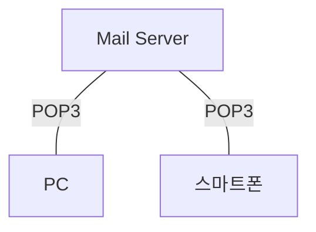
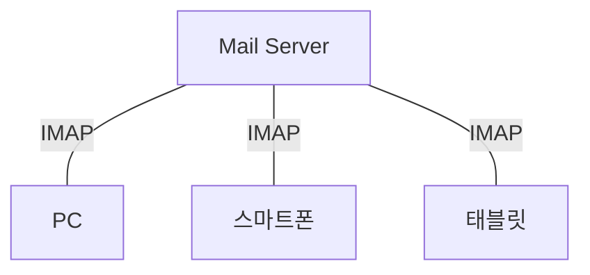

## SMTP

### 정의

SMTP는 메일을 **전송(Transfer)**하기 위한 애플리케이션 계층 프로토콜이다.
클라이언트에서 메일 서버로 제출하는 구간(Submission)과 메일 서버 간에 중계하는 구간(Relay) 모두 SMTP를 사용한다.

- 포트 25

> **보안에서 말하는 송신 구분**
> - 일반적인 의미: 송신자 → 수신자
> - 보안에서의 의미: 송신자 → 메일 서버 (SMTP의 Submission 구간에 해당)
> - 메일 서버 → 수신자는 수신이라 부르며, POP3 또는 IMAP이 담당한다
{: .prompt-info }

### Submission과 Relay 구분

- **Submission — 클라이언트에서 메일 서버로 제출**
  - 사용자가 작성한 메일을 자신의 메일 서버에 처음 건네는 구간이다. 우편물을 우체통에 넣는 것에 해당한다.
- **Relay — "중계", 서버가 받은 메일을 또 다른 서버로 넘기는 것**
  - 최종 목적지가 아닌 서버가 받은 메일을 다음 서버로 넘겨주는 구간이다. 우체국이 편지를 받아 다음 우체국으로 보내는 것에 해당한다.

_메일 클라이언트 → 발신 측 서버(Submission) → 수신 측 서버(Relay) → Mailbox → POP3/IMAP_

## POP3

### 정의

메일 서버에 저장된 메일을 **클라이언트가 가져오기 위한 프로토콜로** 기본적으로 **메일을 다운로드한 후 서버에서 삭제하는 방식**을 전제로 설계됌.

- 포트 110

즉, 서버가 메일을 **중앙에서 관리하는 저장소**라기보다는 클라이언트가 메일을 **가져가는 저장소**에 가까움

### POP3 기본 동작

일반적으로 아래와 같은 동작을 수행함

1. 클라이언트 → POP3 서버 연결
2. 인증
3. 서버에 있는 메일 확인
4. 메일 다운로드
5. 필요하면 서버의 메일 삭제
6. 연결 종료

## IMAP

### 정의

**IMAP(Internet Message Access Protocol)**은 메일 서버에 저장된 메일을 **서버에 유지하면서 원격으로 접근하고 관리하기 위한 프로토콜**

- 포트 143

IMAP에서는 **단순히 메일을 다운로드하는 것뿐만 아니라 서버에 있는 mailbox를 관리**할 수 있다.

### IMAP 기본 동작

- 메일 읽음/안 읽음 상태 관리
- 폴더 관리
- 메일 검색
- 메일 이동
- 메일 삭제
- 메일의 특정 부분만 가져오기
- 여러 클라이언트에서 메일 상태 동기화

## POP3와 IMAP의 핵심 차이

### POP3 : "메일을 가져온다"

_POP3 — 서버의 메일을 클라이언트로 다운로드_

### IMAP : "서버의 메일함을 관리한다"

_IMAP — 서버의 메일·폴더·상태를 동기화/관리_

> 단순히 POP3 = 다운로드 / IMAP = 서버저장 보단
>
> **POP3는 메일을 가져오는 데 초점을 둔 프로토콜**
>
> **IMAP은 서버에 존재하는 메일함을 원격으로 접근하고 관리하며 상태를 동기화하는 데 초점을 둔 프로토콜**
>
> 이렇게 이해하는게 더 정확하다
{: .prompt-tip }

## 운영·관리 측면에서 POP3 vs IMAP

### POP3의 운영 특성

POP3는 기본적으로 메일을 클라이언트로 가져오는 구조이기 때문에 **서버 측 메일 저장 및 동기화 부담이 상대적으로 단순하다.**

예를 들어 한 사용자가 PC 한 대에서만 메일을 사용한다면:

메일을 내려받아 PC에서 관리하는 방식이 가능하다.

따라서 전통적인 환경에서는 서버 저장 공간을 적게 사용할 수 있다는 장점이 있었다.

하지만 여러 장치에서 사용하면 문제가 발생하기 쉽다.

각 클라이언트가 메일을 내려받아 각자 별도의 메일 상태를 가지기 쉽다.

### IMAP의 운영 특성

IMAP에서는 서버가 Mail Server(메일함)을 중심으로 동작한다.

서버에 메일과 mailbox 상태가 유지되므로 여러 장치가 같은 메일함을 바라볼 수 있다.

예를 들어 PC에서 **"읽음"**으로 표시하면 서버에 그 상태가 반영되고, 다른 IMAP 클라이언트가 해당 상태를 확인할 수 있다.

따라서 현대적인 환경에서는 여러 장치에서 동일한 메일 계정을 사용하는 경우 **IMAP이 훨씬 적합하다.**

- 현재 대부분의 메일 서버(**구글, 네이버** 등)는 **IMAP** 방식

## 보안 측면에서의 POP3, IMAP 비교

### 데이터 위치와 노출 범위

데이터 위치에 따른 노출 범위가 각각 다릅니다.

**POP3 (메일이 클라이언트에)** — 위험이 기기로 이동
- 노트북 분실/도난, 기기 악성코드 → 메일 노출
- 서버 계정이 털려도 이미 삭제된 메일은 없음 (노출 범위 작음)
- 대신 백업/암호화 책임이 사용자 개인에게

**IMAP (메일이 서버에)** — 위험이 서버로 집중
- 계정 하나 탈취 = 수년치 메일 전체 열람
- 서버 침해 시 전 사용자 피해
- 대신 서버 측 디스크 암호화, 백업, 보존 정책을 중앙에서 적용 가능

> 즉 **POP3는 "노출 범위는 작지만 통제가 분산", IMAP은 "노출 범위는 크지만 통제가 집중"**입니다.
>
> 어느 쪽이 안전한지는 "누가 더 보안을 잘 관리하는가"에 달려 있고, 보통 개인 기기보다 서버 운영자가 관리를 잘하므로 **조직 환경에서는 IMAP이 유리**
{: .prompt-tip }

> **과거에 POP3를 사용했던 배경 (참고)**
> 1. **기밀성 중시 / 폐쇄적인 회사**
>    - 정보가 외부로 유출되는 것을 극도로 꺼리는 회사들이 POP3로 메일 서버를 운영했음
>    - [보충] 이유를 풀어 보면: POP3는 메일이 서버에 남지 않으므로 **서버 계정이 털려도 이미 내려받은 메일은 없음 → 노출 범위가 작음**. 대신 위험이 개별 기기(분실·도난·악성코드)로 분산되고 백업·암호화 책임이 사용자에게 감
> 2. **메일 서버 성능·가용성 문제**
>    - 과거에는 성능 좋은 메일 서버를 쓰지 않았음
>    - IMAP은 여러 단말기 접근을 받아야 하고 서버에 메일이 **계속 쌓여야** 함 → 쌓일수록 느려지거나 용량 초과 등으로 **메일 서버의 가용성을 해칠 가능성**이 충분히 있었음
>    - → 관리를 편하게 하려는 목적으로도 POP3를 사용했던 시절이 존재
{: .prompt-info }

## 요약

- 보안에서 송신 = 송신자 → 메일 서버 (SMTP, 고정), 수신 = 메일 서버 → 수신자 (POP3 또는 IMAP 중 서버가 선택)
- POP3는 메일을 내려받으면 서버에서 삭제되어 그 단말기에만 남고, IMAP은 서버에 유지되어 여러 단말기에서 동기화된다
- 과거에는 기밀성(노출 범위가 작음)과 서버 가용성(메일이 쌓이지 않음) 때문에 POP3를 썼다
- 현재는 서버 성능이 충분하고 다중 단말기 동기화가 필요하므로 대부분(구글, 네이버 등) IMAP을 사용한다. 조직 환경에서는 통제를 서버에 집중할 수 있다는 점도 IMAP에 유리하다
- 포트: SMTP 25 / POP3 110 / IMAP 143
