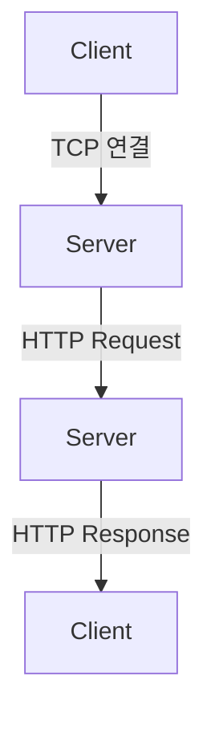
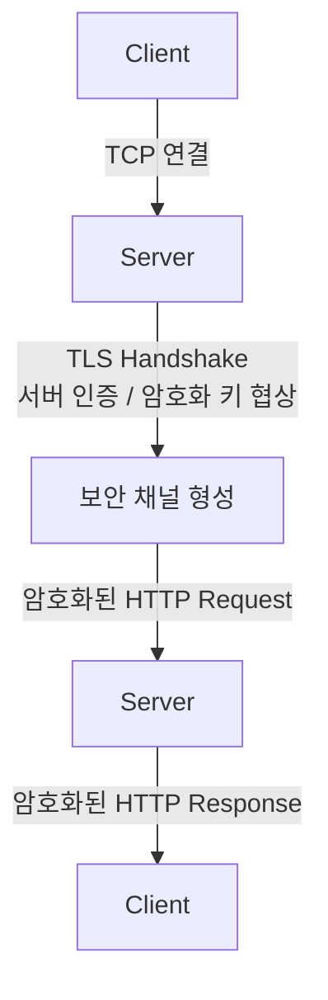
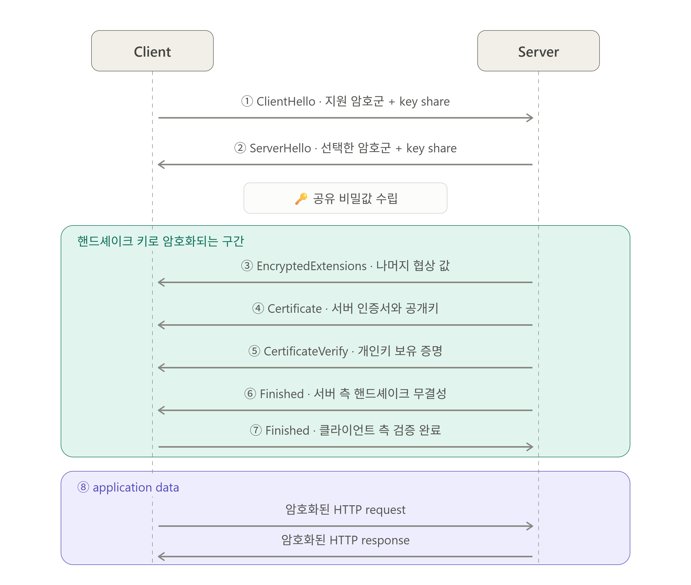

## HTTP (Hypertext Transfer Protocol)

### 개념

- 웹에서 클라이언트와 서버가 요청(Request)과 응답(Response) 형태로 자원을 주고받기 위한 애플리케이션 계층 프로토콜
- 기본적으로 80 포트를 사용

→ (쉽게 말해) 웹에서 클라이언트와 서버가 요청(Request)와 응답(Response)를 어떤 형식으로 할지를 약속(protocol)한 것

### 주요 특징

- **요청-응답 (Request/ Response) 구조**
    - **Request**는 대표적으로 method, target, protocol version, body 등이 포함되고
    - **Response**는 status code와 heade, body 등이 포함됌
- Request - **Method**를 통해 요청의 의도를 표현
    - GET    → 자원의 표현을 조회
    - POST   → 서버에 데이터를 제출하여 처리 요청
    - PUT    → 대상 자원의 상태를 요청 내용으로 대체
    - PATCH  → 대상 자원의 부분적 수정
    - DELETE → 대상 자원의 삭제
- Response - Status Code를 통해 결과를 표현
    
    Status Code는 응답의 결과를 나타내는 3자리 코드
    
    - 1xx → Information
    - 2xx → Success
    - 3xx → Redirection
    - 4xx → Client Error
    - 5xx → Server Error
- HTTP는 Stateless하다
    - **각 HTTP 요청은 필요한 정보를 요청 자체에 포함하여 독립적으로 처리될 수 있는 구조**
    - 즉 상태공유를 하지않음 (필요 시 Cookie, Session 등 메커니즘 사용)

## HTTPS (HyperText Transfer Protocol Secure)

### 개념

- HTTP를 **TLS(Transport Layer Security)**로 보호해서 통신하는 방식
- 기본적으로 443 포트를 사용

> 참고 : **SSL(Secure Sockets Layer)**은 1990년대 넷스케이프가 만든 원조 암호화 프로토콜이고, **TLS(Transport Layer Security)**는 그 후속 버전
>
> → 현업에서는 SSL 과 TLS를 혼용해서 쓰이기도 하는 듯 하니 참고할 것
{: .prompt-info }

### TLS가 제공하는 보안 목표

1. **Confidentiality - 기밀성**
    - TLS는 HTTP로 만든 평문을 암호화해서, 통신 내용을 3자가 볼 수 없도록 보호
2. **Integrity - 무결성**
    - 통신 과정에서 데이터가 변하더라도 탐지할 수 있게 함
3. **Authentication - 서버 인증**
    - HTTPS의 인증에서 인증서 검사를 통해 서버의 신원을 확인

### HTTPS의 통신 흐름

HTTP

HTTPS

### TLS Handshake

**개념**

- 보안 통신을 시작하기 전에 클라이언트와 서버가 서로 약속하고, 키를 만들고, 서버의 신원을 확인하는 과정

_ClientHello·ServerHello로 공유 비밀값 수립 → 암호화 구간에서 서버 인증서·검증·Finished 교환 → 암호화된 HTTP request/response_

TLS Handshake에서는 

① 어떤 TLS / 암호 설정을 사용할지 협상

② 이후 통신에 사용할 비밀 키를 수립

③ 서버가 누구인지 인증

④ handshake 자체가 정상적으로 끝났는지 확인

이후 TLS로 암호화된 Response와 Request를 주고받음

## HTTP와 HTTPS 차이점

|  | HTTP | HTTPS |
| --- | --- | --- |
| 포트 | 80 | 443 |
| 통신 | 평문 | TLS 암호화 |
| 보장 | 없음 | 기밀성·무결성·서버 인증 |

> **실무 관점**
> 로그인 페이지, 개인정보·결제 등 중요 정보가 오가는 구간이 HTTP로 통신하면
> "전송 시 주요 정보 노출" 취약점이다.
>
> 웹 취약점 진단과 인증 감사에서 확인하는 항목이고,
> 조치는 HTTPS 적용이다.
{: .prompt-tip }
