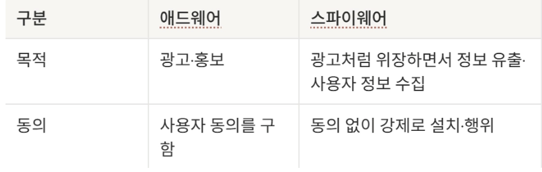
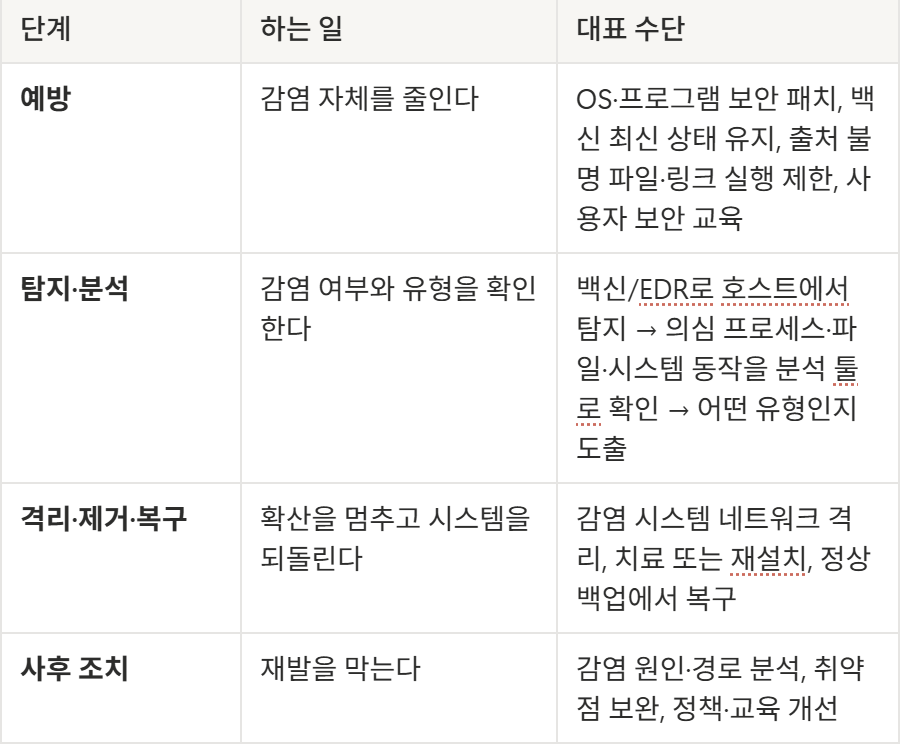
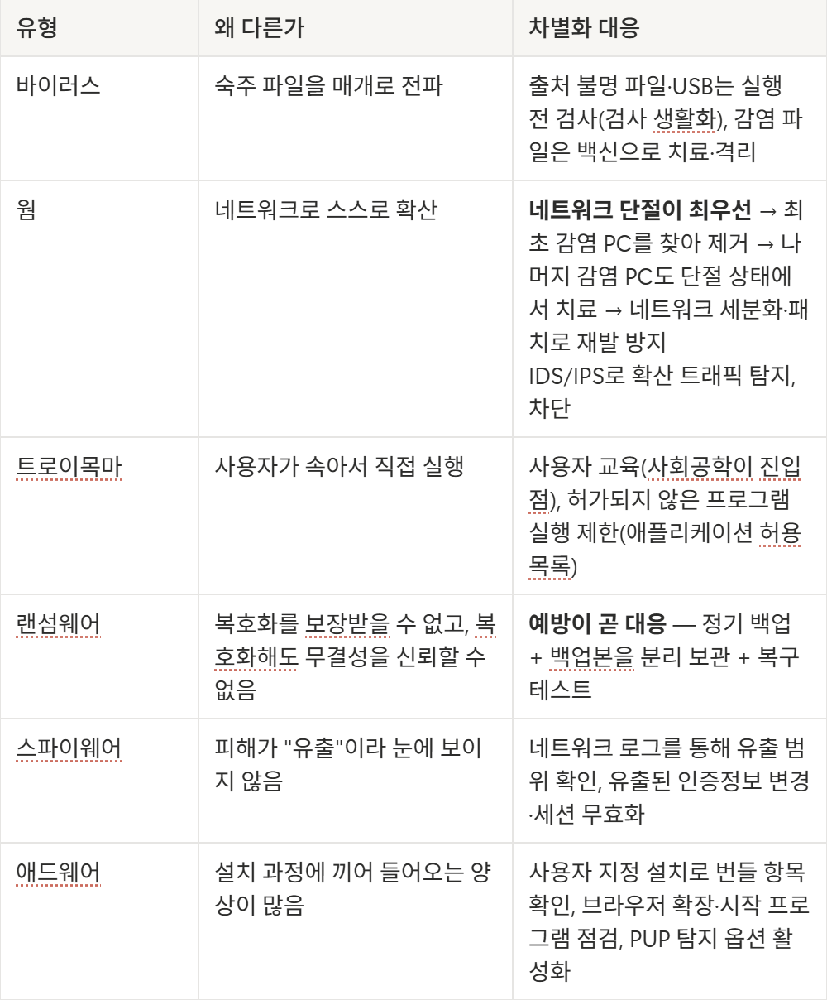

## 1. 악성코드란 무엇인가

**개념**

- 악성코드(Malware)란 시스템에 의도적으로 유해한 동작을 수행하도록 만들어진 소프트웨어 또는 코드로, 정상적인 권한이나 사용자의 의도에 반하여 시스템 또는 데이터의 보안에 영향을 주는 프로그램

→ 즉 악성코드는 **악의적인 목적을 가지고 있는 소프트웨어**

### 목적

악성코드 종류나 공격자의 목적에 따라 달라지지만, 크게 다음과 같이 볼 수 있음.

- **정보 탈취**: 사용자나 조직의 정보를 몰래 수집
- **데이터 또는 시스템 파괴/변조 →** 시스템의 무결성 및 가용성을 공격
- **금전적 이익** (랜섬웨어 등)
- **다른 공격의 기반으로 활용** (DDoS - Bot)
- **시스템 장악 및 원격 제어 →** 시스템에 대한 공격자의 통제권 확보

## 2. 악성코드 대표 유형과 유형별 특징

### 바이러스(Virus)

**개념**

- 바이러스는 “다른 파일이나 프로그램에 **자신의 복사본을 삽입**하여 감염시키고, **감염된 프로그램이 실행될 때 함께 실행되어 확산**되는 악성코드
    - 자신의 복사본을 삽입한다의 의미: **바이러스 코드가 정상 파일의 내부에 추가되어 그 파일 실행 시 바이러스 코드 함께 실행**되게 만드는 것을 의미
- 예시:  내 PC를 감염시킨 파일을 바이러스인 줄 모르고 USB에 담아 다른 PC에서 실행 → 숙주 파일이 매개체가 되어 그 PC도 감염

**특징**

- 다른 파일/프로그램에 기생
    - 독립적으로 실행되기보다 정상 프로그램/파일 등에 기생하여 함께 실행되는 것이 특징
- 실행 시 활성화
    - 감염된 파일이 실행되면 바이러스가 동작하고, 다른 파일이나 시스템에 자신을 복제/감염시킬 수 있다.
- 자기 복제
    - 실행 시 다른 프로그램/파일에 자신을 삽입하여 복제됨
    - 동작: `자신의 복사본을 삽입 → 감염 대상 증가 → 확산`
    - 자신의 코드를 다른 파일이나 프로그램에 삽입하여 **새로운 감염 대상을 만들고 감염을 확산**시킨다.

> [핵심] 바이러스는 파일에 의존적이며, 숙주 파일을 매개로 다른 PC를 감염시킨다
{: .prompt-tip }

### 웜(Worm)

**개념**

- 숙주 파일에 기생하지 않고 **스스로 복제**하면서 **네트워크를 통해 다른 시스템으로 확산**되는 악성코드
- 웜 자체가 독립적으로 실행 가능한 프로그램으로 존재하면서 네트워크를 통해서 다른 시스템으로 자신을 전달하고 실행시키는 방식 **(네트워크를 통한 확산)**

**특징**

- 독립적으로 실행/복제 가능
- 자기 복제
    - 감염된 시스템에서 자신의 복사본을 만들어 **네트워크를 통해** 다른 시스템으로 전파
- 네트워크를 통한 자동 확산

> **[참고]** 바이러스와의 구분 포인트 = **숙주 파일(매개체)의 유무**
{: .prompt-info }

### 트로이목마(Trojan)

**개념**

- 트로이 목마(Trojan)는 **정상적인 프로그램이나 파일로 위장하여 사용자가 실행하도록 유도하고, 실행되면 공격자가 의도한 악성 행위를 수행하는 악성코드**
- 바이러스와 웜은 “복제/확산 특”으로 구분하는 것과 달리, 트로이목마는 “**위장하여 사용자의 실행을 유도하는 특성”**으로 구분한다.

**특성**

- 정상적인 프로그램처럼 위장하여 실행을 유도
- 비자기복제 프로그램(nonreplicating program)으로 분류됌 (NIST SP 800-83 출처)
    - 독립적인 프로그램으로 자기복제가 핵심이 아니다 (위장 후 실행 유도가 핵심)
- 자주 보이는 패턴: **실행 시 원본 파일 삭제**와 동시에 다른 프로세스가 랜덤한파일을 생성하고 **백그라운드에서 악성 파일이 동작함**

> **[참고]**트로이목마 악성코드 분석 시 **Process Monitor, Process Explorer** 같은 툴로 보면: 원본은 삭제되어 끝난 것처럼 보이지만, 백그라운드에서 생성된 파일로 동작이 이어지는 것을 자주 확인할 수 있음
{: .prompt-info }

> **[참고]** 트로이목마 - **거의 모든 악성코드가 가지고 있는 대표적 특징,** 대부분 트로이+웜, 트로이+바이러스처럼 2~3개 유형이 복합됌
{: .prompt-info }

### 랜섬 웨어

**개념**

- 랜섬웨어(Ransomware)는 피해자의 파일이나 시스템을 사용할 수 없게 만든 뒤, 이를 복구해주는 대가로 금전을 요구하는 악성코드
  - 즉 **가용성을 저해**하고 **복구의 댓가로 금전 요구**

- **동작방식**: 시스템에 침투 → **파일을 암호화**하거나 **시스템 접근을 제한** → 피해자에게 복구 대가를 요구

**특징**

- 데이터 암호화: 피해 시스템의 파일이나 데이터를 암호화해서 사용자가 정상적으로 이용하지 못하게 만듦 (대표적인 동작 방식)

- 금전 요구: 금전 요구를 목적으로 파일이나 시스템의 사용을 제한하는 것이 랜섬웨어의 핵심 특성
    - 이름도 그래서 **Ransom(몸값) + ware(소프트웨어)**

> **[참고]** 공격자가 복호화 키를 주더라도 한번 암호화되고 복호화되는 순간 원본 파일의 무결성은 이미 깨진 상태 (해시 값이 원본과 달라짐)
> - 보안에서의 무결성 = 파일 생성 당시의 해시 값 (이는 복호화 시 달라짐)
> - 복호화했다고 해도 100% 복호화가 되었다는 보장이 없음
>
> 이런 종합적인 상황 때문에 원본 파일이 그대로 보존되지 않는다고 한다.
> → 대응 방안으로 백업을 강조하는 이유
{: .prompt-info }

### 애드웨어

**개념**

- Advertisement + ware의 합성어. 사용자에게 **광고를 노출해 수익을 얻는 것이 목적**인 소프트웨어
- 다른 유형과 달리 정보 탈취나 시스템 파괴 같은 악의적 목적이 본질은 아님. 하지만 사용자가 원치 않는 팝업, 브라우저 홈·검색엔진 변경, 성능 저하 등을 일으켜 **의도치 않게 악성코드 유형으로 분류**됨
    - 보안업계에서는 보통 PUP/PUA(잠재적 원치 않는 프로그램)로 묶어 부름

**특징**

- 광고 노출: 팝업, 배너 삽입, 특정 사이트로 리다이렉트
- 번들 설치: 다른 프로그램 설치 과정에 끼어 들어옴 — "B도 함께 설치하시겠습니까?"처럼 **동의 절차를 거치는 형태**가 많음
- 광고 타겟팅을 위해 웹 활동을 추적하기도 함 → 이 선을 넘어 사용자 몰래 정보를 수집·전송하면 스파이웨어와 구분이 흐려짐

### 스파이웨어

**개념**

- 사용자가 인지하지 못하는 사이 시스템이나 사용자의 정보를 수집하고 이를 외부로 전송하는 악성코드
- **동작**: 사용자 시스템에 침투 → 백그라운드에서 활동 → 계정정보·개인정보·사용자 활동 등의 정보를 수집 → 공격자에게 전송

**정보 수집 목적**이라는 점이 핵심

(랜섬웨어가 가용성을 침해한다면, **스파이웨어는 기밀성(Confidentiality)을 침해**함)

**특징**

- 사용자 모르게 설치/동작
    - 은밀성이 중요한 특징
- 정보 수집
- 개인정보 및 민감정보 침해
    - 스파이웨어는 특히 **기밀성과 밀접하게 관련**: 사용자가 허가하지 않은 상태에서 정보를 수집하기 때문
- 정보 외부 전달
    - 수집한 정보를 공격자가 지정한 서버 등 **외부로 전달**할 수 있음
    - 단순 정보 수집 뿐 아니라 수집한 정보를 공격자가 활용할 수 있다는 점이 중요

> **[참고]** 스파이웨어는 애드웨어인 것처럼 위장하고, 실제로는 뒤에서 정보를 유출하는 등 악성행위를 하는 경우도 있다
{: .prompt-info }

**[참고]** 애드웨어와의 구분 기준으로 애드웨어는 사용자 동의를 구하는 경우가 많고, 스파이웨어는 동이 없이 강제로 설치되는 경우가 많은 듯 하다.

- 애드웨어: **사용자 동의를 구하는 형태**: A를 설치하는 중간에 팝업이 떠서 "B도 설치하시겠습니까?" → "예"면 설치, "아니요"면 설치 안 됨
- 스파이웨어: **사용자 동의 없이 강제 설치**: A만 설치했는데 설치가 끝나고 보니 B, C도 설치되어 있음

**애드웨어 vs 스파이웨어 구분** (보통 비슷하게 취급되므로 차이 구분 중요)

_애드웨어 vs 스파이웨어 — 목적(광고·홍보 / 정보 유출·수집), 동의(동의를 구함 / 동의 없이 강제 설치·행위)_

## 3. 악성코드 대응 방안

### 3-1) 대응의 공통 흐름

유형이 달라도 사고 대응의 뼈대는 같다.  

NIST SP 800-61(Rev.2)의 사고대응 생명주기 4단계가 그 틀이며, 악성코드 대응도 이 흐름을 따른다.

_사고대응 4단계 — 예방 → 탐지·분석 → 격리·제거·복구 → 사후 조치, 단계별 하는 일과 대표 수단_

→ 위 네 단계는 모든 유형에 공통이므로, 아래 유형별 정리에서는 그 유형별 달라지는 부분을 적는다.

### 3-2)유형별 차별화 대응

_유형별로 왜 다른가와 차별화 대응 — 바이러스, 웜, 트로이목마, 랜섬웨어, 스파이웨어, 애드웨어_

- **바이러스**: 파일 의존적이므로, 신뢰할 수 없는 외부파일/USB 실행 전 검사
- **웜**: 네트워크를 통해 확산되므로, 네트워크를 통한 격리 및 IDS/IPS 통한 트래픽 탐지
- **트로이 목마**: 위장을 통한 실행 유도가 특징이므로, 출처 불분명한 파일/링크 실행 예방/차단
- **랜섬웨어**: 암호화 시 복호화로도 무결성 보장되지 않으므로 백업을 통한 대응이 강조됌
- **스파이웨어**: 정보 유출 경로/범위 확인 후 유출 내용에 대한 조치(인증 정보 변경 및 세션 무효화)

## 4. 3줄 요약

- 악성코드는 악의적인 목적이 있는 소프트웨어/코드를 말한다.
- 악성코드의 대표 유형으로는 바이러스(숙주O,확산), 웜(숙주X, 네트워크 확산), 트로이 목마(위장 통한 실행유도), 랜섬웨어(가용성 저해 후 금전 유도), 스파이웨어(백그라운드 실행 외부 서버로 정보 유출)
- 공통된 대응 방법으로 OS/프로그램 보안 패치, 백신 탐지 등이 있고 유형별 특성에 따른 특화된 대응 방법이 존재한다. (바이러스-파일검사, 웜-네트워크 제어, 트로이목마-사용자 교육, 랜섬웨어-백업, 스파이웨어-인증정보변경, 세션무효화)
