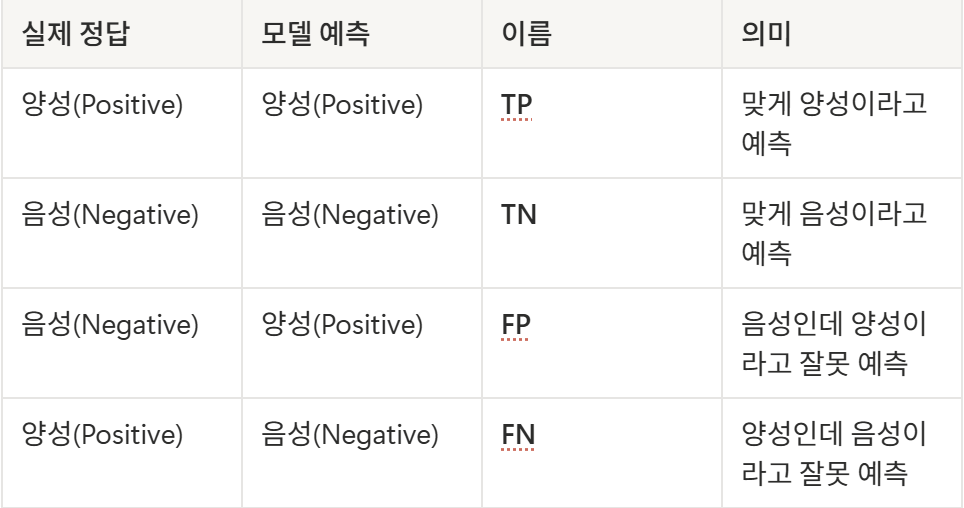
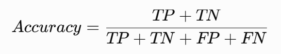
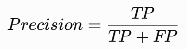
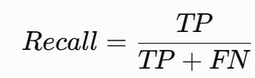

## 1. 머신러닝에서의 TP, TN, FP, FN

**개념**

- 머신러닝의 **분류 모델(classification)** 성능을 평가할 때 사용하는 기본 개념으로,

핵심은 **모델의 예측**과 **실제 정답**을 비교하 지표화한 것을 말합니다.

_실제 정답과 모델 예측의 조합에 따른 TP, TN, FP, FN과 그 의미_

**이렇게 구분하는 이유**

→ 여려 가지 평가지표를 만들 수 있음

1. 정확도(Accuracy): 전체 중에서 **얼마나 많이 맞혔는가**
   
   _Accuracy = (TP + TN) / (TP + TN + FP + FN)_

2. 정밀도(Precision): 모델이 **양성이라고 예측한 것 중 실제 양성**이 얼마나 되는가
   
   _Precision = TP / (TP + FP)_

3. 재현율(Recall) : 실제 양성인 것 중 모델이 얼마나 찾아냈는가
   
   _Recall = TP / (TP + FN)_

## 2. 정보보안에서의 TP(정탐), FP(오탐), FN(미탐)

**개념**

- 정보보안에서는 해당 개념을 탐지 시스템이 **실제 공격·악성 행위를 탐지했는지 여부**로 정탐(TP), 오탐(FP), 미탐(FN)을 구분한다.
    - **TP(정탐)**: 실제 공격·악성 행위를 정상적으로 탐지한 경우
    - **FP(오탐)**: 정상적인 행위를 공격·악성 행위로 잘못 탐지한 경우
    - **FN(미탐)**: 실제 공격·악성 행위를 탐지하지 못한 경우
        - 미탐은 공격 자체를 판단하지 못한 경우이므로 피해가 더 커질 수 있는 심각한 상황임
        - 현실에서는, 공격자가 알려지지 않은 새로운 기술로 공격하므로 공격 시점에 막을 대책 및 탐지 패턴이 존재하지 않아 미탐과 유사한 상황이 생각보다 많이 발생

> **[참고]** 보안에서도 TN = 정상 행위를 정상으로 판단하는 경우이며, 보안 탐지에서는 실제 공격·악성 행위의 탐지 여부가 주된 관심 대상이다. TN은 보안에서 보통 별도 명칭 없이 정탐에 포함해 부른다
{: .prompt-info }

> **[실무]**관제 운영 관점에서, 정탐은 탐지 결과와 실제 결과가 일치하는 것으로 이해하면 된다. 즉 공격이라고 탐지했고 실제 공격인 경우와 공격이 아니라고 판단했고 실제로도 공격이 아닌 경우 두가지 케이스로 볼 수 있다.
> 또한 오탐은 탐지를 했으나 탐지 결과가 실제 상황과 다른 것을 말하며, 미탐은 탐지 자체를 하지 못한 것으로 이해하면 된다.
{: .prompt-tip }

> **[실무]** 관제/CERT 는 정탐을 최대한 많이 발생시키고, 오탐 확률은 줄이고, 미탐은 최대한 생기지 않게 하는 방향으로 노력함
{: .prompt-tip }

## 요약

- 보안 관점에서 정탐은 탐지 결과와 실제 결과가 일치함, 오탐은 탐지를 하였으나 결과가 실제 결과와 상이함, 미탐은 공격이 발생하였으나 탐지 자체를 하지 못함 으로 이해할 수 있다.
- 이중 미탐은 추가 피해 발생 가능성이 있는 사항이므로 미탐을 최대한 발생하지 않게 하는 것이 중요하다.
- 관제/CERT에서는 정탐을 최대한 발생시키고 오탐을 줄이고 미탐을 최대한 배제하는 방향으로 고도화한다.
