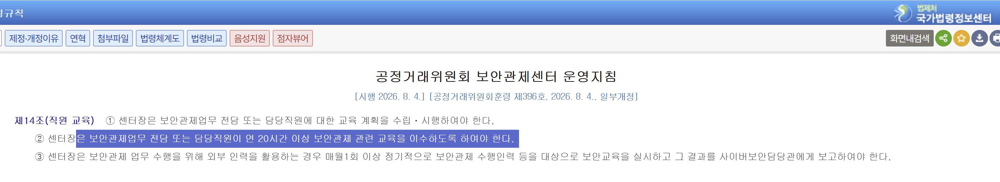
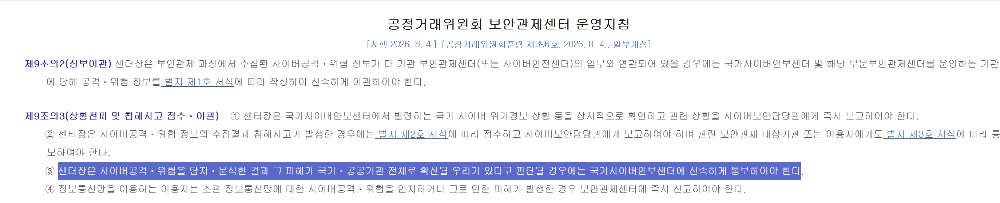
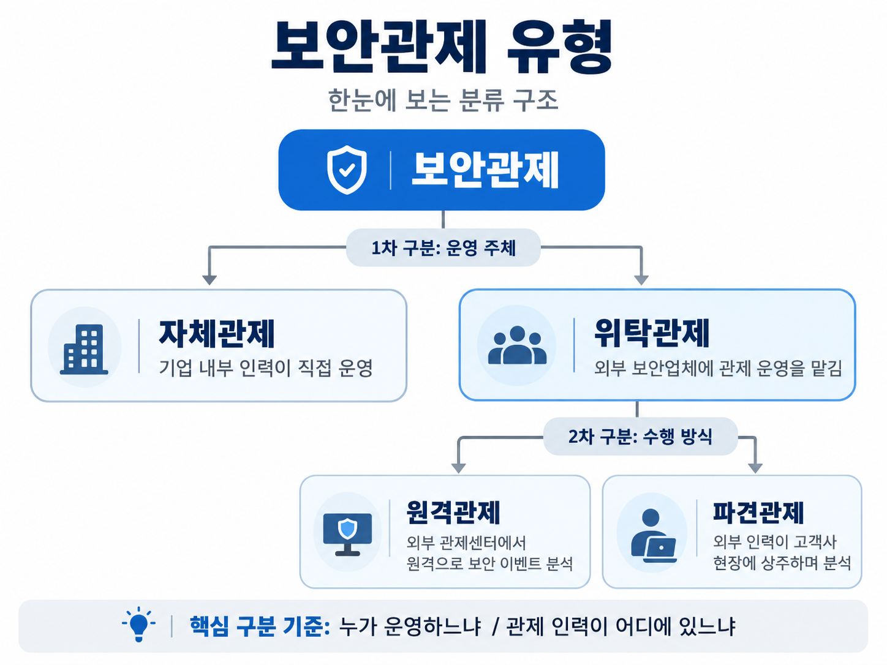
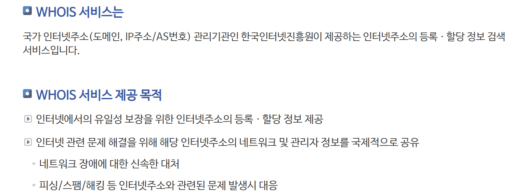
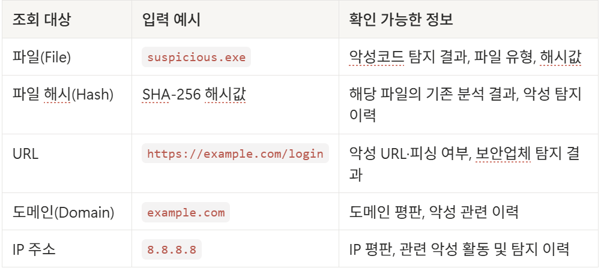
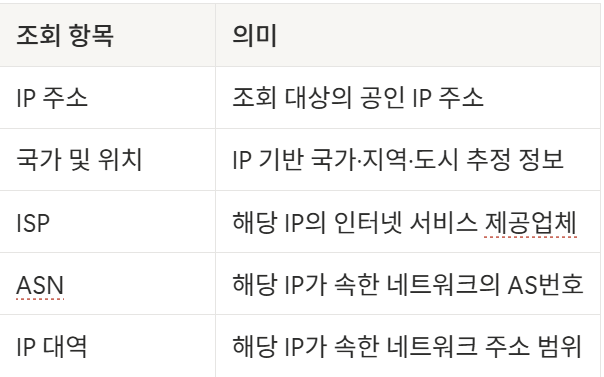

## 1. 보안관제란 무엇인가?

### 1-1) 보안관제의 정의 (보안관제 직무란)

**정의**

- 조직의 정보자산을 보호하기 위해, 네트워크나 시스템 전체를 걸쳐 나타나는 이상징후를 실시간 모니터링하여 탐지/분석/대응하는 보안활동을 말한다.

**목적**

- 외부 공격과 내부 이상 행위를 조기에 발견하고, 신속한 대응을 통해 **정보자산의 기밀성/무결성/가용성을 보호**

### 1-2) 보안관제의 3원칙

- **무중단 원칙**
    - 사이버 위협을 놓치지 않도록 보안관제 업무를 지속적으로 수행해야 함 (24시간/365일)
- **전문성 원칙**
    - 전문 인력과 적절한 시설/장비를 활용해 사이버 위협을 정확하게 분석/대응해야 함
    
    _공정거래위원회 보안관제센터 운영지침 제14조(직원 교육) — 연 20시간 이상 보안관제 관련 교육 이수_
    - \[실무 적용]: 보안 직원 담당자 교육, 일정 수준 이상의 시설 장비를 갖추도록 명시
- **정보공유 원칙**
    - 사이버 위협 정보를 관계 기관 및 담당자와 공유해 공동 대응과 피해 확산 방지를 도모해야 함
    
    _운영지침 제9조의2(정보이관)·제9조의3(상황전파 및 침해사고 접수·이관) — 피해 확산 우려 시 국가사이버안보센터에 통보_

**[출처1, 2]** 법제처 국가법령정보센터 공정거래위원회 보안관제센터 운영지침

### 1-3) 보안관제 업무절차

1. **예방**:
    - 탐지 룰, 장비 정책, 위협 정보를 최신으로 유지
    - 시스템 및 보안 장비 점검, 임직원 교육, 모의 훈련 등 (사고 발생 전 조치 단계)
2. **수집/모니터링**: 방화벽, IDS/IPS, 서버 등에서 보안 로그와 이벤트를 수집하고 관찰
3. **침해사고 탐지/분석**
    - **[탐지]** 보안 장비의 탐지 규칙이나 이상 행위 분석을 통해 의심스러운 이벤트를 식별
    - **[분석]** 공격 유형, 위험도, 실제 침해 여부 등을 분석하고 오탐 가능성 판단 
        1. (추가) 네트워크 패킷, 악성코드 감염 분석 등
4. **침해사고 대응:** 분석된 이벤트에 대한 **원인 및 대응책 마련** 하여 기술/정책적 대응
    - **차단/격리 등 초동조치 수행**하거나 침해사고 대응 담당자에게 조치 요청
5. **결과 보고서 작성**: 침해사고/장애 처리 결과 보고 및 공유
6. 공유/개선
    - 공격 IP와 해시 같은 침해지표를 법령이 허용하는 범위 안에서 정보공유분석센터(ISAC)나 KISA C-TAS를 통해 공유
    - 탐지 룰, 위협 정보 등을 보완해서 예방 절차에 반영

### 1-4) 보안관제 유형 및 특징

_보안관제 유형 — 운영 주체에 따라 자체관제/위탁관제, 위탁관제는 수행 방식에 따라 원격관제/파견관제로 구분_

#### 1-4-1) 자체관제

**개념**

- **보안관제시스템 및 전문인력**을 기관 **자체 구축 및 운영**하는 형태임

**특징**

- 기관 자체 보안인력을 통한 관제 업무 수행
- 근무 위치: 기업 내부
- [추가] 전체 비율 중 10%정도
- [추가] 근래에는 점점 비중이 줄어들고 있다고 함

**장점**

- 내부기밀유지(데이터 외부 반출 없음)
- 내부 환경 이해도 높음/통제력 높음

**단점**

- 전문인력 확보/유지비, 교육비 부담 → 초기투자비용, 유지비용 부담이 큼
- 보안 전문가 양성에 어려움

#### 1-4-2) 원격관제

**개념**

- **관제서비스업체**에서 보안관제에 필요한 **관제시스템을 구비, 
대상기관 침입차단시스템 등 보안장비 중심으로 보안 이벤트를 중점적으로 상시 모니터링**

**특징**

- 단위 보안시스템의 운영 및 관리 위탁
- 제한적인 범위의 보안시스템 위탁
- 근무 위치: 외부 관제센터
- (추가) 파견에 비해 지원 범위가 제한적 (작은 규모들이 선호하는 형태)
- (추가) 파견 관제 대비 비용이 저렴하다는 게 주요 특징 중 하나
- (전체 관제 중 20~30%)

**장점**

- 자체관제 대비 자체 인력, 장비 비용 부담 완화
- 전문업체의 분석 역량 활용

**단점**

- 내부 시스템 이해도 제약
- 즉각적인 현장 조치 지연
- 로그 외부 전송 (보안 이슈)

#### 1-4-3) 파견 관제

**개념**

- 관제 대상기관이 **자체적으로 보안관제시스템을 구축**
- 보안관제 전문업체로부터 **전문인력을 파견** 받아 관제업무 수행
**→ `인력은 전문업체 파견인력, 보안 인프라는 대상기관 인프라`**

**특징**

- 근무위치: 고객사 현장
- (전체 비중 중 50~60%)

**장점**

- 내부 담당자와 신속한 협업, 현장 상황 파악 용이

**단점**

- 상주 인력에 따른 비용 부담 (원격관제 대비) 및 외부 인력에 대한 의존
- 조직 내부 보안관제 역량 축적의 한계 (지속적인 외부위탁 요구됌)

#### 1-4-4) 관제 유형 별 주요 대상 기관

- **원격 관제:** 일반 기업, 포털 업체 등
    - 자체 관제 할만큼의 보안에 투자할 여력/의지 부족
- **파견 관제:** 공공 분야, 금융권 (하이브리드를 하기도 경우에 따라) + **대기업(규모 큰 곳들)**
    - 민감 정보 및 중요 시스템 관리 (로그 외부로 보낼 필요가 없으니까)
    - 사고발생 시 내부 담당자와 신속 협업
- **자체 관제:** 국정원, 경찰청 등 대규모 통신사
    - 핵심 시스템에 대한 **직접적인 통제권** 확보
        - 외부 업체에 대한 의존도 낮출 수 있음
    - 내부 환경에 맞는 보안 대응 체계
        - 조직의 시스템과 조직에 따른 위협 환경에 대한 전문성 축적 가능
    - 정보 기밀성
        - 국가안보 관련 정보나 중요 통신 인프라 정보를 외부 인력에게 노출되는 범위 조차 막을 수 있음

→ 이런식으로 보안 관제 방식은 업종 자체보다, 조직의 보안 요구 수준, 통제권 확보 필요성, 전문 인력 및 예산 규모에 따라 결정

일부 금융권 하이브리드 관제(원격관제 + 파견관제)

- 중요 정보 및 즉각 대응 필요 영역 파견 관제
- 그 외 정보 원격관제

**핵심: 자체관제는 시스템 과 통제력, 원격관제는 비용 효율성, 파견관제는 현장 대응과 협업에 상대적인 강점이 있습니다.**

## 2. 보안관제 업무 시 활용하는 웹 페이지에 대해 조사

### 2-1) WHOIS

_WHOIS 서비스 정의와 제공 목적_

(출처: WHOIS 공식 사이트)

#### 2-1-1) WHOIS 개념

- **국가 인터넷주소(도메인, IP주소)** 관리기관인 한국인터넷진흥원이 제공하는 인터넷주소의 등록ㆍ할당 정보 검색 서비스입니다.
    - 주로 IP 주소를 기반으로 등록/할당 정보 검색을 한다고 함

#### 2-1-2) WHOIS 조회 대상별 확인 가능한 정보

**1. 도메인 이름 (Domain Name)**

입력 예시: `google.com`

- 등록기관: 도메인 등록을 처리한 업체
- 등록일: 도메인이 최초 등록된 날짜
- 만료일: 도메인 등록 유효기간이 끝나는 날짜
- 네임서버: 도메인의 DNS 정보를 관리하는 서버
- 등록 상태: 도메인의 등록·이전·삭제 제한 등 상태
- 등록자 정보: 등록 조직 및 공개 가능한 연락처

**2. IP 주소 (IP Address)**

입력 예시: `8.8.8.8`

- IP 주소 대역: 해당 IP가 속한 할당 대역
- 할당 기관: IP 주소를 할당받은 조직
- 관리기관: IP 주소 자원을 관리하는 기관
- 국가: IP 주소 등록정보에 기재된 국가
- 관리자 연락처: 네트워크 관리 및 침해사고 신고 담당자
- 할당 정보: IP 대역의 할당·등록 관련 정보

#### 2-1-3) WHOIS 활용 분야

- 오랫동안 네트워크 운영, 보안 조사, 도메인 관리의 기본 도구로 활용됌
- 최근에는 개인정보 보호와 표준화 요구에 따라 **RDAP**로 점진적으로 전환되는 추세라고 함

보안관제 → 의심스러운 IP·도메인 탐지 시 등록·관리 주체 확인 및 악성 여부 판단의 참고자료로 활용 (침해사고 분석 및 대응에 필요한 기초 정보를 확보하는 데 사용)

### 2-2) Virus Total

#### 2-2-1) VirusTotal 개념

**개념**

- 여러 백신 엔진과 보안업체의 탐지 결과를 종합하여 **파일, URL, 도메인, IP 주소의 악성 여부를 분석**하는 온라인 보안 서비스
- 사용자가 의심스러운 파일을 업로드하거나 URL, IP 주소 등을 검색하면 관련 보안 분석 결과를 제공

**특징**

- 70개 이상의 백신 엔진 및 URL·도메인 차단 목록 서비스 등을 활용
- 파일의 해시값을 입력하여 기존 분석 결과 조회 가능
    - 지금까지 사람들의 검사 결과가 쌓인 거대 DB 역할도 수 (기존 분석 결과 조회)
- 다양한 보안업체의 탐지 결과를 한곳에서 비교 가능
    - 여러 백신 엔진 및 차단 목록 서비스 등을 통해 병렬적 분석(다중 보안 엔진 기반 분석)

#### 2-2-2) VirusTotal 조회 대상별 확인 가능한 정보

_조회 대상(파일·파일 해시·URL·도메인·IP 주소)별 입력 예시와 확인 가능한 정보_

### 2-3) ipconfig.co.kr

**개념**

- IP 주소를 입력하여 해당 IP의 국가, 추정 위치, 인터넷 서비스 제공업체(ISP), 네트워크 소속 정보 등을 확인하는 온라인 조회 서비스

→ 의심 IP를 입력해서 기본 정보 확인하는 데 사용되는 사이트

**IPConfig로 확인 가능한 정보**

_IP 주소, 국가 및 위치, ISP, ASN, IP 대역 — 조회 항목별 의미_

## 3. 3줄 요약

- 보안 관제는 조직의 정보자산을 보호하기 위해 네트워크와 시스템에서 나타나는 이벤트를 실시간 모니터링해서 탐지/분석/대응하는 보안활동을 말한다.
- 업무 절차는 예방-수집/모니터링-탐지/분석-대응-보고서 작성-공유/개선 절차로 진행되며 공유/개선 단계가 다시 예방으로 맞물리는 싸이클 구조를 갖는다.
- 보안관제 유형은 자체인력여부에 따라서 자체관제냐 위탁관제냐로 나뉘고, 위탁관제에서도 수행 방식에 따라 원격관제와 파견관제로 나뉜다. (기관별로 조직의 보안 요구 수준, 통제권 확보 필요성, 예산 규모 등에 따라 결정됌)
- 보안관제 업무 시 활용하는 웹 페이지에는 WHOIS, IPConfig.co.kr, Virus Total 등이 있다.
