## 0. 개요

Virus Total은 보안 업무에서 다양한 목적으로 활용됌.

- 특히 보안 관제, 침해 사고 대응, 악성코드 분석, 취약점 진단, 모의 해킹 등 거의 보안 전반의 직무에서 필수적으로 사용하는 사이트

이번 정리를 통해 Virus Total의 각각의 기능 및 사용방법에 대해서 알아보도록 하겠습니다.

## 1. Virus Total 의 기능

FILE / URL / Search 각 역할 및 기능

### 1-1. Virus Total 정의 및 목적

**개념**

- Virus Total은 **70개 이상의 백신 검사 엔진**과 **URL/도메인 차단 목록**, 다양한 분석 도구를 활용하여 **의심스러운 파일과 URL의 악성 여부를 조사**하는 온라인 보안 분석 서비스

**동작 방식**

- 사용자가 파일이나 URL을 제출하면 여러 보안엔진의 검사 결과와 추가 분석 정보를 수집하여 하나의 보고서로 제공함.

**주요 특징**

- 다중 엔진 검사: 여러 보안 업체의 탐지 결과를 한곳에서 비교
- 상세 분석 결과: 탐지 여부 뿐 아니라 엔진별 진단 내용도 제공
- 지속적인 정보 갱신: 보안 업체의 악성코드 시그니처 및 URL 차단 정보가 갱신 시 검사 결과에도 반영
- 위협 정보 공유: 검사 결과와 사용자 의견을 보안 커뮤니티에서 공유, 악성 여부 및 오탐 판단에 활용
- 무료 이용

> **[실무] 보안 관제/침해 사고 대응에서의 활용**
> - **보안 이벤트 발생 시 가장 먼저 확인할 수 있는 정보가 바로 IP 주소**
>   - 의심스러운 IP인지 등을 확인하고 그에 따른 대응을 수행해야 함.
>   - Virus Total IP를 조회하여 현재 악성 여부와 과거 악성 이력을 활용할 수 있음.
> - **보안 관제에서는 처음 확인하는 정보가 IP나 URL인 경우가 많아 해당 정보를 조회하는 비중이 높음.**
>   - CERT 업무나 악성코드 분석에서는 **파일을 업로드한 분석 결과**도 활용하고, **분석 과정에서 확인한 IP/URL도 추가 조회**
>   - 최근에는 보안 관제도 단순 모니터링/대응뿐 아니라 악성코드 분석을 함께 수행하는 경우가 있어 File/URL/Search 기능을 모두 활용
> - 현재 악성이 없더라도 과거에 악성 이력이 있었다면, 다시 악성으로 활동할 가능성을 염두하고 접근 (보안에서는 보수적 관점에서 전근)
{: .prompt-tip }

### 1-2. File / URL / Search 각 역할 및 기능

#### 1-2-1. File - 파일 분석

**개념**

- 의심스러운 파일을 다수의 보안 엔진으로 검사하여 악성 여부와 파일의 특성을 확인
    - 악성으로 의심되는 경우 분석 결과를 참고함.

**주요 기능**

- 다중 백신 검사: 70개 이상의 백신 및 관련 분석 엔진을 활용하여 파일을 검사
- 파일 정보 분석: 파일 크기, 유형, 해시값(SHA-256 등), 최초 및 최근 제출 시점 등을 확인
- 파일 행위 분석: 샌드박스에서 실행한 파일의 프로세스 및 네트워크 활동 등의 분석 결과를 제공
- 연관 정보(Relations) 조회: 파일과 연관된 URL, IP, 도메인 및 다른 파일에 관한 정보를 확인
- 재분석: 기존에 분석된 File을 다시 검사해서 최신 탐지 결과 확인 가능
    - 악성코드는 시간이 지나며 행위가 달라질 수 있으므로 과거 분석 시점이 오래되었을 경우 재분석을 통해 현재 시점의 분석 결과 확인을 권고

> **참고**
> - 보안 이벤트는 **외부에서 내부로 침입할 때뿐 아니라 내부에서 악성 파일을 실행했을 때도 발생할 수 있음**.
>   - 문제가 발생한 PC를 확인하고 전수조사하는 과정에서 의심 파일을 확보하면, 이를 업로드하여 확인하고 실제 분석에도 활용.
> - **파일 업로드 시 해당 파일이 Virus Total DB에 남으므로, 민감 파일 업로드 절대 주의**
{: .prompt-info }

#### 1-2-2. URL - 웹 주소 분석

**개념**

- 사용자가 제출한 URL을 보안엔진과 웹사이트 차단 목록을 이용해 검사하여 위험 여부를 확인하는 기능
    - 보안 관제 및 침해 사고 대응의 실시간 모니터링 업무에서 IP, URL을 조회하는 데 활용하는 대표 기능

**주요 기능**

- **악성 사이트 탐지**: URL이 피싱, 악성코드 유포, 스캠 등과 관련되어 있는지 보안 엔진으로 검사
    - URL 분석에도 보안 엔진을 사용
    - 다만 파일을 검사하는 백신 엔진과 달리 URL 검사 엔진(URL Scanner)을 주로 사용
- **엔진 별 탐지 결과**: 개별 보안 업체가 해당 URL을 어떻게 평가했는지 확인
- **웹페이지 정보 확인**: HTTP 응답 헤더, 콘텐츠 유형, 분석 시점(최초, 최근) 등을 확인
- **재분석**: 기존에 분석된 URL을 다시 검사해서 최신 탐지 결과 확인 가능
- 관련 정보 조회: 해당 URL과 연관된 도메인 및 파일 등의 정보를 확인 (일부 유료)
    - 도메인: URL이 속한 도메인
    - 연관된 파일
        - 해당 URL에서 다운로드된 파일
        - 실행 과정에서 해당 URL에 접속한 파일
        - 내부에 해당 URL이 포함된 파일

#### 1-2-3. Search -위협 정보 검색

**개념**

- 파일 자체를 업로드하지 않고, **해시값, URL, IP 주소, 도메인 등을 검색**하여, Virus Total에 축적된 분석 정보와 위협 이력을 확인하는 기능 **(기존 분석 결과 확인)**

**주요 기능**

- 파일 해시 검색: MD5, SHA-1, SHA-256 등의 해시 알고리즘으로 생성된 파일의 해시값을 검색하여 해당 파일의 분석 결과를 조회합니다.
- URL 검색: 특정 URL의 **기존 분석 결과를 확인**합니다.
    - 악성 탐지 결과, 엔진 별 진단 내용, 웹페이지 정보 등 확인
- IP 주소 검색: 해당 IP의 악성 탐지 정보와 연관 도메인, 통신 및 악성코드 관련 정보를 확인합니다.
    - IP 주소: 조사하려는 네트워크 상의 통신 대상 또는 출발지 주소
- 도메인 검색: 해당 도메인의 탐지 결과, DNS 정보 및 연관 위협 정보를 확인합니다.

실무 활용: 보안관제에서 발견한 의심 IP 또는 악성코드 해시를 검색하여 기존 위협 정보와 비교할 때 사용합니다

**참고**

- 파일을 직접 업로드하지 않더라도 해시 조회를 통해 해당 파일의 분석 결과를 가져올 수 있음
- 다만 Virus Total에 한 번이라도 업로드된 이력이 있는 파일이어야 함.

### 1-3. 악성 여부 판단 시 참고 사항

#### 1-3-1. 백신의 탐지 개수에 따라 의문을 가질 수 있음

예를 들어, 70개중 60개가 악성으로 진단한 파일은 위험하고, 5개만 악성으로 진단한 파일은 안전한건가?

→ 보안 업무에서는 **보수적인 관점으로 접근**한다.

- **악성으로 진단한 이력이 있다면 우선 악성코드에 가깝게 추정하고 분석함**

또한 정상 파일도 내부 문자열 등의 이유로 악성으로 탐지될 수가 있어서 Virus Total은 참고 자료임을 강조함.

#### 1-3-2. Detection 결과 및 진단명에서 확인할 수 있는 특징

- 파일 업로드 시 백신별 분석 결과와 진단명을 확인할 수 있음
    - 백신마다 진단명이 다르더라도 공통으로 포함된 단어가 있을 수 있음.
    - 예: `win32`, `다운로더`, `트로이안` 등. (정상 파일은 나오지 않음)
    - 이러한 공통 단어를 통해 해당 파일이 어떤 특징의 악성코드일 가능성이 높은지 추정할 수 있음.

#### 1-3-3. Details/History에서 확인할 수 있는 정보

- Details에서 의심 파일의 기본적인 정보를 확인할 수 있음.
    - 여러 종류의 해시와 해시값.
    - 파일 타입과 파일 크기.
    - **패킹 여부**.
    - **암호화 여부** 등.
- History에서 파일이 최초로 만들어진 날짜 등을 확인할 수 있음..
    - 오래된 악성코드라면 현재 시점에서는 원래 행위를 온전하게 수행하지 못할 가능성도 고려할 수 있음.
- 이러한 기초 정보를 통해 악성코드의 특징을 추정하고, 만들어진 시점과 경과 시간을 참고하여 현재도 활동할지 생각해 볼 수 있음.

#### 1-3-4. Behavior·Relations와 직접 분석한 결과의 관계

- Behavior·Relations 등에서는 이후 정적 분석·동적 분석을 직접 수행하기 전에 참고할 수 있는 분석 결과를 확인할 수 있음.
    - VirusTotal은 여러 샌드박스에서 관찰한 파일의 실행 행위 분석 결과를 제공
- Virus Total의 환경과 직접 구축한 환경은 여러 조건이 다름.
    - OS 버전.
    - 보안 수준.
    - 설치된 패키지 등.
    - 따라서 **같은 파일이라도 동일한 결과가 나온다고 볼 수 없음**.
- Virus Total의 결과는 직접 분석할 때 **참고하고 방향을 잡는 용도**로 활용.
    - Virus Total에서 A라는 행위가 확인되었다면, 직접 분석할 때도 그 행위가 있는지 확인해 보는 식으로 접근.
    - 직접 분석하면서 실제로 확인한 내용을 별도로 정리해야 함.

#### 1-3-5. 악성코드 분석 과정에서 IP·URL을 함께 조사하는 방법

- Virus Total로 기초 분석을 수행하고, 직접 악성코드를 분석하는 과정에서 통신 대상의 IP·URL을 확인할 수 있음.
    - 확인된 IP·URL을 다시 조회하여 실제 악성 이력이 있는지 확인.
    - 현재 악성 여부와 해당 사이트의 과거 이력 등을 함께 살펴볼 수 있음.
    - 이러한 추가 확인을 통해 더 심도 있는 악성코드 분석이 가능

## 2. Virus Total 의 세부적인 사용 방법

### 2-1) File 사용 방법

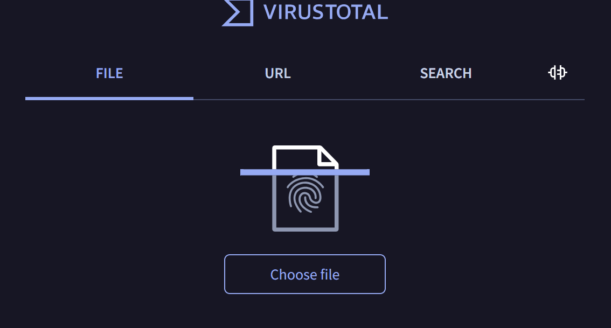
_VirusTotal 메인 화면 — FILE / URL / SEARCH 탭과 Choose file 버튼_

**사용 절차**

1. 분석할 파일을 업로드하여 보고서 검색
2. 분석 결과 보고서에서 탐지 결과와 파일의 상세 정보를 확인

**세부 분석 항목**

- Detection (탐지 결과): **악성으로 탐지한 보안 엔진의 수와 엔진별 진단 내용을 확인**합니다.
- Details (파일 상세 정보): **파일의 해시값, 유형, 크기, 최초·최근 제출 시점 등을 확인**합니다.
- Relations (연관 정보): 해당 파일과 관련된 URL, IP 주소, 도메인 및 다른 파일을 확인합니다.
    - 통신한 서버가 어떤 IP·도메인인지, 생성한 파일이 무엇인지 등 연결된 대상을 조사
- Behavior (행위 분석): **샌드박스에서 관찰된 프로세스 실행, 파일 변경, 네트워크 통신 등을 확인**합니다.
- Community (커뮤니티): 다른 사용자들이 작성한 분석 의견과 평판 정보를 확인합니다.

**실무 활용**

- 보안관제에서 의심스러운 파일 발견 시, 악성 탐지 여부 확인하고, 실행 행위와 외부 통신 정보를 조사하여 추가 대응이 필요한지 판단

#### 실습

예전에 다운받아봤던 파일을 분석해보았습니다.

**1. 파일 업로드 및 분석 보고서 확인**

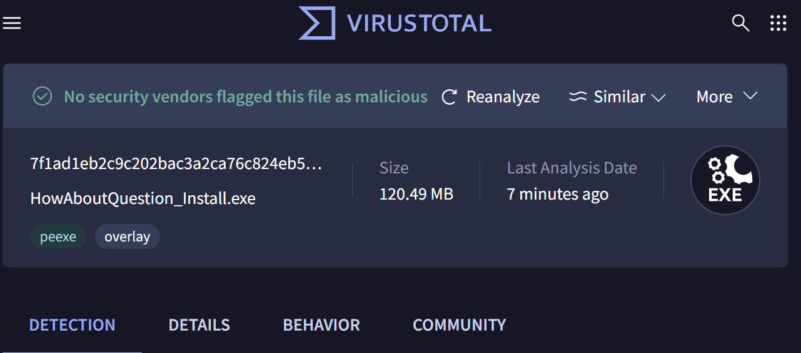
_업로드한 exe 파일의 분석 보고서 — 파일 크기 120.49 MB, Last Analysis Date, DETECTION/DETAILS/BEHAVIOR/COMMUNITY 탭_

- 파일이름, 크기, 최근 분석 날짜(Last Analysis Date)를 확인
- 분석 보고서에는 DETECTION, DETAILS, BEHAVIOR, COMMUNITY 확인

각 목차들을 들어가보겠습니다.

**2. DETECTION - 악성 탐지 결과 확인**

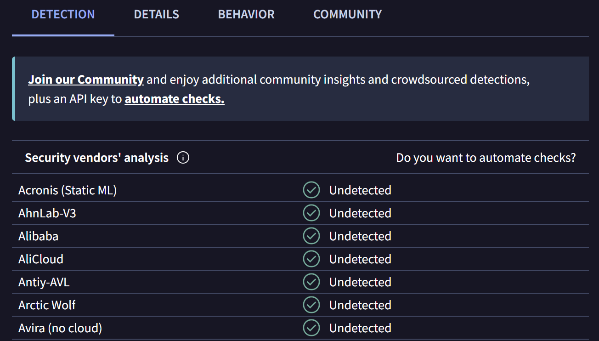
_Security vendors' analysis — 보안 업체 엔진별 결과가 모두 Undetected_

- 여러 보안 업체의 엔진별 탐지 결과를 확인
    - AhnLab, Alibaba 등
- 해당 파일은 검사 결과 악성으로 탐지한 보안 업체가 없었음 (Undetected)

**3. DETAILS - 파일 상세 정보 확인**

**3-1) Basic properties**

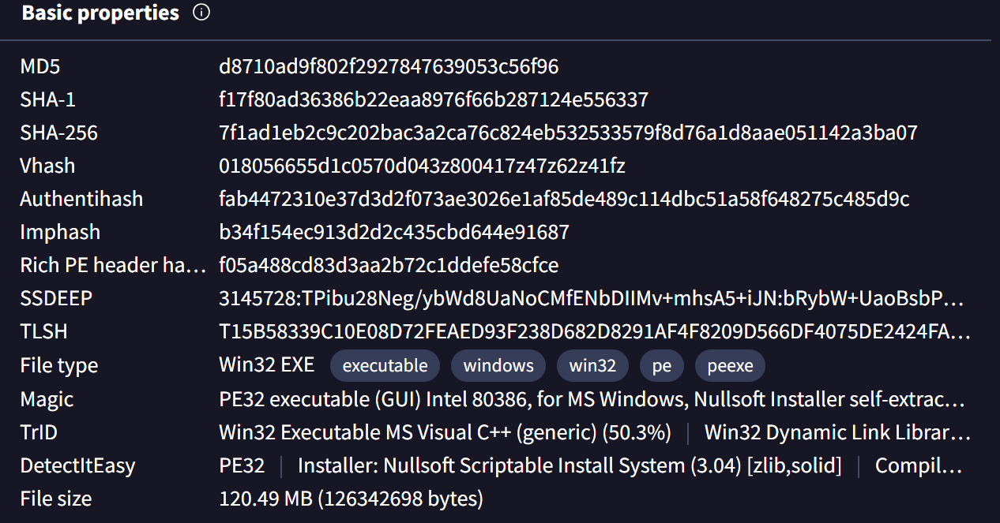
_Basic properties — MD5·SHA-1·SHA-256 등 해시값, File type(Win32 EXE), File size_

- MD5, SHA-1, SHA-256: 파일을 식별하는 해시값들을 확인
- 파일 유형(File type / Magic): Window 실행 파일 exe
- 파일 크기(File Size)

**3-2) History**

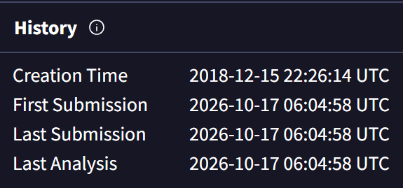
_History — Creation Time, First Submission, Last Submission, Last Analysis_

분석이력

- Creation Time: 컴파일된 타임스탬프

**3-3) 전자 서명 여부 확인**

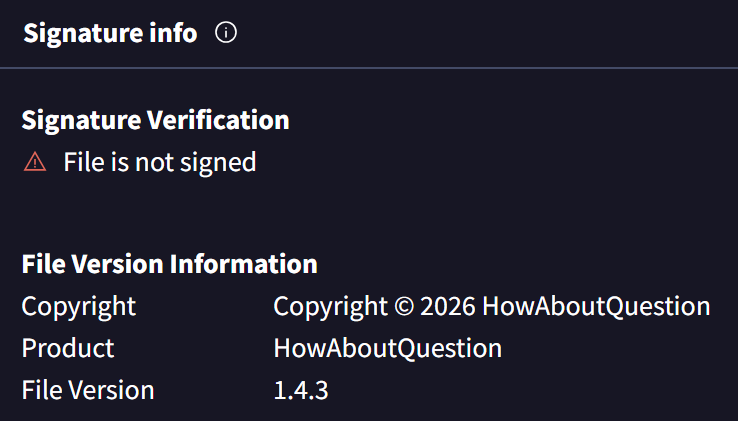
_Signature info — Signature Verification: File is not signed_

- 전자서명 (Digital Signature):  파일의 배포자 신원 확인 및 서명 이후 파일 변조 여부 검증하는 보안 기술
    - 배포자 확인 및 무결성 확인

**4. Behavior - 파일 행위 분석 결과 확인 (해당 파일 실행 시 어떤 행동을 했는가)**

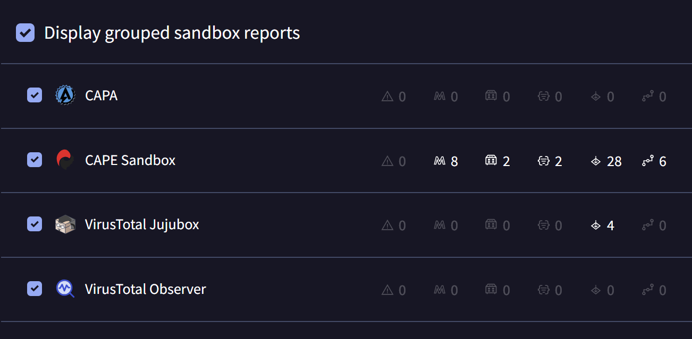
_BEHAVIOR — CAPA, CAPE Sandbox, VirusTotal Jujubox, VirusTotal Observer 샌드박스 결과_

여러 샌드박스의 결과를 나란히 보여줌

- CAPE Sandbox: MITRE 관련 결과 8, IDS 2, Sigma 2, 생성 파일 28, 네트워크 관련 정보 6이 표시됩니다.

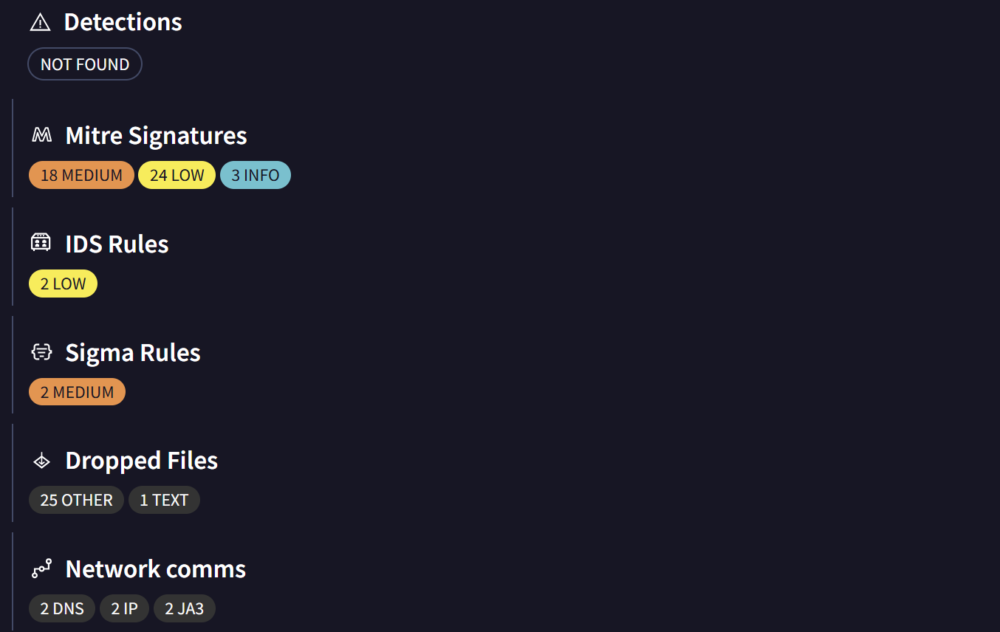
_Detections(NOT FOUND), Mitre Signatures, IDS Rules, Sigma Rules, Dropped Files, Network comms 항목_

- Detection: NOT FOUND (샌드박스에서 악성코드 탐지 결과 보고되지 않음)
- Mitre Signatures: 파일 실행 중 관찰된 행위가 알려진 사이버 공격 기법과 관련되는지 분석하는 항목 (MITRE: 사이버보안 및 국가안보 분야의 연구를 수행하는 기관)
- IDS Rules: 네트워크 통신에서의 탐지 규칙과 일치 여부 확인
- Sigma Rules: 시스템 로그에서 의심스러운 행위 패턴을 탐지하는 규칙
  - 시스템 이벤트란 프로그램 실행, 파일 접근, 설정 변경 등 PC에서 발생하는 동작을 기록한 정보

### 2-2) URL 사용 방법

**사용 절차 및 분석 항목**

- URL 제출: VirusTotal에서 URL 입력 후 분석 보고서 확인
- Detection: 보안 엔진별 악성 URL 탐지 결과 확인
- Details: HTTP 응답 정보, 분석 시점 등 확인
- Relations: 연관된 도메인·파일 등의 정보 확인(제공되는 경우)
- 분석 결과 종합: 탐지 결과와 관련 정보를 근거로 URL의 위험성 판단

#### 실습

위키피디아 사이트 URL로 실습

**1. Detection**

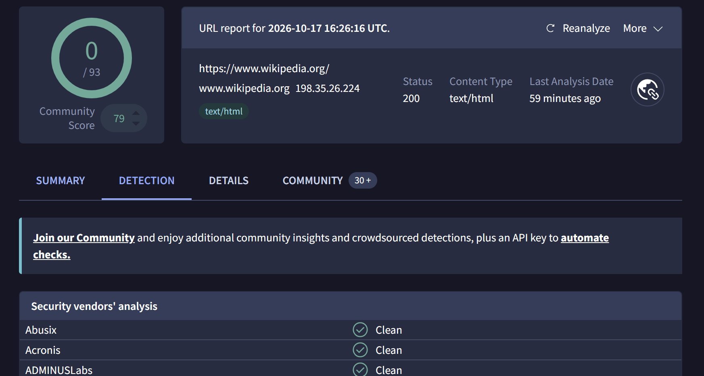
_wikipedia.org URL 보고서 — 0/93 탐지, Community Score 79, 보안 업체별 결과 Clean_

Detection (악성 탐지 결과)

- 탐지 결과 (0/93): 총 93개 보안 엔진 중 해당 url을 악성으로 탐지한 엔진은 없었음
- Security Vendors Analysis: 보안 업체별 검사 결과 확인
- Community Score(79): Virus Total 커뮤니티 사용자들의 평판 평가 (긍정적)

**2. Detail**

2-1. Categories: 보안 업체들이 해당 웹사이트를 어떤 용도의 사이트로 분류했는지 보여주는 항목

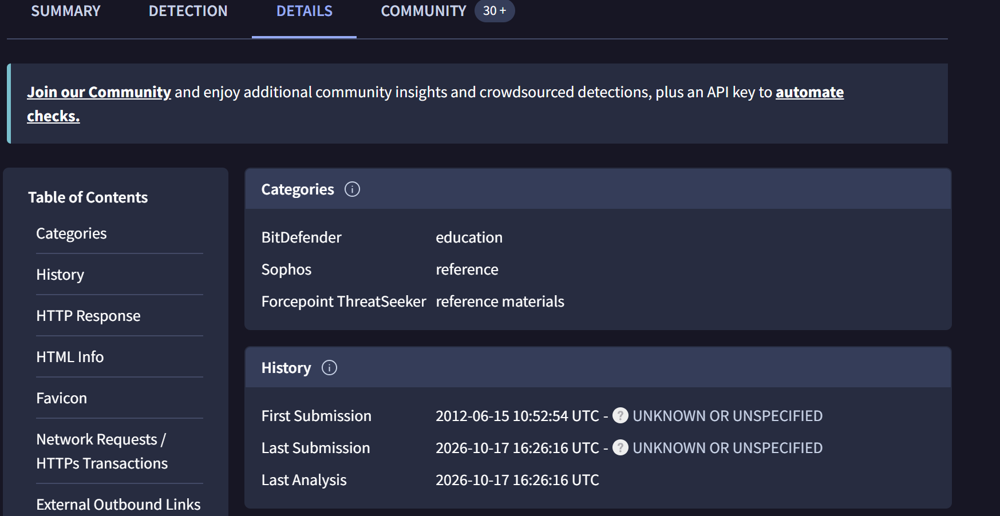
_DETAILS > Categories — 보안 업체별 사이트 분류(education, reference, reference materials)_

2-2. HTTP Response (웹 서버 응답 정보)

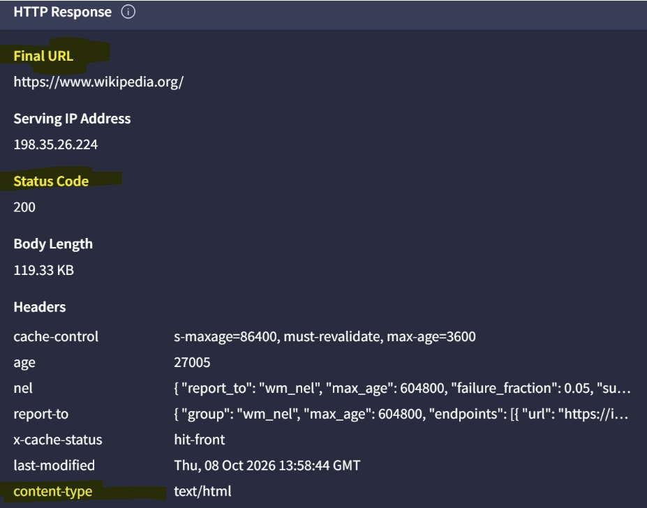
_HTTP Response — Final URL, Status Code 200, content-type text/html_

- Status: 200 — 웹 서버가 요청을 정상적으로 처리했음을 의미
- Content Type: text/html — 응답 콘텐츠가 HTML 문서임을 의미
- Final URL: `https://www.wikipedia.org/` — 최종적으로 도달한 URL

### 2-3) Search 사용 방법

**사용절차**

1. VirusTotal 접속 후 `SEARCH` 선택
2. 파일 해시값, URL, IP 주소 또는 도메인 입력
3. 기존 분석 보고서 및 관련 위협 정보 확인

**분석 항목**

- 파일 해시 검색: 앞서 분석한 EXE 파일의 SHA-256으로 기존 보고서 조회
- IP 주소 검색: IP의 악성 탐지 결과, 소속 네트워크 및 연관 도메인 확인
- 도메인 검색: 도메인의 악성 탐지 결과, DNS 정보 및 연관 위협 정보 확인

## 3. Virus Total 통한 분석 방법

1. 분석 대상 확보: 보안관제에서 발견한 **의심 파일, URL, IP 등을 확보**합니다.
2. 악성 탐지 결과 확인: 여러 보안 엔진의 **탐지 결과와 진단 내용을 확인**합니다.
3. 추가 정보 분석: 실행 행위, 네트워크 통신, 연관 위협 정보 등을 분석합니다.
    1. 즉 악성 탐지 결과(Detection) 확인 뒤, 해당 파일이 실제 어떤 행동을 했고(Behavior), 다른 위협과 연결(Relation) 되어 있는지 조사
4. 종합 판단 및 대응: 분석 결과를 교차 검증하여 악성 여부와 추가 조사·차단 필요성을 판단합니다.

**실무 적용**: 보안관제 담당자는 VirusTotal을 통해 의심 대상을 조사하고, 탐지 결과와 실행 행위 등을 종합하여 오탐 가능성을 검토하고 대응 여부를 결정합니다.

## 3줄 요약

- Virus Total은 다양한 보안 도구를 활용하여 파일이나 URL 등의 악성 여부 분석 서비스로, 보안 관제, 침해사고대응 등 다양한 보안 업무에서 활용합니다.
- 여러 보안 엔진 기반으로 파일 및 URL의 악성 여부 및 각각의 특성 정보를 확인할 수 있으며, 제공되는 샌드박스 행위 분석 결과 및 이와 연관된 IP, 도메인 추가 분석도 할 수 있습니다.
- Search에서는 파일 해시/URL/IP/도메인으로 기존 보고서와 위협 정보를 조회할 수 있으며, 원본 파일을 업로드하지 않아도, 파일 해시값으로 기존 분석 결과를 확인할 수 있습니다.
