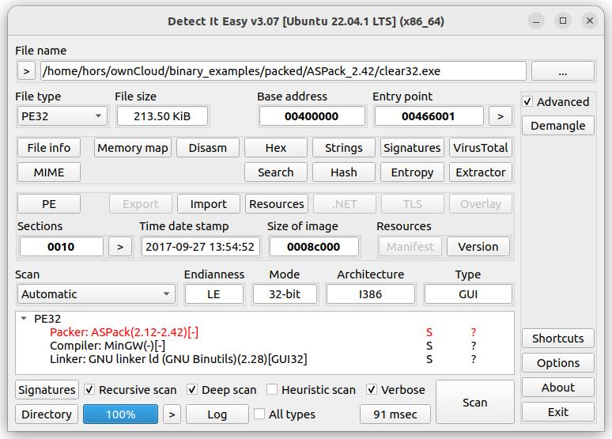
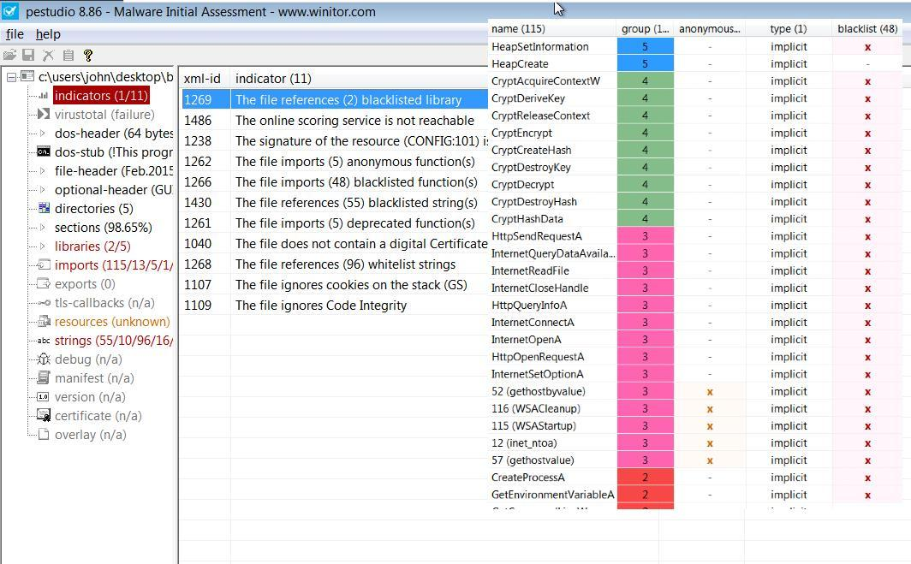

**2. 정적 분석 및 동적 분석 Tool 조사**

## 2-1. 정적 분석 Tool 종류

### 개념 (정적 분석 Tool)

- **악성코드를 직접 실행하지 않고** 파일의 내부 구조, 코드, 문자열 등의 정보를 분석하는 도구
  - 분석 도구에 따라 **파일의 형식 및 패킹 여부를 식별**하거나, **API와 문자열을 조사하여 악성코드의 잠재적 기능을 파악**할 수 있습니다.

**대표적인 정적 분석 도구**

| 도구 | 주요 기능 |
| --- | --- |
| VirusTotal | 기존 악성코드 탐지 결과 및 파일 정보 확인 |
| Detect It Easy | 파일 형식, 아키텍처, 패커 식별 |
| PEStudio | 실행 파일 구조, API, 문자열 분석 |
| FLOSS | 문자열 추출 및 난독화 문자열 복원 |

※ **VirusTotal**은 정적 분석뿐만 아니라 샌드박스 기반 동적 분석 결과도 제공하는 종합 분석 서비스이지만, 이번 조사에서는 초기 파일 분석 도구로 분류합니다.

### 2-1-1. Virus Total

#### 개념

- 파일, URL, 도메인, IP 주소 등에 대한 악성 탐지 결과와 관련 보안 정보를 제공하는 온라인 분석 서비스
  - 다수의 보안 엔진과 샌드박스 분석 결과를 통해 의심스러운 파일의 악성 가능성 확인 가능

#### 주요 기능

- Detection (탐지 결과)
  - 여러 보안 엔진의 악성코드 탐지 여부와 진단명을 확인
- Details (세부 정보)
  - 파일 해시값, 크기, 형식, 제출 및 분석 시점 등의 정보를 확인
- Relations (연관 정보)
  - 해당 파일과 관련된 URL, IP 주소, 도메인 및 다른 파일 등을 조사
- Behavior (행위 분석)
  - 샌드박스에서 관찰된 프로세스 실행, 파일 변경, 네트워크 통신 등의 정보를 확인
    - Virus Total이 제공하는 샌드박스 동적 분석 결과를 확인하는 것

#### 분석 결과 활용

- 기존에 알려진 악성코드와 동일한 파일인지 조사
- 탐지 결과를 참고해서 악성 가능성 평가
- 악성 IP, 도메인, 해시값 등의 침해지표(IOC)를 수집

### 2-1-2. Detect It Easy (DiE)


_Detect It Easy — PE32 파일의 형식·아키텍처와 패커(ASPack)·컴파일러·링커 탐지 결과_

#### 개념

- **실행 파일을 직접 실행하지 않고**, 파일 형식, 아키텍쳐, 컴파일러, 패커(Packer)등을 식별하는 정적 분석 도구
  - 파일 형식(File Format): 어떤 실행 파일 형식인지
    - 예: `PE`(Windows 실행 파일), `ELF`(Linux 실행 파일)
  - 아키텍쳐: 프로그램이 어떤 CPU 환경에서 실행되도록 만들어졌는지
    - 예: `x86`(32비트), `x64`(64비트), `ARM`
  - 컴파일러: 사람이 작성한 소스코드를 기계어로 변환하는 프로그램
    - 예: `MSVC`, `GCC`, `Clang`  (DiE에서는 해당 파일을 만드는 데 사용된 컴파일러를 추정)
  - 패커: **실행 파일의 코드와 데이터를 압축하거나 암호화하여 저장하고, 실행 시 복원**하도록 만드는 도구
    - 예: `UPX`
    - DiE에서는 **파일에 패킹이 적용되었는지, 어떤 패커가 사용되었는지 식별**
- Windows PE 뿐만 아니라 ELF, Mach-O 등 **다양한 형식의 파일을 분석**할 수 있음.

#### 주요 기능

1. **파일 형식 및 아키텍처 식별**
   - PE, ELF, Mach-O 등 실행 파일의 형식을 확인
   - x86, x64 등 해당 프로그램의 대상 아키텍처를 파악
2. **컴파일러 및 패커(Packer) 탐지**
   - 파일의 특징을 기반으로 사용된 컴파일러나 패커를 추정
   - UPX 등 패킹 도구의 사용 여부를 조사할 수 있음
     - **패커**는 실행 파일의 코드를 압축하거나 변형하여 원본 코드를 분석하기 어렵게 만드는 도구
3. **파일 구조 분석**
   - 실행 파일의 **헤더, 섹션, 엔트리 포인트** 등의 정보를 확인
   - 섹션의 엔트로피(Entropy) 등 구조적 특징을 통해 **패킹 및 암호화 가능성을 조사**할 수 있음.
     - 헤더 - 실행 파일의 기본 정보 및 실행에 필요한 정보 저장 영역 (파일 형식, cpu 아키텍처, 엔트리 포인트, 섹션 정보 등 저장)
     - 섹션 - 실행 파일 내부에서 **코드와 데이터를 용도에 따라 구분하여 저장하는 영역**
       - `.text`: 프로그램의 실행 코드 저장
       - `.data`: 프로그램에서 사용하는 데이터 저장
       - `.rsrc`: 아이콘, 이미지 등 리소스 저장

       → 섹션의 크기, 권한, 엔트로피(무작위성) 등을 확인하여 패킹/암호화 가능성이나 비정상적인 파일 구조를 조사

#### 사용방법

1. 공식 GitHub Releases에서 Detect It Easy를 다운로드합니다.
2. GUI 프로그램인 `die`를 실행합니다.
3. `Open` 또는 파일 드래그 앤 드롭으로 분석할 파일을 불러옵니다.
4. 표시되는 **파일 형식, 아키텍처, 컴파일러 및 패커 탐지 결과를 확인**합니다.
5. 필요한 경우 **파일 구조와 섹션 정보를 추가 조사**합니다.

#### 분석 결과 활용

예를 들어 다음과 같은 결과가 발견되었다고 가정합니다.

```txt
File Type    : PE32+
Architecture : x64
Packer       : UPX
```

- `PE32+`: 64비트 Windows PE 실행 파일 형식
- `x64`: x86-64 아키텍처 대상 파일
- `UPX`: UPX로 패킹되었을 가능성

이를 통해 파일의 기본 구조를 파악하고, 이후 PEStudio나 FLOSS로 분석할 때 패킹 여부를 고려할 수 있습니다.

#### 한계 및 주의사항

- **패커 탐지 결과는 추정치**이므로 오탐이나 미탐이 발생할 수 있습니다.
- **패킹된 파일이라고 해서 반드시 악성코드인 것은 아닙**니다.
- 파일의 **실제 실행 행위를 직접 확인할 수는 없습**니다.

### 2-1-3. PEStudio


_PEStudio — 의심 지표(indicators)와 Import 함수 목록(blacklist 표시)_

#### 개념

- **Windows PE(Portable Executable)** 형식의 파일을 실행하지 않고 **내부 구조, API, 문자열 및 의심스러운 특징 등을 조사**하는 정적 분석 도구
  - 실행 파일에 포함된 정보를 통해 악성코드가 사용할 수 있는 시스템 기능을 추정하는 데 활용

#### 주요 기능

1. **파일 정보 및 구조 분석**
   - **파일 메타데이터, 디지털 서명, 섹션, 리소스 등의 정보**를 확인
     - 실행 파일의 기본적인 구조와 특징을 파악
2. **Import/Export 분석**
   - **Import**: 실행 파일이 **외부 라이브러리에서 가져와 사용하는 함수(API)** 등을 확인
   - **Export**: 실행 파일 또는 DLL이 **외부에 제공하는 함수**를 확인
     - Import된 API를 통해 파일 조작, 레지스트리 변경, 네트워크 통신 등의 기능을 사용할 가능성을 추정함.
     - DLL(동적 연결 라이브러리) - 여러 프로그램이 공통으로 사용할 수 있는 기능이나 코드를 담은 라이브러리 파일

       (실행파일의 도구 모음집으로 생각하면 편함 - 다른 프로그램에 제공할 수도 있고 자기가 사용할 수도 있는)

     **PEStudio에서의 활용**

     - Import: 실행 파일이 DLL에서 가져와 사용하는 함수(API) 확인
     - Export: 해당 DLL이 다른 프로그램에 제공하는 함수(API) 확인
3. **문자열(String) 분석**
   - 파일 내부에 포함된 **IP 주소, URL, 파일 경로, 명령어 등의 문자열**을 확인
   - **외부 통신 대상이나 의심스러운 기능과 관련된 단서**를 찾음.
4. 의심 지표(Indicators) 분석
   - 파일에 포함된 **의심스러운 API, 문자열, 구조적 특징** 등을 식별
   - 기존 탐지 정보와 연계하여 추가 조사가 필요한 항목을 파악

#### 사용 방법

1. 공식 사이트에서 PEStudio를 다운로드하여 실행합니다.
2. 분석할 EXE 또는 DLL 파일을 불러옵니다.
3. 파일 기본 정보와 의심 지표를 확인합니다.
4. `imports` 항목에서 외부 DLL과 API 참조 정보를 확인합니다.
5. `strings` 항목에서 IP, URL, 파일 경로 등의 문자열을 조사합니다.
6. 필요한 경우 `resources`, `exports` 등의 정보를 추가로 확인합니다.

#### 분석 결과 활용

예를 들어 **Import 항목에서 다음과 같은 API가 발견**되었다고 가정합니다.

| API | 주요 기능 | 추정 가능한 행위 |
| --- | --- | --- |
| `CreateFileW` | 파일 열기 및 생성 | 파일 접근 |
| `WriteFile` | 데이터 쓰기 | 파일 또는 장치에 데이터 기록 |
| `RegSetValueExW` | 레지스트리 값 설정 | 레지스트리 변경 |
| `InternetOpenUrlW` | URL 리소스 열기 | 외부 URL 접근 |

해당 정보를 통해 **파일이 어떤 시스템 기능을 사용할 수 있는지 추정**하고, 동적 분석에서 해당 기능이 실제로 실행되는지 확인할 수 있습니다.

#### 한계 및 주의사항

- **패킹이나 난독화된 파일에서는 실제 사용하는 API와 문자열이 충분히 들어나지 않을 수 있음**
- API가 존재한다는 사실만으로 악성 기능 수행한다고 단정할 수 없음

### 2-1-4. FLOSS (FLARE Obfuscated String Solver)

#### 개념

1. **실행 파일 내부의 문자열을 추출**하고, **일부 난독화된 문자열을 정적 분석을 통해 복원**하는 도구
   - 일반적인 String 도구로는 확인하기 어려운 문자열도 분석할 수 있음

#### 주요 기능

- **Static String 추출**
  - 파일 내부에 일반적인 형태로 저장된 ASCII, UTF-16LE 문자열 등을 추출
- **Stack Strings 추출**
  - 프로그램이 실행 과정에서 스택에 문자들을 조합하여 생성하도록 작성된 문자열을 정적 분석으로 복원
- **Decoded Strings 추출**
  - 문자열 복호화 및 디코딩 루틴을 분석하여 일부 숨겨진 문자열을 복원
  - 파일 내부에 알아보기 어렵게 변형하여 저장된 문자열을 복호화/디코딩하는 함수를 분석하여 원래 문자열로 복원
- Tight Strings 추출
  - 스택에서 생성된 후 추가적인 연산으로 완성되는 문자열을 분석

#### 사용 방법

1. 공식 GitHub Releases에서 FLOSS를 다운로드합니다.
2. 명령 프롬프트 또는 PowerShell을 실행합니다.
3. FLOSS 실행 파일과 분석 대상 파일이 있는 디렉터리로 이동합니다.
4. **명령어를 실행하여 문자열을 추출**합니다.
5. 결과에서 **URL, IP, 파일 경로, 명령어 등을 조사**합니다.

Windows PowerShell에서 사용하는 예시입니다.

```powershell
# 기본 문자열 추출 및 복원
.\floss.exe sample.exe

# 주요 정적 문자열 요약 확인
.\floss.exe --summary sample.exe

# 복호화·디코딩 문자열만 추출
.\floss.exe --string-type decoded -- sample.exe

# JSON 형식으로 결과 저장
.\floss.exe --json sample.exe > result.json
```

#### 분석 결과 활용

예를 들어 다음과 같은 문자열이 복원되었다고 가정합니다.

```powershell
hxxp://example[.]com/api
C:\Users\Public\config.dat
```

- URL: 외부 통신 대상이나 추가 리소스의 단서
- 파일 경로: 프로그램이 접근하거나 생성할 수 있는 파일의 단서

이를 통해 일반 문자열 분석에서 발견하지 못한 의심스러운 정보를 확보할 수 있습니다.

#### 한계 및 주의사항

- **모든 난독화·암호화 문자열을 복원할 수는 없**습니다.
- **복잡한 복호화 방식**이나 **실행환경에 의존하는 문자열**은 분석에 실패할 수 있습니다.
- 추출된 문자열이 **실제 실행 과정에서 사용되는지는 추가 분석이 필요**합니다.

<br>

## 2-2. 동적 분석 Tool 종류

### 개념

- 분석 대상 프로그램을 실행한 상태에서, **프로세스 활동, 파일 및 레지스트리 변경, 네트워크 통신 등의 실행 행위**를 관찰하는 도구
- 악성코드가 실제로 어떤 작업 수행하는지 확인하고, 시스템에 미치는 영향과 악성 행위의 단서를 파악하는 데 활용
- 실제 악성코드를 실행하는 경우에는 외부 시스템에 피해가 발생하지 않도록 격리된 분석환경이 필요

### 대표적인 동적 분석 도구

| 도구 | 주요 기능 |
| --- | --- |
| Process Monitor | 파일/레지스트리/프로세스 활동 추적 |
| Process Explorer | 실행 중인 프로세스 및 DLL 분석 |
| Wireshark | 네트워크 패킷 및 외부 통신 분석 |
| Autoruns | 자동 실행 항목 및 지속성 유지 흔적 조사 |

※ Autoruns는 악성코드의 실시간 실행 행위를 관찰하는 도구라기보다, 실행 전후의 자동 실행 설정을 비교하는 동적 분석 보조 도구입니다.

### 2-2-1. Process Monitor (Procmon)

#### 개념

- Windows에서 실행 중인 프로그램의 **파일 시스템, 레지스트리, 프로세스 및 스레드 관련 활동**을 실시간으로 기록/분석하는 도구
- 악성코드가 실행 과정에서 어떤 파일이나 레지스트리에 접근하고 변경을 시도하는지 조사

> **레지스트리 설명**
>
> - <b>레지스트리(Registry)</b>란 Windows 운영체제와 설치된 프로그램의 설정 정보를 저장하고 관리하는 데이터베이스입니다.
> - 저장 정보: 프로그램 설정, 시스템 구성, 자동 실행 설정 등
> - 보안 관점: 악성코드가 레지스트리를 수정하여 부팅 시 자동 실행되도록 설정하는 등 악용할 수 있습니다.
> - Procmon 활용: 프로그램이 어떤 레지스트리 항목을 조회·생성·수정·삭제하는지 확인합니다.
{: .prompt-info }

#### 주요 기능

1. 파일 시스템 활동 분석
   - 파일 생성, 열기, 읽기, 쓰기, 삭제 등 파일 관련 작업을 추적
   - 어떤 프로세스가 특정 파일에 접근했는지 확인할 수 있음
2. 레지스트리 활동 분석
   - 레지스트리 키 및 값의 조회, 생성, 수정, 삭제 등의 작업 확인
   - 자동 실행 등록 등 **지속성 유지**와 관련된 변경 시도 조사 가능
3. 프로세스 및 스레드 활동 분석
   - 프로세스 생성 및 종료 등 관련 이벤트 기록
   - 프로세스의 실행 경로, PID, 명령줄 등의 정보를 확인 가능
4. 이벤트 필터링
   - **프로세스명, PID, 경로, 작업 유형 등의 조건**으로 특정 이벤트만 표시
   - 수많은 시스템 이벤트 중 분석 대상과 관련된 활동을 선별

#### 사용 방법

1. Microsoft 공식 사이트에서 Process Monitor를 다운로드합니다.
2. `Procmon.exe`를 실행합니다.
3. 이벤트 수집(Capture)을 시작합니다.
4. 분석 대상 프로그램을 실행하여 활동을 발생시킵니다.
5. `Filter → Filter` 메뉴에서 분석할 프로세스의 이름을 지정합니다.
6. 파일 및 레지스트리 관련 이벤트를 확인합니다.
7. 특정 이벤트를 선택하여 상세 정보를 조사합니다.

예를 들어 메모장에서 발생한 이벤트만 확인하려면 다음 조건을 설정할 수 있습니다.

```powershell
Process Name is notepad.exe → Include
```

#### 분석 결과 활용

| 이벤트 | 주요 의미 | 분석 목적 |
| --- | --- | --- |
| `CreateFile` | 파일 또는 파일 시스템 객체 열기·생성 시도 | 파일 접근 조사 |
| `WriteFile` | 파일에 데이터 쓰기 시도 | 파일 변경 조사 |
| `RegSetValue` | 레지스트리 값 설정 시도 | 레지스트리 변경 조사 |
| `Process Create` | 프로세스 생성 | 추가 프로세스 실행 조사 |

예를 들어 악성코드로 의심되는 프로세스에서 **`RegSetValue` 이벤트가 발생**하고 **자동 실행 관련 레지스트리 경로가 확인**되었다면, 지속성 유지 시도인지 추가 조사할 수 있습니다.

> **[참고] Procmon은 프로세스의 작업 이력을 추적하는 도구이지, 파일에 쓰인 모든 데이터를 기록하는 도구는 아닙니다.**
> - 즉 WriteFile에서 쓰기 작업을 어디에 수행했는지의 작업 이력은 알 수 있으나, 실제로 어떤 데이터를 기록했는지는 Procmon의 `WriteFile` 이벤트만으로 알 수 없음 → 이를 확인하려면 해당 파일을 직접 분석해야 함
{: .prompt-info }

#### 한계 및 주의사항

- 시스템에서 매우 많은 이벤트가 발생하므로 **필터링하지 않으면 분석이 어렵**습니다.
- 기록된 파일/레지스트리 작업이 정상적인 프로그램 활동일 수도 있습니다.
- `CreateFile`은 기존 파일을 열 때도 발생하므로 파일이 새로 생성되었다고 단정하면 안 됩니다.
- 이벤트 발생 여부뿐 아니라 `Result`, `Path`, `Detail` 등의 정보를 함께 확인해야 합니다.
  - **이벤트 종류**는 '무슨 작업을 시도했는가'를, **Result/Path/Detail**은 '어디에, 어떤 작업을 수행했고 결과가 어땠는가'를 판단하는 근거

### 2-2-2. Process Explorer

#### 개념

- Windows에서 현재 실행 중인 **프로세스의 정보, 부모,자식 관계, 로드된 DLL 및 열린 핸들(Handle)등을 확인**하는 분석 도구
  - 악성코드가 **어떤 프로세스에서 실행**되었고, **다른 프로세스와 어떤 관계를 갖는지 분석**하는데 활용

#### 주요 기능

1. **프로세스 관계 분석**
   - 실행 중인 프로세스를 트리(Tree)형태로 표시
   - 부모 프로세스와 자식 프로세스의 관계를 확인할 수 있음
2. **프로세스 상세 정보 분석**
   - 프로세스 ID(PID), 실행 경로, 사용자 계정, 명령줄 등의 정보를 조사
   - CPU와 메모리 사용 현황 등을 확인할 수 있음.
3. **DLL (동적 연결 라이브러리)** 분석
   - 특정 프로세스가 로드한 DLL 및 메모리 매핑 파일을 확인
   - 의심스러운 DLL의 파일 경로 등을 조사하는데 활용
4. **핸들(Handle) 분석**
   - 프로세스가 열고 있는 파일, 레지스트리 키 등의 운영체제 객체를 확인
   - 특정 프로세스가 어떤 시스템 자원을 참조하는지 파악

- 핸들: 프로세스가 **파일, 레지스트리 키 등 운영체제 자원에 접근하기 위해 사용하는 식별자**
- <b>DLL(Dynamic Link Library, 동적 연결 라이브러리)</b>은 여러 프로그램이 공통으로 사용할 수 있는 기능이나 코드를 담은 Windows의 라이브러리 파일

#### 사용 방법

1. Microsoft 공식 사이트에서 Process Explorer를 다운로드합니다.
2. `procexp.exe`를 실행합니다.
3. 프로세스 목록에서 분석 대상 프로세스를 선택합니다.
4. 부모·자식 프로세스 관계와 PID 등을 확인합니다.
5. 프로세스를 더블클릭하여 Properties에서 실행 경로, 명령줄 등 상세 정보를 확인합니다.
6. `View → Show Lower Pane`을 선택합니다.
7. 하단 창의 DLL 또는 Handle 보기 모드에서 관련 정보를 조사합니다.

#### 분석 결과 활용

예를 들어 다음과 같은 프로세스 관계가 발견되었다고 가정합니다.

```txt
explorer.exe
 └── suspicious.exe
      └── powershell.exe
```

이를 통해 다음 정보를 파악할 수 있습니다.

- `suspicious.exe`는 `explorer.exe`의 자식 프로세스로 실행되었습니다.
- `suspicious.exe`는 `powershell.exe`를 자식 프로세스로 생성했습니다.
- PowerShell의 실행 명령과 인자를 추가로 조사하여 수행한 작업을 파악할 필요가 있습니다.

이처럼 프로세스의 실행 관계와 내부 상태를 조사하여 의심스러운 활동의 단서를 확보할 수 있습니다.

#### 한계 및 주의사항

- **주로 현재 실행 중인 프로세스를 확인하는 도구**이므로 이미 종료된 프로세스의 과거 활동은 확인하기 어렵습니다.
- 프로세스 관계나 DLL 목록만으로 악성 여부를 확정할 수 없습니다.
- 프로세스가 실제로 수행한 파일/레지스트리 작업은 **Process Monitor 등의 도구와 연계하여 분석하는 것이 효과적**입니다.

  **예시**: 의심스러운 프로세스의 악성 행위 분석

  1. Process Explorer: `suspicious.exe`가 `powershell.exe`를 자식 프로세스로 실행한 사실을 확인합니다.
  2. Process Monitor: 해당 `powershell.exe`가 `malware.exe` 파일을 생성(`WriteFile`)하고 자동 실행 레지스트리 값을 설정(`RegSetValue`)한 기록을 확인합니다.
  3. 분석 결과: 악성 파일 생성 및 재로그인 시 자동 실행을 통한 지속성 유지 가능성을 판단합니다.

  즉, **Process Explorer**로 프로세스 간 실행 관계를 파악하고, **Process Monitor**로 실제 파일/레지스트리 작업을 조사하는 것입니다.

### 2-2-3. Wireshark

#### 개념

- **네트워크에서 송수신되는 패킷(Packet)을 수집하고 분석**하여 통신 대상, 프로토콜 및 통신 내용을 조사하는 네트워크 분석 도구
- 악성코드가 외부 서버와 통신하거나 데이터를 전송하는 행위를 분석하는 데 활용

#### 주요 기능

1. 네트워크 패킷 수집
   - 네트워크 인터페이스를 통해 송수신되는 패킷을 기록
   - 출발지/목적지 IP 주소 및 포트 번호 등을 확인
2. 네트워크 프로토콜 분석
   - TCP, UDP, DNS, HTTP 등의 프로토콜을 분석
   - DNS 질의, HTTP 요청 등 네트워크 통신의 세부 정보를 확인할 수 있음
3. 패킷 필터링
   - 프로토콜, IP 주소, 포트 번호 등을 기준으로 패킷을 필터링
   - 수집된 패킷 중 특정 통신과 관련된 정보만 표시할 수 있음
4. 통신 흐름 분석
   - `Follow TCP Stream` 기능으로 특정 TCP 연결에서 주고받은 데이터를 확인
   - **통신의 흐름**과 전송된 **데이터의 특징** 조사
     - 통신 흐름: **클라이언트와 서버 중 누가 어떤 요청을 보내고, 상대방이 어떻게 응답했는지** 확인
     - 전송 데이터의 특징: **주고받은 명령어, 파일 내용, 문자열 등에서 악성 행위의 흔적을 조사**

#### 사용 방법

1. Wireshark를 설치하고 실행합니다.
2. **분석할 네트워크 인터페이스를 선택**합니다.
3. 패킷 수집(Capture)을 시작합니다.
4. **분석 대상 프로그램의 네트워크 활동을 관찰**합니다.
5. **Display Filter**에 조건을 입력하여 필요한 패킷을 표시합니다.
6. 패킷을 선택하여 IP, 포트, 프로토콜 등의 정보를 확인합니다.
7. 필요한 경우 `Follow → TCP Stream`을 이용해 통신 흐름을 조사합니다.

- 1~6 : **개별 패킷 분석**: 패킷 하나하나의 정보를 확인
- 7: **Follow TCP Stream**: 하나의 TCP 연결에서 주고받은 여러 패킷의 데이터를 재구성하여 실제로 어떤 내용을 주고받았는지 확인

#### 분석 결과 활용

악성코드로 의심되는 프로그램이 다음과 같은 네트워크 활동을 발생시켰다고 가정합니다.

```txt
DNS Query
 └── example.com

TCP Connection
 └── 192.0.2.10:443
```

- DNS 질의: 프로그램이 특정 도메인의 IP 주소를 조회한 사실을 확인
  - `example.com`에 대한 도메인 조회 확인
- TCP 연결: `192.0.2.10`의 443번 포트와 통신을 시도한 사실 확인

이를 통해 외부 통신 대상의 정보를 확보하고, 악성코드가 C2 서버와 통신하거나 정보를 유출하려는 시도인지 추가 조사할 수 있습니다.

#### 한계 및 주의사항

- **HTTPS 등 암호화된 통신**은 필요한 복호화 정보가 없다면 **실제 전송 내용을 확인하기 어렵**습니다.
- 패킷 정보만으로 통신을 발생시킨 프로세스를 확정하기 어렵습니다.
  - 일반적인 패킷에는 프로세스명(`malware.exe`)이나 PID가 포함되어 있지 않음 → 해당 통신을 발생시킨 프로세스를 직접 확인하기 어려움
    - TCPView 등을 이용해 IP·포트와 PID를 대조하면 통신을 발생시킨 프로세스를 식별한다고 함
- 외부 서버와 통신했다는 사실만으로 악성 행위라고 단정할 수는 없습니다.
