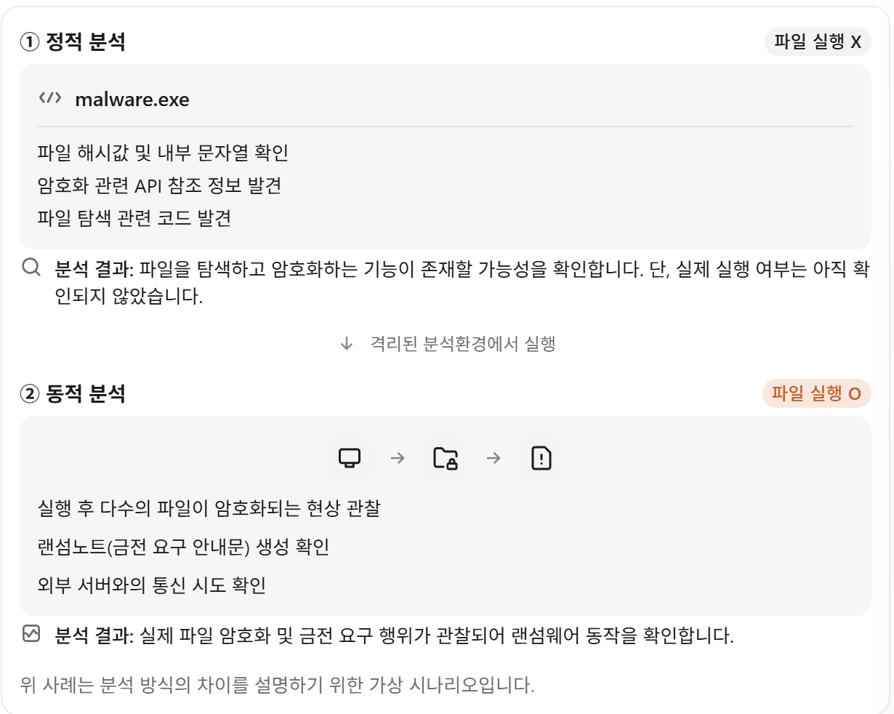
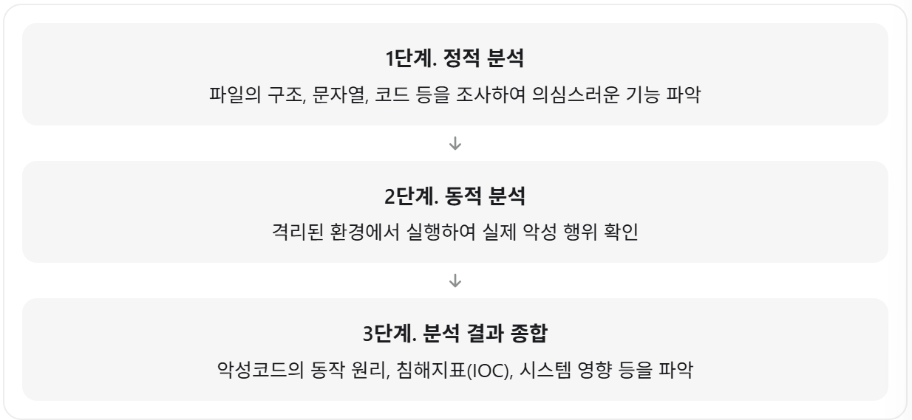

# 1. 악성코드의 동적 분석과 정적 분석의 특징 및 차이점

## 1-1. 악성코드 분석이란

### 개념

- 악성코드(Malware)의 **구조**, **기능**, **실행 행위** 등을 조사하여 **악성 여부와 동작 원리를 파악**하는 과정
- 분석을 통해 **악성코드가 시스템에 미치는 영향 확인**하고, **침해사고 탐지 및 대응에 필요한 정보를 확보**할 수 있습니다.

### 분석 목적

- 악성코드의 **기능과 동작 방식 파악**
- 악성코드가 **시스템에 미치는 영향** 확인
- 악성 IP, 도메인, 파일 해시 등 침해지표(IOC) 추출
  - 왜 추출할까 → 활용하여 다른 시스템의 **감염 여부 조사, 추가 피해 탐지/차단** 위해
  - 침해지표(IOC)가 무엇일까
    - IOC(Indicator of Compromise, 침해지표): 시스템이나 네트워크에서 **침해사고 또는 악성 행위가 발생했을 가능성을 판단하는 데 활용하는 증거성 정보**
- **악성코드 탐지** 및 **침해사고 대응**에 활용

#### 주요 분석 방식

악성코드 분석은 크게 <b>정적분석(Static Analysis)</b>과 <b>동적 분석(Dynamic Analysis)</b>으로 구분됩니다.

두 방식은 **실행 여부**와 **분석 대상**에서 차이가 있습니다.

- 실행 여부
  - 정적분석 - 악성코드 직접 실행하지 않고 분석
  - 동적분석 - 악성코드를 직접 실행하며 분석
- 분석 대상
  - 정적 분석 - 파일 자체의 정보 (문자열, 파일 구조, 코드, API 참조 정보 등)
  - 동적 분석 - 실행 과정에서 발생하는 행위 (프로세스 실행, 파일 변경, 레지스트리 변경, 네트워크 통신 등)

 

# 2. 악성코드 정적 분석 (Static Analysis)

## 2-1. 정적 분석

### 개념

- **악성코드를 직접 실행하지 않고**, **파일의 내부 구조와 코드 등을 조사**하여 **악성 여부와 기능을 분석**하는 방식
- **파일 자체에 포함된 정보**를 바탕으로 악성코드가 어떤 기능을 수행할 수 있는지 파악

## 2-2. 주요 분석 항목

1. **파일 정보 분석**
   - 파일명, 크기, 형식, 해시값(MD5, SHA-256) 등을 확인합니다.
   - **파일의 식별** 및 **기존 악성코드와의 동일 여부 확인**에 활용합니다.
2. **문자열 분석(Strings) 분석**
   - 파일 내부에 포함된 **IP 주소, URL, 명령어, 파일 경로** 등의 **문자열을 추출**합니다.
   - **외부 통신 대상**이나 의심스러운 기능의 단서를 찾을 수 있습니다.
     - IP주소 - 악성코드가 통신하려는 외부 주소일 가능성
     - URL - 악성코드가 접속하려는 악의적 주소일 가능성
     - 파일 경로 - 악성코드가 접근하거나 생성/수정/실행하려는 파일의 위치일 가능성
3. **파일 구조 분석**
   - **실행 파일의 헤더, 섹션, 라이브러리 및 API 참조 정보** 등을 확인
   - 악성코드가 사용할 수 있는 **시스템 기능**과 **파일의 구조적 특징**을 파악합니다.
     - 실행 파일의 헤더, 섹션, 라이브러리 및 API 참조 정보
       - 이걸로 시스템 기능과 파일의 구조적 특징을 어떻게 파악한다는 걸까? → **프로그램이 사용하는 DLL과 API를 확인하면** 어떤 시스템 기능을 사용할 가능성이 있는지 추정 가능
     - **헤더**: 실행 파일의 기본 정보 및 실행에 필요한 정보를 저장하는 영역 (파일 형식, cpu 아키텍쳐, Entry point - 프로그램 시작 위치)
     - **섹션**: 실행 파일 내부에서 코드와 데이터를 용도에 따라 구분하여 저장하는 영역
4. **코드 분석**
   - 디스어셈블러나 디컴파일러를 이용하여 프로그램 내부 로직을 분석합니다.
   - → 기계어를 사람이 분석하기 쉬운 언어로 변환하는 도구

> **디스어셈블러와 디컴파일러가 뭐지?**
>
> 디스어셈블러와 디컴파일러는 **실행 파일의 기계어를 사람이 분석하기 쉬운 형태로 변환하는 도구**입니다.
>
> **1. 디스어셈블러(Disassembler)**
> - 개념: 기계어를 어셈블리어로 변환하는 도구입니다.
> - 목적: CPU 명령어를 확인하여 프로그램의 동작을 분석합니다.
> - 대표 도구: IDA, Ghidra
>
> **2. 디컴파일러(Decompiler)**
> - 개념: 기계어를 C언어와 같은 고급 언어 형태의 코드로 복원하는 도구입니다.
> - 목적: 프로그램의 조건문, 반복문, 함수 등의 로직을 이해하기 쉽게 분석합니다.
> - 대표 도구: Ghidra, IDA(디컴파일러 기능)
>
> **3. 핵심 차이**
> - 디스어셈블러: 기계어 → 어셈블리어
> - 디컴파일러: 기계어 → 고급 언어 형태의 의사코드

## 2-3. 정적 분석 특징

#### 장점

- 악성코드를 실행하지 않으므로 **실행에 따른 감염 위험이 상대적으로 낮습**니다.
- **기본적인 파일 정보**와 **의심스러운 기능**을 빠르게 조사할 수 있습니다.
- **실제 실행되지 않는 코드**나 **특정 조건에서만 동작하는 기능**도 분석할 수 있습니다.

#### 단점

- 코드가 난독화(Obfuscation), 암호화 또는 패킹(Packing)되어 있다면 분석이 어렵습니다.
  - 난독화(obfuscation): 프로그램의 기능을 유지하면서 코드나 문자열을 복잡하게 변형하여 사람이 이해하거나 분석하기 어렵게 만드는 기술
  - 패킹: 실행 파일의 코드와 데이터를 압축하거나 암호화하여 저장하고, 실행 시 이를 복원하도록 만드는 기술
  - 암호화: 데이터를 암호화하여 복호화 없이는 원래 내용을 확인하기 어렵게 만드는 것
- 코드만으로는 실제 실행 과정에서 발생하는 행위를 정확히 확인하기 어렵습니다.
- **상세한 코드 분석에는 어셈블리어 및 운영체제에 대한 전문 지식이 필요**합니다.

> **[참고]** 정적 분석으로 확인한 기능은 실제 실행된 기능과 다릅니다.
> - 예를 들어 파일에서 네트워크 통신 관련 API가 발견되더라도 실제 외부 서버에 접속했다고 확정할 수는 없습니다.
> - 따라서 **정적 분석 결과에서는 통신 기능이 존재할 가능성이 있다**라고 표현하고, 동적 분석에서 실제 통신이 관찰되면 통신 시도를 확인했다라고 구분하는 것이 정확합니다.

 

# 3. 악성코드 동적 분석(Dynamic Analysis)

## 3-1. 동적 분석 개념

#### 개념

- 악성코드를 **격리된 가상환경이나 샌드박스(Sandbox)에서 직접 실행**하고, **실행 과정에서 발생하는 행위를 관찰하여 분석하는 방식**입니다.

샌드박스(Sandbox)란?

- 의심스러운 프로그램을 실제 운영환경과 분리하여 실행하고 관찰하기 위한 통제된 분석 환경
  - 악성코드가 외부 시스템에 영향을 줄 위험을 줄이기 위해 사용 **(단, 샌드박스가 모든 위험을 제거하는 것은 아님)**

## 3-2. 주요 분석 항목

1. **프로세스 실행 분석**
   - **악성코드가 생성하거나 실행하는 프로세스를 확인**합니다.
     - 다른 프로세스 실행, 프로세스 인젝션 등 의심스러운 행위를 관찰합니다.
2. **파일 시스템 분석**
   - **악성코드 실행 과정에서 생성/수정/삭제되는 파일을 확인**합니다.
     - 추가 악성파일 다운로드, 기존 파일 변조 등의 행위를 파악합니다.
3. **레지스트리 변경 분석**
   - **Windows 레지스트리의 생성/수정/삭제 내역을 확인**합니다.
   - 자동 실행 등록 등 악성코드의 지속성 유지(Persistence) 시도를 파악합니다.
     - 레지스트리(Registry): Windows 운영체제와 프로그램의 **설정 정보를 저장하고 관리하는 계층형 데이터베이스 (Windows와 프로그램 동작 시 참고하는 설정 정보 저장 공간)**
     - 악성코드는 레지스트리를 변경하여 악성 행위를 수행하거나 <b>지속성(Persistence)</b>을 확보할 수 있음 (예: Windows 시작 시 악성코드 자동 실행하도록 등록)
4. **네트워크 통신 분석**
   - **악성코드가 실행 중 접속하는 IP, 도메인 및 통신 내용을 확인**합니다.
     - C2(Command and Control) 서버와의 통신이나 정보 유출 시도 등을 탐지할 수 있습니다.
       - **C2(Command and Control, 명령제어) 서버**란 공격자가 감염된 시스템의 악성코드에 명령을 전달하고, 실행 결과나 탈취한 정보를 수신하기 위해 사용하는 서버 (공격자 서버)

## 3-3. 동적 분석 특징

### 장점

- 악성코드의 **실제 실행 행위**를 직접 관찰할 수 있습니다.
- 정적 분석에서 확인하기 어려운 **파일 변경, 네트워크 통신** 등의 행위를 파악할 수 있습니다.
- **실행 과정에서 복호화되거나 메모리에 나타나는 악성코드의 정보**를 확인할 수 있습니다
  - (정적 분석만으로 탐지할 수 없었던 악성코드 탐지 가능)

### 단점

- 악성코드를 직접 실행하므로 반드시 **격리된 분석환경이 필요**합니다.
- **악성코드가 가상환경이나 분석 도구를 탐지하면 악성 행위를 숨길 수 있습니다.**
- 특정 날짜, 사용자 입력, 외부 명령 등 **실행 조건이 충족되지 않으면 악성 행위가 관찰되지 않을 수 있**습니다.

 

# 4. 정적 분석과 동적 분석의 차이점

| 비교 항목 | 정적 분석 | 동적 분석 |
| --- | --- | --- |
| 실행 여부 | 실행하지 않음 | 직접 실행 |
| 분석 대상 | 파일 구조 및 코드 | 실행 중 발생하는 행위 |
| 분석 목적 | 악성코드의 구조와 잠재적 기능 파악 | 실제 동작 방식 파악 |
| 주요 분석 정보 | 해시, 문자열, 파일 헤더, API 참조, 코드 | 프로세스, 파일 변경, 레지스트리, 네트워크 |
| 분석 환경 | 별도 실행환경 없이도 가능 | 격리된 분석환경 필요 |
| 장점 | 비교적 빠르고 안전한 초기 분석 | 실제 악성 행위 관찰 가능 |
| 단점 | 난독화 및 암호화에 취약 | 실행 조건과 분석환경에 영향을 받음 |

**핵심 차이점 - 실행 여부와 분석 대상**

- **정적 분석**: 실제 실행 X, 파일 자체 정보 분석
- **동적 분석**: 실제 실행 O, 악성 코드의 행위 분석

두 방식은 서로 대체하는 관계가 아니라 상호 보완하는 관계입니다.

 

# 5. 정적 분석과 동적 분석의 실제 활용 예시

상황: 랜섬웨어로 의심되는 `malware.exe` 파일 발견

 

# 6. 정적 분석과 동적 분석의 연계

실제 악성코드 분석에서는 두 가지 방식을 함께 활용하는 것이 효과적입니다.

**정적 분석을 통해 의심스러운 기능을 먼저 파악**하고, **동적 분석을 통해 해당 기능이 실제로 실행되는지 확인**합니다.

필요하면 다시 정적 코드 분석으로 돌아가 실행 조건이나 내부 로직을 추가로 조사할 수도 있습니다.

 

# 7. 실무 관점 정리

## 7-1. 정적 분석 - 패킹 여부 확인

정적 분석에서는 패킹 여부를 확인하여 내부 정보를 볼 수 있는 상태인지 고려해야 한다.

**일반적인 정적 분석의 흐름**

1. 분석 대상 파일의 패킹 여부 확인
2. 패킹되어 있다면 언패킹 과정을 고려
3. 언패킹이 제대로 이루어졌다는 전제에서 내부 문자열 등을 확인

## 7-2. 정적 분석에서 얻은 단서를 동적 분석의 확인 대상으로 연결

파일 내부의 문자열에는 IP 주소, URL, 실행 파일명, 함수나 명령어 관련 정보 등이 포함될 수 있다.

- 이러한 정전 분석 정보는 동적 분석에서 무엇을 집중적으로 관찰할 지 결정하는 단서가 된다.

예를 들어, 다음과 같이 구체화할 수 있다.

| 정적 분석에서 발견한 단서 | 동적 분석에서 확인할 내용 | 언급된 도구 |
| --- | --- | --- |
| 실행 파일명, 명령어 관련 문자열 | 해당 실행이나 관련 행위가 실제로 나타나는지 | Process Monitor, Process Explorer |
| IP 주소, URL | 해당 대상과 관련된 네트워크 활동이 실제로 발생하는지 | Wireshark, 스크립트상 ‘컬포츠’ |
| 함수 및 파일의 구조적 정보 | 예상되는 기능과 관련하여 어느 부분을 집중적으로 관찰할지 | 관찰 목적에 맞는 분석 도구 |

이렇게 연결하면 의심스러운 파일에 특정 정보가 들어 있다는 사실에서, 나아가 그 정보와 관련된 행위가 실제로 발생하는지 확인할 수 있다.

핵심은 **정적 분석 결과를 동적 분석의 관찰 방향으로 활용**하는 것

## 7-3. 분석은 기초 정보 수집부터 결론과 대응 방안까지 이어져야 한다

멘토님은 악성코드 분석에 하나의 고정된 방법론만 있는 것이 아니라고 전제하며, 다음과 같은 기본적인 흐름을 설명하셨다.

**기초 분석 → 정적 분석 → 동적 분석 → 결과 종합 → 대응 방안 제시**

각 단계의 역할은 다음과 같다.

- **기초 분석:** 대상 파일에 어떤 정보가 있고 어떤 행위를 할 가능성이 있는지 살펴볼 참고 자료를 얻는다.
- **정적 분석:** 문자열, 함수, 구조적 특징 등을 확인한다.
- **동적 분석:** 앞에서 확보한 단서를 바탕으로 실제 행위를 집중적으로 관찰한다.
- **결과 종합:** 각 분석에서 확인한 내용을 연결하여 결론을 정리한다.
- **대응 방안 제시:** 분석 결과를 근거로 필요한 대응을 설명한다.

따라서 도구별 분석 결과를 각각 나열하는 데서 끝내지 않고, **그 결과들이 어떤 관계에 있는지 설명하는 것이 중요**하다.

- 참고: 정적 분석을 깊게 다루는 직무에서는 리버싱이나 역공학 까지 포함될 수 있지만 리팩토링 과정에서는 해당 수준까지 접근하지 않는다.

## 7-4. 동적 분석에서는 분석 대상의 활동을 다른 시스템 활동과 구별해야 한다.

동적 분석에서는 악성코드 실행 전후를 비교한다.

- 분석자는 실행한 악성코드의 변화만 명확하게 나타나면 편하겠지만, 실행 환경에서는 운영체제와 다른 프로그램의 활동도 함께 발생한다.
- 필터링하지 않은 상태에서 분석 도구를 사용하면 대상 파일과 무관한 프로세스 활동이나 네트워크 통신까지 함께 보게 된다.
  - **먼저 필터링 기능을 통해 대상과 관련된 활동을 선별하고, 그 활동 중심으로 분석해야 함**

## 7-5. 실행 직후 나타난 현상이라는 이유만으로 악성코드가 발생시킨 행위라고 단정할 수 없다.

멘토님은 동적 분석에서 특히 주의해야 할 부분으로 악성코드의 행위와 운영체제의 정상적인 활동을 혼동하는 문제를 강조하셨다.

- Windows는 사용자가 직접 조작하지 않아도 백그라운드에서 다양한 작업을 수행한다.
  - 정기적인 작업이나 예약된 작업이 실행될 수 있다.
  - 운영체제와 프로그램에 필요한 프로세스 및 서비스가 자동으로 동작할 수 있다.
- 이러한 활동이 악성코드를 실행한 시점과 우연히 겹칠 수 있다.
- 이 경우 실제로는 Windows의 정상적인 활동임에도 악성코드가 발생시킨 행위라고 잘못 판단할 가능성이 있다.

따라서 악성코드 실행 직후 관찰되었다는 사실만으로 해당 행위를 악성코드에 의한 것으로 확정해서는 안 된다.

따라서 **동일한 도구를 사용하더라도 최소 2~3회를 반복하여 분석 결과를 확인할 필요가 있음을 강조**하셨다.

- 관찰된 행위가 반복적으로 발생하는지 확인
- 정상적인 시스템 활동과 분석 대상의 활동 구분
- 악성코드에 의한 행위인지 충분한 근거 확보

## 7-6. 동적 분석에서는 크게 3가지 영역을 중심으로 악성 행위를 확인한다.

멘토님은 동적 분석에서 확인해야 할 영역을 다음 세 가지로 구분하여 설명하셨다.

| 분석 영역 | 확인할 내용 |
| --- | --- |
| 프로세스 활동 | 프로세스 실행 및 관련 동작 |
| 파일 시스템 및 레지스트리 | 파일과 레지스트리의 생성·수정·삭제 |
| 네트워크 통신 | 외부 서버와의 연결 및 데이터 송수신 |

이러한 영역을 조사하여 악성코드가 시스템에 어떤 영향을 미치는지 파악한다.

## 7-7. 악성 행위가 관찰되지 않는다고 악성코드가 아니라고 판단해서는 안된다.

멘토님은 악성코드의 행위가 시간이 지나면서 달라지거나 더 이상 나타나지 않을 수 있다는 점을 강조하셨다.

### 악성 행위가 관찰되지 않는 이유

- 악성코드가 통신하려는 **외부 서버나 경유지가 차단**되었을 수 있다.
- 악성코드와 관련된 **파일이나 통신 대상이 보안 정책에 의해 차단**되었을 수 있다.
- 시간이 지나면서 **악성코드의 동작 방식이나 실행 가능한 조건이 달라졌**을 수 있다.

따라서 실제 분석에서는 **다음 두 상황을 구별**해야 한다.

1. **분석 도구의 사용이나 설정 문제**로 악성 행위를 관찰하지 못한 경우
2. 악성코드 자체가 **현재 환경에서 특정 행위를 수행하지 않는** 경우

멘토님은 이러한 상황을 정확하게 구분하기 위해서라도 **분석 도구의 기능과 사용법을 충분히 숙지하는 것이 중요**하다고 설명하셨다.
