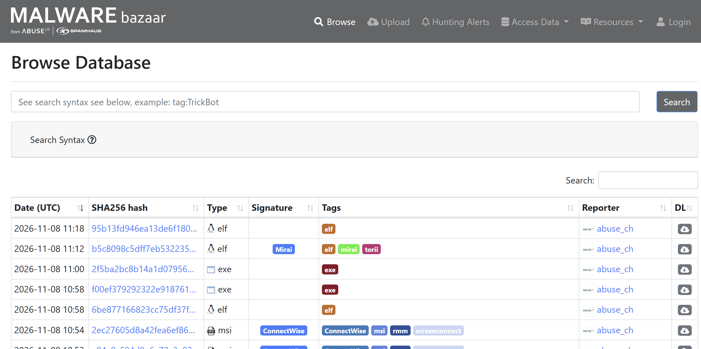
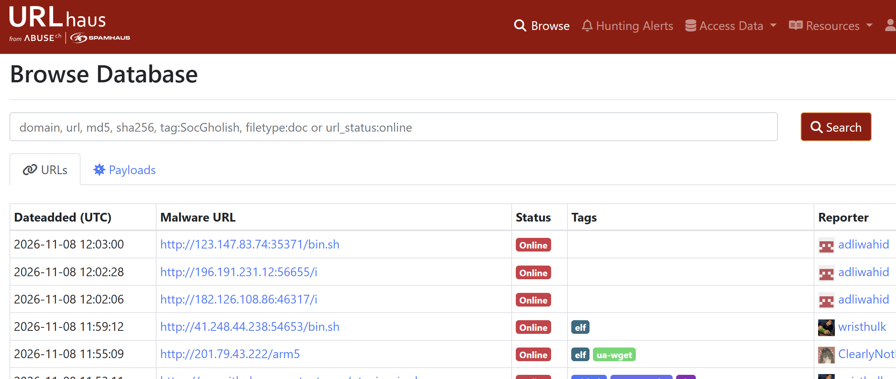
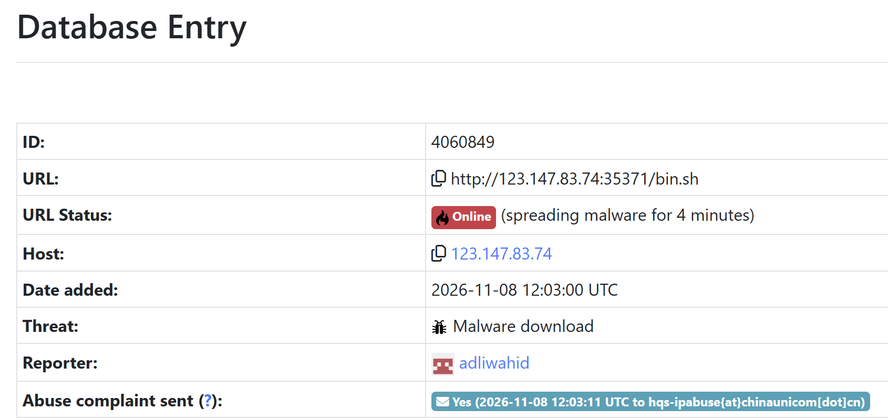
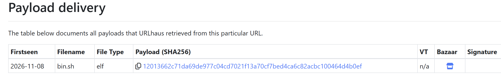
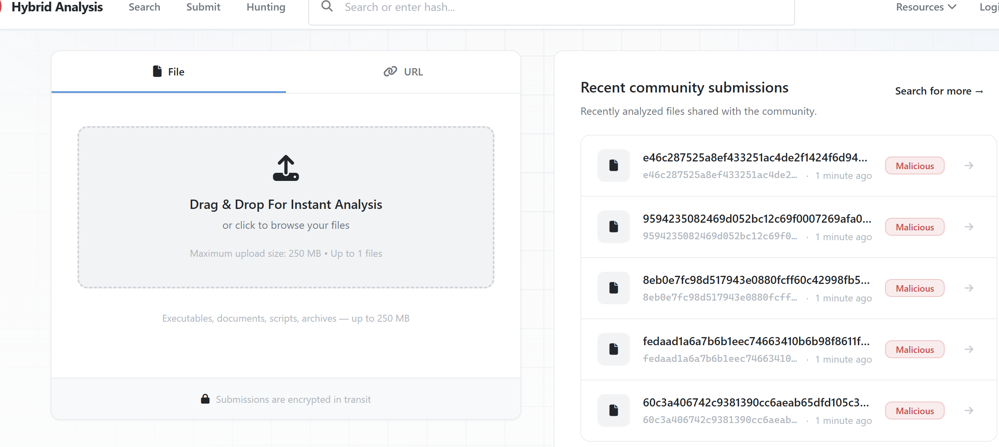
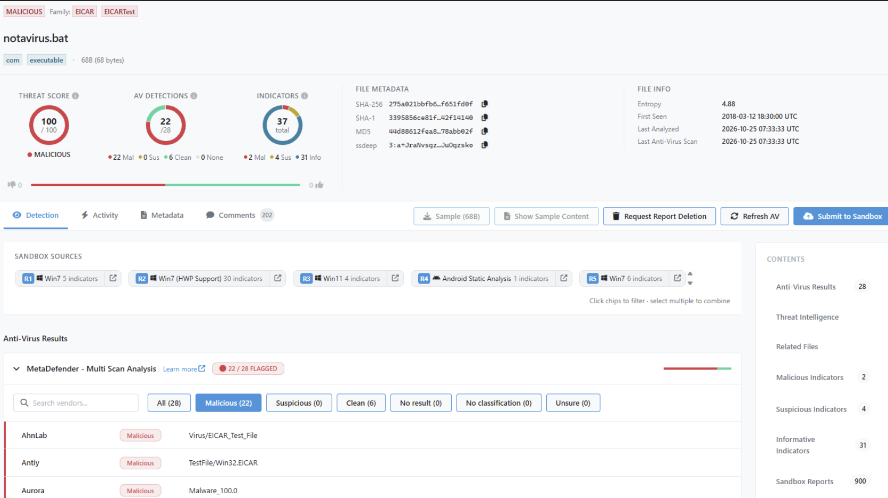
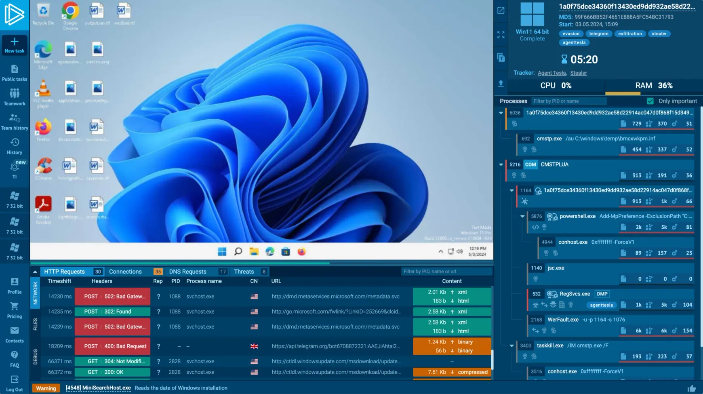

## 1. 수집 사이트

### 1-1. MalwareBazaar


_MalwareBazaar Browse Database — 최근 등록된 샘플 목록_

#### 기본 정보

- 악성코드 샘플을 무료로 공유하는 **위협 인텔리전스 저장소**
- 주로 보안 연구자, 백신 업체, 보안 관제 담당자가 샘플과 탐지 정보를 주고받는 데 사용

#### 주요 기능

1. **샘플 검색:** 해시(SHA256, MD5 등), 악성코드 패밀리(signature), 태그, 파일 형식으로 검색
2. **샘플 상세 정보:** 파일 해시, 크기, 최초 발견 시각, 제보자를 보여 주고 YARA·ClamAV 탐지 결과도 제공해요.
3. **외부 분석 연계:** VirusTotal, ANY.RUN, Triage, Hybrid Analysis 등 다른 분석 사이트의 결과로 바로 연결돼요.
4. **샘플 다운로드:** 비밀번호(`infected`)가 걸린 zip으로 받아요.
5. **Hunting Alerts:** 특정 패밀리나 YARA 규칙에 맞는 새 샘플이 올라오면 알려 줘요.
6. **API 제공:** 보안 시스템과 연동해서 자동으로 조회하거나 수집할 수 있어요.

> **[참고] 악성 패밀리, YARA/ClamAV 탐지 의미**
>
> **1. 악성코드 패밀리 (Family)**
>
> **같은 뿌리에서 나온 악성코드 묶음**이에요. 같은 제작자나 같은 소스코드에서 나와서 핵심 동작이 같은 것끼리 한 이름으로 부르는 거예요.
>
> 생물로 비유하면 이래요.
> - **패밀리**는 "독감 바이러스" 같은 종류예요.
> - **개별 샘플**은 올해 유행한 특정 변종 하나예요.
>
> **2. YARA 규칙**
>
> **악성코드를 찾아내기 위한 "몽타주(인상착의)" 같은 규칙**이에요. 보안 분석가가 "이런 특징이 있는 파일은 이 패밀리다"라고 조건을 적어 두면, YARA 프로그램이 파일을 검사해서 조건에 맞는지 판단해요.
>
> ```text
> rule Mirai_Example
> {
>     strings:
>         $a = "/bin/busybox"           // 파일 안에 이 문자열이 있고
>         $b = "admin" ascii            // 흔한 기본 비밀번호 목록도 있고
>         $c = { 7F 45 4C 46 }          // 리눅스 실행파일(ELF) 시작 바이트
>
>     condition:
>         $c at 0 and $a and $b         // 셋 다 만족하면 "Mirai 의심"
> }
> ```
>
> 해시는 파일이 1바이트만 바뀌어도 완전히 달라져서 변종을 못 잡아요. YARA는 **"이 문자열과 이 코드 조각이 들어 있으면"**처럼 특징으로 찾기 때문에 **변종까지 잡을 수 있어요.** 그래서 보안 업계에서 사실상 표준으로 써요.
>
> **3. ClamAV**
>
> **무료 오픈소스 백신 프로그램**이에요. Cisco가 관리하고 리눅스 메일 서버 등에서 많이 써요. 자체 탐지 시그니처 데이터베이스로 파일을 검사해서 `Win.Trojan.AgentTesla` 같은 탐지명을 붙여요.
{: .prompt-info }

### 1-2. URLhaus


_URLhaus Browse Database — 등록된 악성코드 유포 URL 목록_

#### 기본 정보

악성코드를 **퍼뜨리는 URL**을 수집하고 공유하는 데이터베이스
각 URL에서 내려받아지는 악성 파일(payload)도 함께 기록

#### 목적

- 악성코드 유포 URL을 빠르게 공유해서 **차단하고, 호스팅 업체에 알려 내리게(takedown)** 하는 것

#### URL 상세 정보


_URLhaus 개별 URL 상세 정보(Database Entry)_

| 항목 | 의미 |
| --- | --- |
| ID | URLhaus 안의 등록 번호 |
| URL | 실제 악성 URL (옆에 복사 아이콘은 절대 누르지 않기) |
| URL Status - Online | 지금도 살아서 악성코드 퍼뜨리고 있음 |
| Host | 유포 서버의 IP |
| Date added | 등록된 시간 |
| Threat | 악성코드 다운로드 유형 |
| Reporter | 제보한 연구자 |
| Abuse complaint sent | 등록 11초만에 차이나유니콤이라는 중국 통신사에서 자동으로 신고가 갔음 (Takedown 정보) |


_해당 URL에서 수집된 payload 정보(Payload delivery)_

- Bazaar : MalwareBazaar의 같은 샘플 페이지로 연결
- File Type : elf 로 실제 파일 타입은 리눅스 실행 타입임을 알 수 있음
- Payload : 파일의 고유 해시값, 클릭하면 URLhaus의 payload 정보 페이지로 감

## 2. 분석 사이트

### 2-1. Hybrid Analysis


_Hybrid Analysis 메인 — 파일/URL 업로드와 최근 커뮤니티 제출 목록_

#### 기본 개념

의심 파일이나 URL을 올리면 **가상 환경(샌드박스)에서 자동으로 실행**해서 행위를 분석하고, 위험도와 함께 보고서로 보여 주는 무료 서비스

#### 주요 특징

- **분석 대상:** Windows 실행 파일, 문서(Office, PDF), 스크립트, URL 등
- **동적 분석:** 샘플을 가상 Windows에서 실행하고 프로세스 생성, 파일·레지스트리 변경, 네트워크 통신을 기록
- **정적 분석:** 파일을 실행하지 않고 구조, 문자열, 임포트 함수를 분석
- **다중 백신 결과:** VirusTotal, MetaDefender, CrowdStrike Falcon 탐지 결과를 함께 보여줌
- **위험도 점수:** Threat Score와 함께 malicious / suspicious / no specific threat로 판정
- **검색:** 해시, IP, 도메인, 파일명으로 기존 보고서를 찾을 수 있음

#### 분석 보고서 예시


_notavirus.bat 분석 보고서 — Threat Score 100/100, AV Detections 22/28_

> **[참고]** 이 보고서의 샘플은 **EICAR 테스트 파일임**. 진짜 악성코드가 아니라 **백신이 제대로 작동하는지 확인하려고 만든 표준 시험용 파일임**
{: .prompt-info }

| 항목 | 값 | 의미 |
| --- | --- | --- |
| 판정/패밀리 | MALICIOUS, EICAR / EICARTest | 악성으로 판정됐고, 패밀리는 EICAR |
| 파일명/형식 | `notavirus.bat`, com/executable, 68바이트 | |
| Threat Score | 100/100 | 종합 위험도 최고점 |
| AV Detections | 22/28 | 백신 28개 중 22개가 악성으로 탐지 |
| Indicators | 37 | 샌드박스 실행 중 발견된 행위 지표 |

### 2-2. ANY.RUN

#### 기본 개념

악성코드를 가상 PC에서 실행하면서 **분석가가 실시간으로 화면을 보고 직접 조작할 수 있는 대화형(Interactive) 샌드박스**

- 대화형(Interactive): 분석가가 샌드박스 안의 가상 PC와 실시간으로 주고받으며 조작할 수 있다
  - 즉 자동 샌드박스와 다르게 실행화면이 실시간으로 보이고 분석가가 클릭, 입력, 창 닫기 등의 원격 접속 후 직접 조작이 가능하다.


_ANY.RUN 분석 화면 — 가상 PC 실행 화면, 프로세스 트리, 네트워크 요청이 함께 표시됨_

#### 왜 필요할까?

악성코드 중에는 **사람이 뭔가를 해야만 동작하는 것이 많음**

- **악성 Word 문서:** "콘텐츠 사용" 버튼을 눌러야 매크로가 실행돼요. 자동 샌드박스는 이 버튼을 못 누르면 "아무 행위 없음"으로 끝남
- **설치 마법사형 악성코드:** "다음 > 동의 > 설치"를 눌러야 진행
- **비밀번호가 걸린 압축 파일:** 비밀번호를 입력해야 열림
- **샌드박스 회피형:** 마우스 움직임이나 키보드 입력이 없으면 "가짜 환경"으로 판단하고 숨음
