## 1. VMware 설치

- Broadcom 포털(<https://support.broadcom.com/>)에서 VMware Workstation Pro를 다운로드

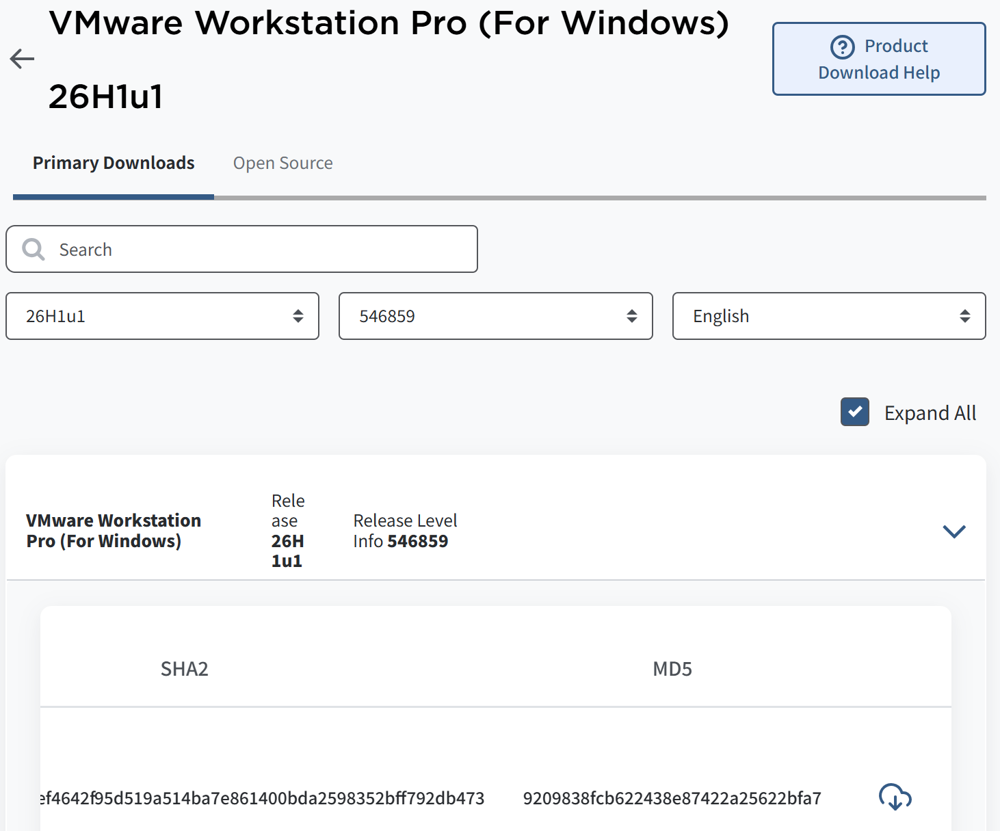
_Broadcom 포털의 VMware Workstation Pro 26H1u1 다운로드 화면_

- 다운받은 `VMware-Workstation-Full-26H1u1-25688693.exe` 파일을 실행해서 VMware Workstation Pro 설치

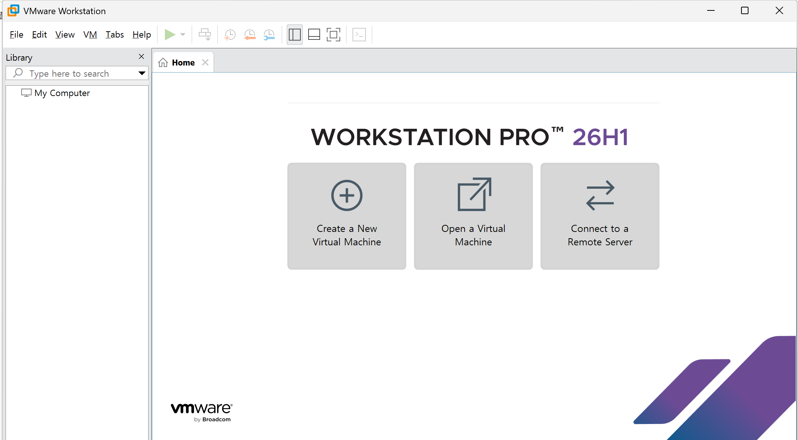
_설치 완료 후 VMware Workstation Pro 26H1 홈 화면_

## 2. Windows ISO 파일 다운로드

- [www.microsoft.com](https://www.microsoft.com/) 에서 Windows 10 미디어 생성 도구 다운로드 (`MediaCreationTool_22H2.exe`)
- `MediaCreationTool_22H2.exe`를 실행하여 `Windows.iso` 다운로드
  - "다른 PC용 설치 미디어(USB 플래시 드라이브, DVD 또는 ISO 파일) 만들기"를 선택
  - ISO 파일을 고르고 `C:\VM`에 저장

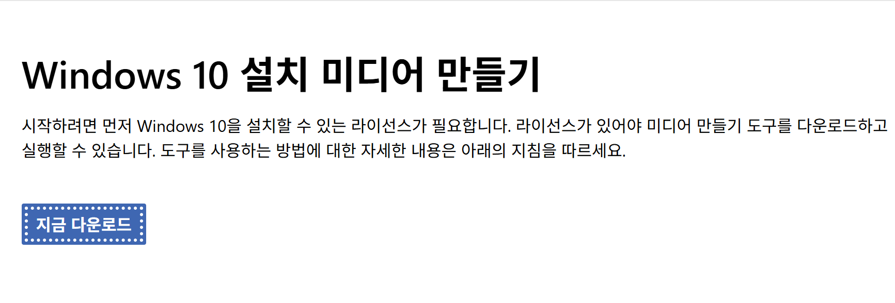
_Microsoft의 Windows 10 설치 미디어 만들기 페이지_

- VMware 와 Windows.iso 다운로드 완료

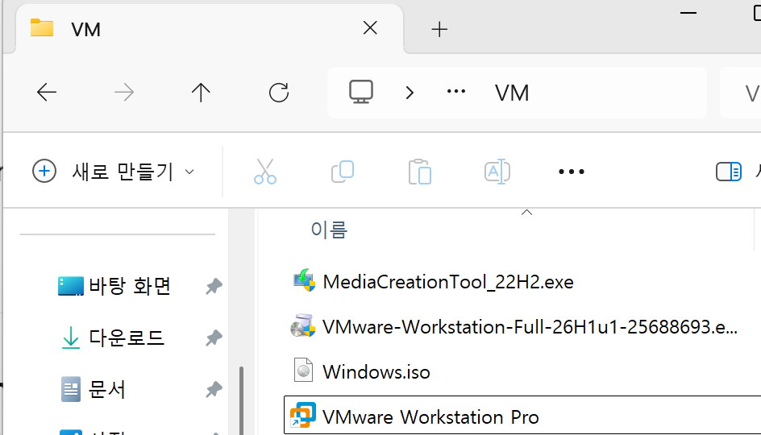
_`C:\VM` 폴더 — MediaCreationTool, VMware 설치 파일, Windows.iso_

## 3. 가상 머신 생성

1. **Create a New Virtual Machine** 선택

   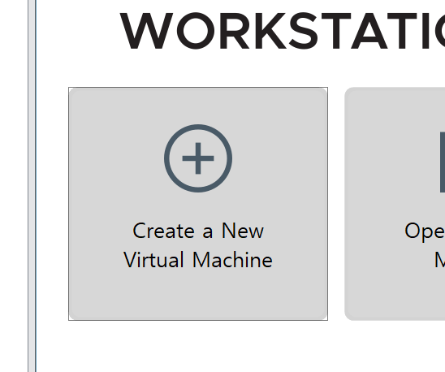
   _VMware 홈 화면의 Create a New Virtual Machine_

2. **Installer disc image file (iso)** 선택 후 `Browse...`를 눌러 다운로드한 `C:\VM\Windows.iso` 경로 지정 > **Next**

   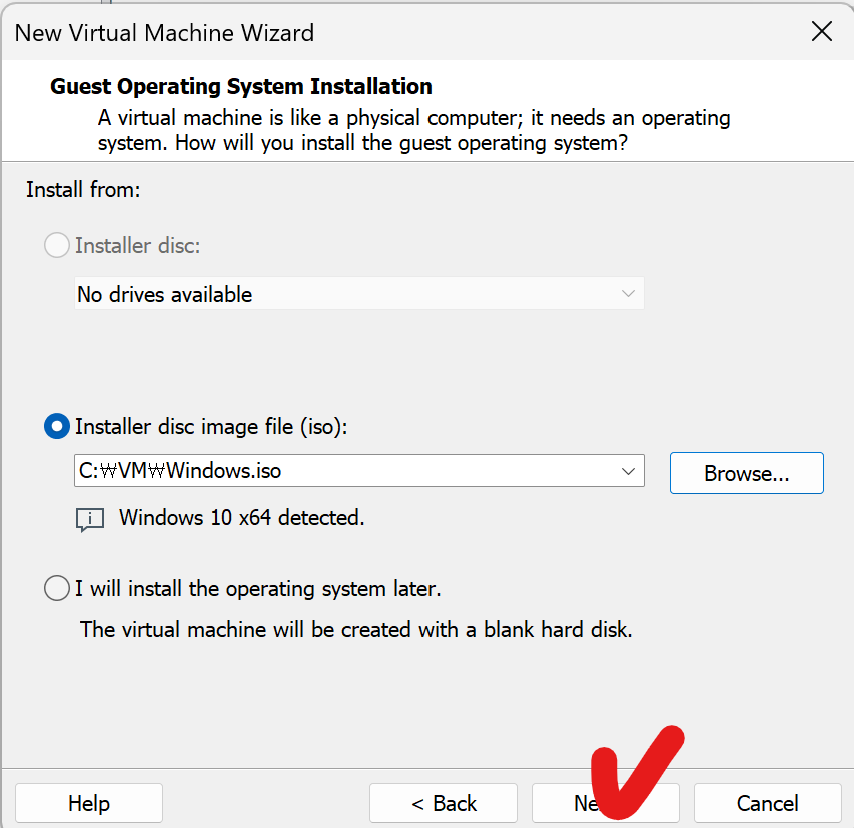
   _ISO 경로 지정 — Windows 10 x64 detected_

3. 디스크 용량 설정(기본값 유지 또는 원하는 용량 입력) 및 **Split virtual disk into multiple files** 선택 > **Next**

   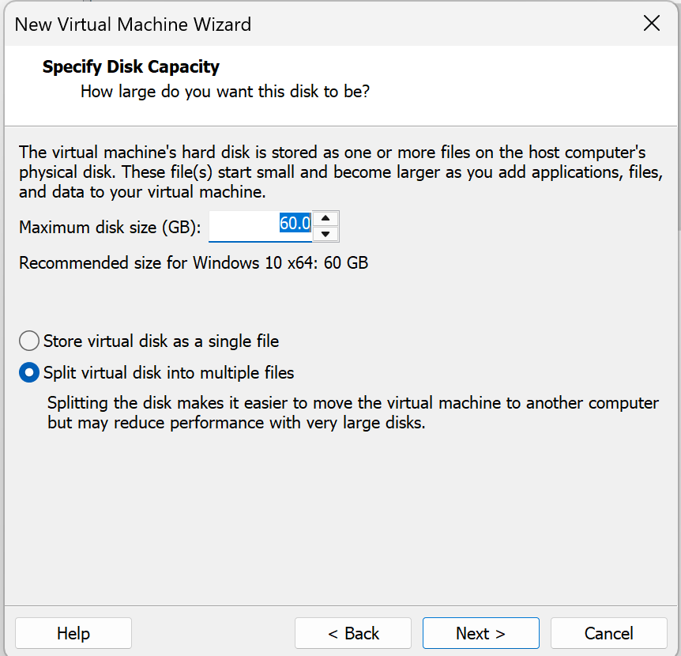
   _디스크 60GB, Split virtual disk into multiple files_

4. 가상 머신 설정 정보 확인 후 **Finish** 클릭

   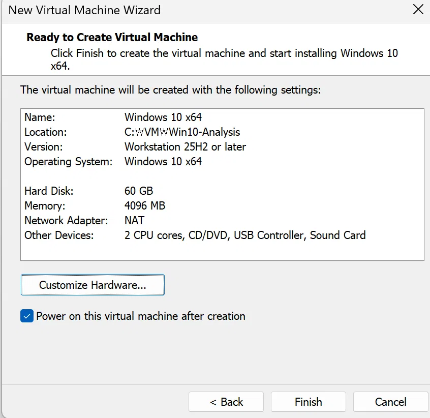
   _최종 설정 — 디스크 60GB, 메모리 4096MB, 네트워크 NAT, CPU 2코어_

5. 윈도우 10 설치 완료

   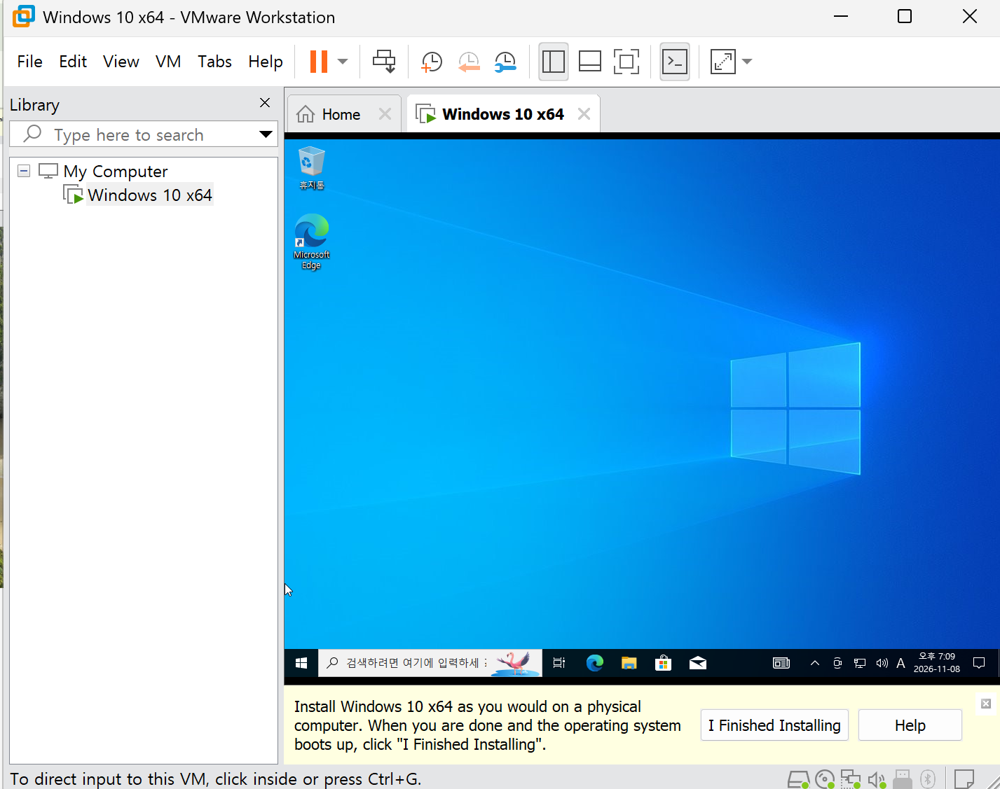
   _가상 머신에서 부팅된 Windows 10 x64_

6. `ping 8.8.8.8` 명령어로 외부 네트워크(인터넷) 정상 연결 확인

   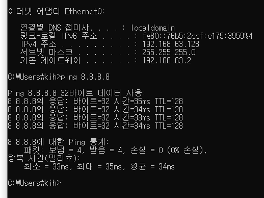
   _NAT 네트워크로 8.8.8.8 ping 응답 확인 (손실 0%)_

## 4. 악성코드 분석 Tool 설치

- 사전에 조사한 동적분석 Tool 가상 환경에서 다운로드

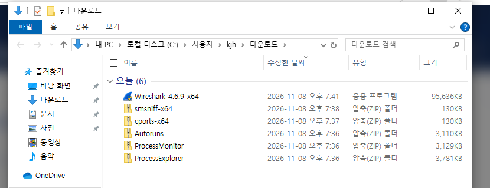
_다운로드한 도구 — Wireshark, SmartSniff, CurrPorts, Autoruns, Process Monitor, Process Explorer_

- 이후 압축을 풀고, 설치를 진행한다.

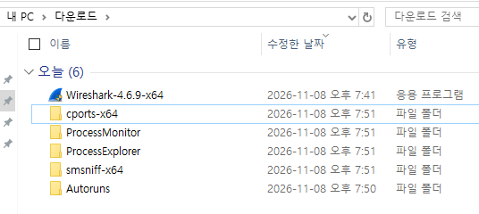
_각 도구 압축 해제_

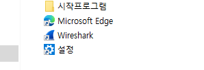
_시작 메뉴에 등록된 Wireshark_

### 도구별 실행 화면

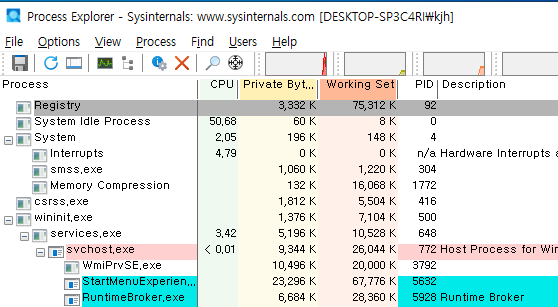
_Process Explorer 실행화면_

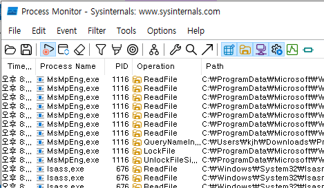
_Process Monitor 실행화면_

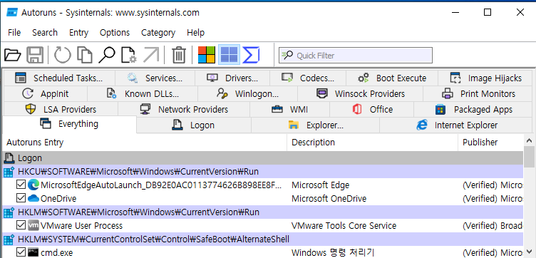
_Autoruns 실행화면_

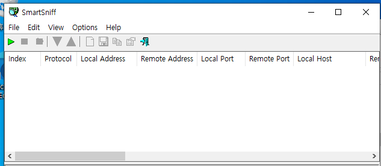
_SmartSniff 실행화면_

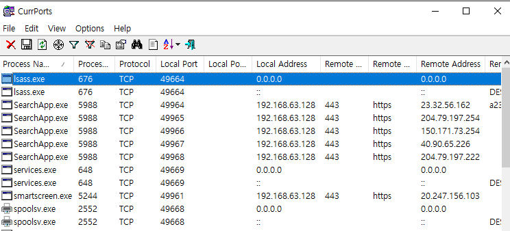
_CurrPorts 실행화면_

## 5. 스냅샷 만들기

**VM > Snapshot > Take Snapshot** 선택 후, Name과 Description을 입력

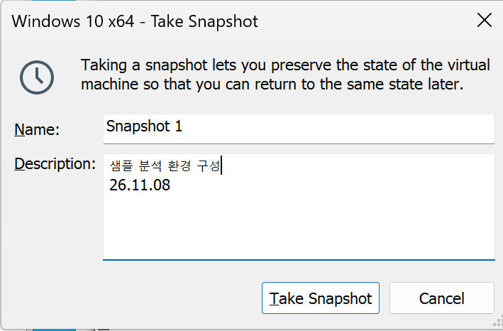
_Take Snapshot — Name과 Description 입력_

**VM > Snapshot > Snapshot Manager** 에서 스냅샷 확인 가능

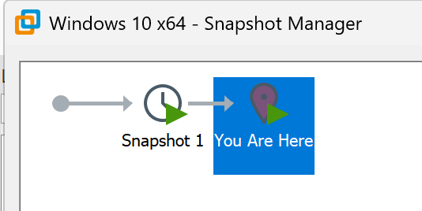
_Snapshot Manager에서 생성된 Snapshot 1 확인_
