## 1. 동적 분석 도구

### 1-1. Process Monitor

#### 1-1-1. 개념

- Windows에서 **프로세스가 수행하는** **파일 시스템, 레지스트리, 프로세스 및 스레드 활동을 실시간으로 기록**하는 분석 도구
- 악성코드가 실행된 후 **어떤 파일을 생성하거나 레지스트리를 변경하는지 조사**하는데 활용됌

#### 1-1-2. 주요 기능

1. **파일 시스템 모니터링**
   1. 프로세스가 수행하는 파일 생성, 읽기, 쓰기, 삭제 등의 활동을 실시간으로 기록
   2. 악성코드가 **새로운 파일을 생성하거나 기존 파일을 변경하는 행위를 추적**하는 데 활용
2. **레지스트리 모니터링**
   1. 프로세스가 수행하는 레지스트리 키/값의 조회, 생성, 수정, 삭제 활동을 기록
   2. 악성코드가 자동 실행 항목을 등록하거나 시스템 설정을 변경하는 행위를 조사하는 데 활용
3. **프로세스 및 쓰레드 모니터링**
   1. 프로세스와 쓰레드의 생성/종료 활동을 기록
   2. 프로세스 트리(Process Tree)를 통해 부모/자식 프로세스 관계도 확인 가능
4. **이벤트 필터링**
   1. 수집된 이벤트 중 특정 프로세스, PID, 파일 경로, 작업 유형 등에 조건에 해당되는 이벤트만 표시
5. **이벤트 상세 정보 및 로그 저장**
   1. 각 이벤트의 발생 시각, 프로세스 이름, PID, 작업 유형, 대상 경로, 실행 결과 등을 확인

#### 1-1-3. Process Monitor 실습

**첫 실행 화면**

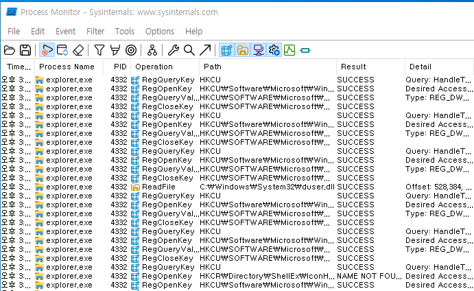
_Process Monitor 첫 실행 화면_

- Process Monitor를 실행하면 Windows에서 실행 중인 프로세스들이 수행하는 시스템 활동을 실시간으로 기록됌.
  - 파일 시스템: 파일 생성/읽기/쓰기/삭제
  - 레지스트리: Windows 설정 조회/생성/수정/삭제
  - 프로세스 및 쓰레드: 생성/종료

  각 활동은 이벤트 단위로 기록되며, 어떤 프로세스가 어떤 작업을 수행했는지 확인할 수 있음.

- 화면의 주요 항목
  - Time: 이벤트 발생 시각
  - Process Name: 작업을 수행한 프로세스 이름
  - PID: 프로세스 ID
  - Operation: 수행한 작업의 종류
  - Path: 접근한 파일/레지스트리 등의 경로
  - Result: 작업 수행 결과
  - Detail: 작업에 대한 추가 정보

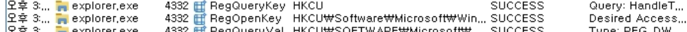
_explorer.exe(PID 4332)의 레지스트리 활동 기록_

현재 화면에는 `explorer.exe`(PID 4332)의 활동이 기록되어 있음

- RegOpenKey: 레지스트리 키 열기
- `HKCU`: 현재 사용자 계정의 레지스트리 영역
- `SUCCESS`: 해당 작업이 정상적으로 수행됨

**툴 바에서 제공하는 주요 기능은 아래와 같다.**

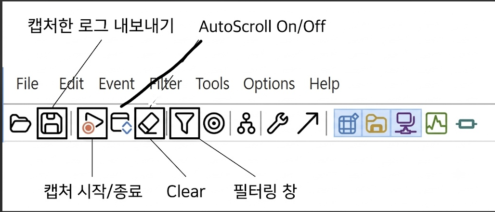
_Process Monitor 툴 바 주요 기능_

**특정 프로그램의 로그 필터링하기**

- 특정 프로세스에서 발생하는 시스템 활동만 필터링하여 확인해보자.

필터링 메뉴 클릭

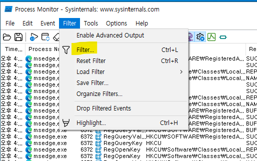
_Filter 메뉴 선택_

Process Name / is / msedge.exe /Include → Add

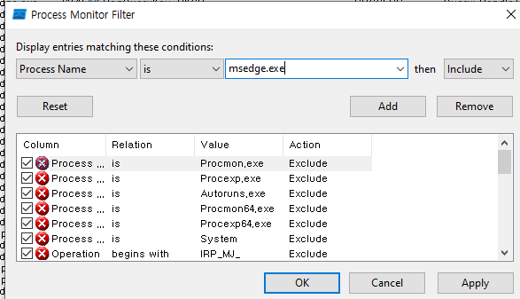
_Process Name is msedge.exe Include 조건 추가_

Apply→OK

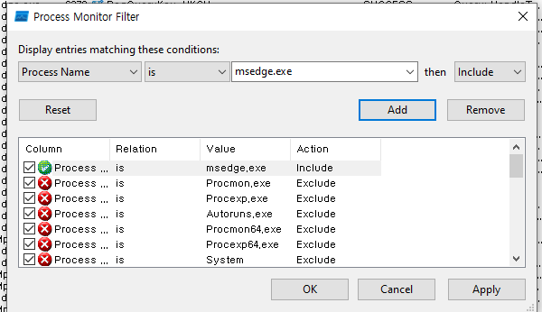
_Apply → OK로 필터 적용_

프로세스 이름이 msedge.exe인 이벤트만 필터링

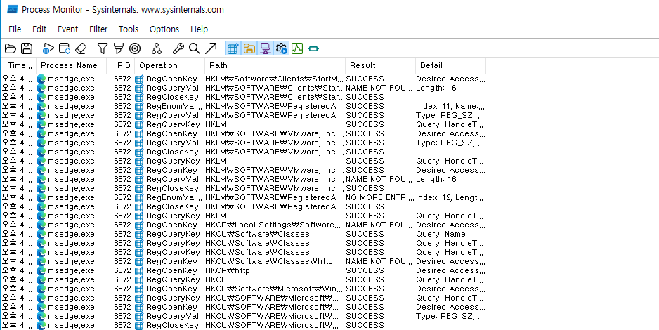
_msedge.exe 이벤트만 표시된 결과_

**필터링 결과**

- `Process Name is msedge.exe → Include` 조건을 적용하여 **Microsoft Edge 프로세스에서 발생한 이벤트만 표시**
- 필터링 결과, `msedge.exe`가 레지스트리 키를 열거나(`RegOpenKey`), 설정값을 조회하는(`RegQueryValue`) 등의 활동을 수행한 것을 확인

→  특정 프로세스의 시스템 활동만 선별하여 분석할 수 있음.

### 1-2. Process Explorer

#### 1-2-1. 개념.

- Windows에서 실행 중인 **프로세스의 상세 정보**와 **부모/자식 프로세스 관계**를 확인하는 분석 도구
- 악성코드가 어떤 프로세스로 실행되었는지, 추가로 어떤 프로세스를 생성했는지 조사하는 데 활용

#### 1-2-2. 주요 기능

1. 프로세스 트리
   1. 부모/자식 프로세스 관계 확인
2. 프로세스 상세 정보
   1. PID, 실행 경로, 명령줄, 사용자 계정
3. DLL 및 Handle 확인
   1. 프로세스가 로드한 DLL과 사용 중인 시스템 자원
4. 프로세스 자원 모니터링
   1. CPU, 메모리 사용량
5. VirusTotal 연동
   1. 실행 파일의 해시 기반 보안 엔진 탐지 결과

#### 1-2-3. 실습

실행 화면

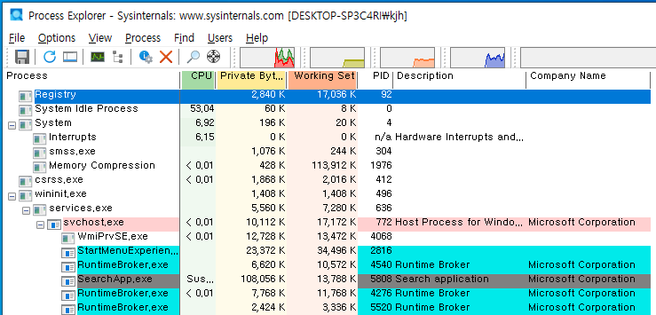
_Process Explorer 실행 화면_

- 주요 항목
  - 프로세스: 실행 중인 프로세스 이름과 부모, 자식 관계
  - CPU: 해당 프로세스의 CPU 사용률
  - Private Bytes: 프로세스가 독점적으로 사용하는 커밋 메모리 크기
  - Working Set: 프로세스가 현재 물리 메모리(RAM)에 올려 사용하는 메모리 크기
  - Description: 프로그램에 대한 설명
  - Company Name: 실행 파일의 제작사 정보
- 참고
  - System Idle Process: CPU 53% → CPU가 약 53%의 시간 동안 아무 작업도 하지 않는 유휴 상태
  - `System Idle Process`는 실제 작업에 CPU를 소비하는 일반적인 프로세스가 아니라, CPU가 사용되지 않는 시간을 나타내는 특수한 항목

**프로세스 상세 정보 확인 (실습)**

1. 메모장 실행 후 notepad.exe 프로세스 확인

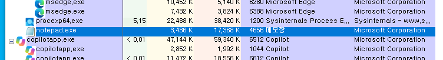
_프로세스 트리에서 notepad.exe 확인_

2. Properties → Image 탭

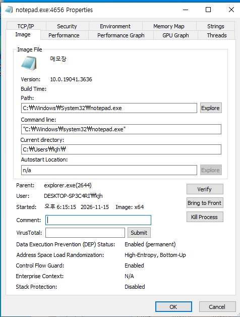
_notepad.exe Properties의 Image 탭_

- Path: 실행 파일이 저장된 위치
- Command Line: 프로세스 실행 시 사용한 명령어
- Parent: 해당 프로세스를 생성한 부모 프로세스

등을 확인할 수 있었음.

**프로세스 DLL, Handle 확인**

> - DLL(Dynamic Link Library): 프로그램이 실행 중 필요한 기능을 사용하기 위해 메모리에 로드하는 라이브러리 파일
> - Handle: 프로세스가 파일, 레지스트리 키 등 운영체제 자원에 접근할 때 사용하는 식별값
{: .prompt-info }

DLL

notepad.exe 선택 → View → Show Lower Pane → DLL

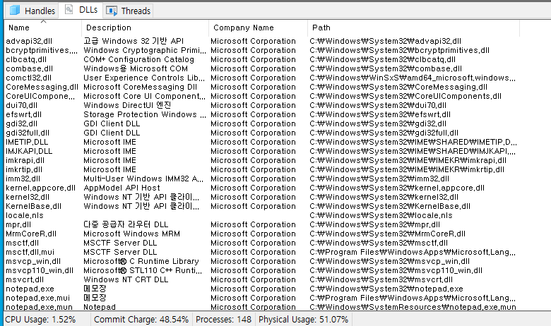
_하단 패널에 표시된 notepad.exe의 DLL 목록_

하단에 해당 프로세스가 로드한 DLL 목록 표시됌

Handle

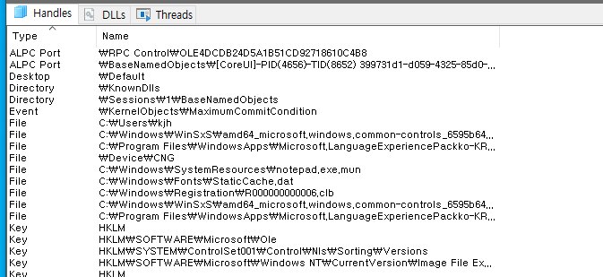
_하단 패널에 표시된 notepad.exe의 Handle 목록_

해당 프로세스가 열어 둔 파일, 레지스트리 키 등의 자원을 확인할 수 있음.

### 1-3. Wireshark

#### 1-3-1. 개념

- 네트워크에서 송수신되는 **패킷을 캡쳐하고 통신 내용을 분석**하는 도구
- 악성코드가 외부 서버와 통신하는지, 어떤 IP/도메인/프로토콜을 사용하는지 조사하는 데 활용

#### 1-3-2. 주요 기능

- 패킷 캡쳐: 네트워크에서 송수신되는 **패킷을 실시간으로 수집**하고 기록
- 프로토콜 분석: 수집한 패킷을 TCP, UDP, DNS, HTTP 등 프로토콜별로 구분하고 내용 분석
  - 어떤 프로토콜을 이용해 통신했는지 확인
- 패킷 필터링: 수집 패킷 중 특정 IP주소, 포트, 프로토콜 등의 조건에 해당하는 패킷만 선별하는 기능
- 패킷 상세 분석 (Packet Inspection): 개별 패킷의 출발지/목적지/ip, 포트, 프로토콜 정보 및 데이터 등을 확인하는 기능
- 통신 흐름 분석(Follow Stream): 특정 TCP,UDP 등의 통신에 속한 패킷을 하나의 흐름으로 연결하여 확인하는 기능

#### 1-3-3. 실습

**실습 1. 패킷 캡처**

첫 시작 화면

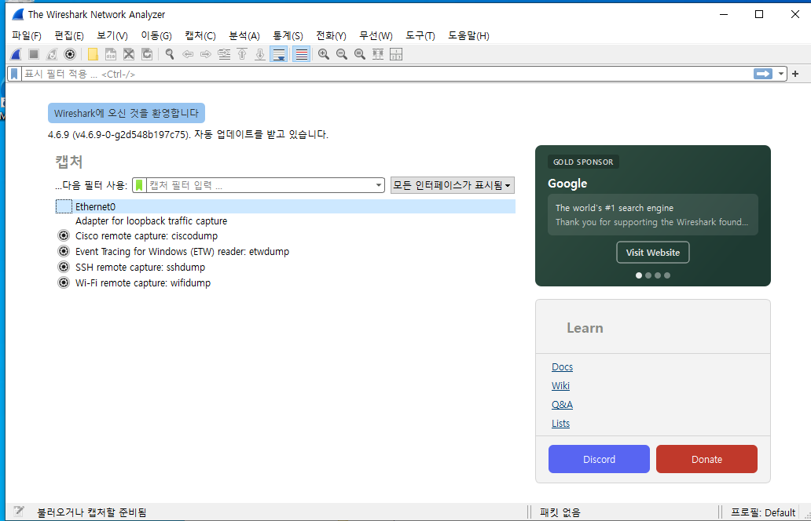
_Wireshark 첫 시작 화면 — 캡처할 인터페이스 목록_

- `Adapter for loopback traffic capture`

  - 해당 인터페이스는 컴퓨터가 자기 자신과 통신할 때  발생하는 패킷을 캡쳐하는 데 사용
    - 루프백 통신: 내 컴퓨터 ↔ 내 컴퓨터
- `Ethernet0`

  - VM과 외부 네트워크 사이의 송수신 패킷 캡처 (일반적으로 사용)

패킷 캡처 시작

1. `Adapter for loopback traffic capture`를 더블클릭합니다.
2. 패킷 캡처가 시작되면 그대로 유지합니다.
3. Windows CMD를 열어 다음 명령어를 실행합니다.

```powershell
ping 127.0.0.1 -n 4
```

- `127.0.0.1`은 자기 자신의 컴퓨터를 가리키는 루프백 주소
- 이 명령어는 자기 자신에게 ICMP Echo Request를 네 번 보내고 응답을 확인

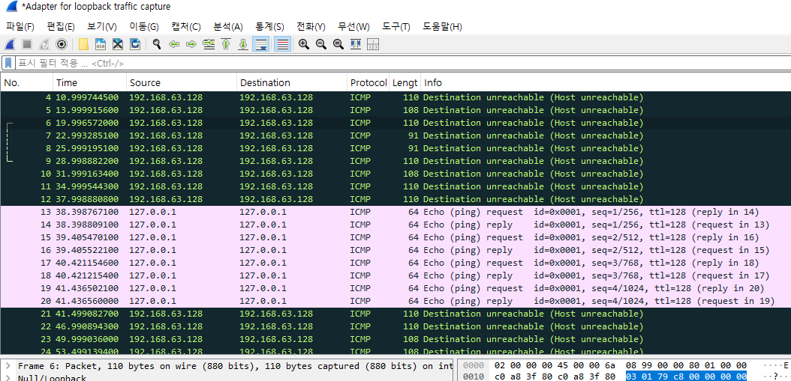
_루프백 인터페이스에서 캡처한 ICMP Echo Request/Reply_

ICMP 요청(Echo Request)과 응답(Echo Reply)패킷을 확인할 수 있었음.

- Source -  출발지 IP
- Destination - 목적지 IP
- Protocol - ICMP
  - ICMP(Internet Control Message Protocol): 네트워크 통신 상태를 확인하거나 통신 중 발생한 오류를 알리는 프로토콜
- Info - Echo Request / Echo Reply

**실습2. 패킷 상세 분석 실습**

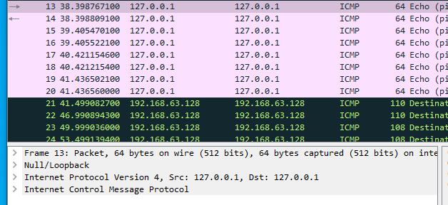
_선택한 패킷의 상세 정보 — Frame, IPv4, ICMP_

Frame - 패킷 번호, 크기, 캡쳐 시각 확인 가능

Internet Protocol Version 4 - 출발지 목적지 ip, TTL 확인 가능

Internet Control Message Protocol - ICMP 메세지 유형, 식별자, 시퀀스 번호 확인 가능

1. IPv4 헤더 분석

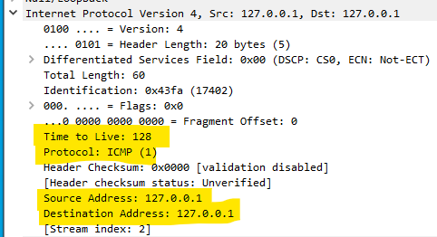
_IPv4 헤더 상세 — 출발지/목적지 주소, TTL, Protocol_

- Source Address: `127.0.0.1` — 패킷 출발지
- Destination Address: `127.0.0.1` — 패킷 목적지
- Time to Live(TTL): 패킷이 라우터를 거칠 수 있는 최대 홉 수를 제한하는 값
- Protocol: `ICMP (1)` — IPv4 패킷에 담긴 상위 프로토콜

확인 가능

2. ICMP 메세지 분석

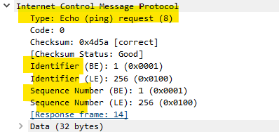
_ICMP 메시지 상세 — Type, Code, Identifier, Sequence Number_

| 항목 | 의미 | 예시 |
| --- | --- | --- |
| Type | ICMP 메시지의 종류를 구분 | `8`: Echo Request, `0`: Echo Reply |
| Code | Type에 따른 세부 유형을 구분 | Echo Request/Reply는 `0` |
| Identifier | 같은 Ping 요청·응답을 식별하는 값 | 요청과 응답에서 동일 |
| Sequence Number | 각 Ping 요청의 순서를 구분하는 번호 | 1번 요청 → 1번 응답 |

> 핵심: `Type`으로 요청인지 응답인지 확인하고, `Identifier`와 `Sequence Number`로 어떤 요청에 대한 응답인지 확인합니다.
{: .prompt-tip }

- Identifier: Ping 통신 식별하는 값
  - 현재 값: `1 (0x0001)`
  - 동일한 Ping 요청과 응답을 대응시키는 식별값입니다.
  - 해당 Echo Reply에도 같은 Identifier가 포함됩니다.
- Sequence Number (순서 번호)
  - 현재 값: `1 (0x0001)`
  - 동일한 Identifier를 사용하는 Ping 요청 중 몇 번째 요청인지 구분하는 값입니다.
  - 일반적으로 Ping을 반복하면 1, 2, 3, 4처럼 증가합니다.

### 1-4. Autoruns

#### 1-4-1. 개념

- Windows에서 **부팅하거나 사용자가 로그인할 때 자동으로 실행되도록 등록된 프로그램과 설정을 확인**하는 도구
- 악성코드가 시스템 재부팅 후에도 계속 실행되도록 등록한 흔적을 조사하는 데 활용

#### 1-4-2. 주요 기능

1. 자동 실행 항목 분석
   1. Windows에 등록된 자동 실행 프로그램 및 관련 설정을 확인하는 기능
2. 자동 실행 유형별 분석
   1. 로그인 프로그램, 예약 작업, 서비스 등 자동 실행 항목을 유형별로 구분하여 확인하는 기능
3. 실행 파일 정보 확인
   1. 자동 실행 항목의 **파일 경로, 게시자, 디지털 서명** 등을 확인
4. 항목 필터링 - 정상적인 Windows 기본 프로그램을 목록에서 숨기고, 분석이 필요한 자동 실행 항목을 쉽게 찾는 기능
5. 자동 실행 항목 관리
   1. 자동 실행 항목 비활성화하거나 삭제하는 기능

> **실무 핵심**: 악성코드가 Windows 시작 시 자동 실행되도록 설정하여 지속성(Persistence)을 확보했는지 조사할 때 사용
{: .prompt-info }

#### 1-4-3. 실습

첫 실행 화면

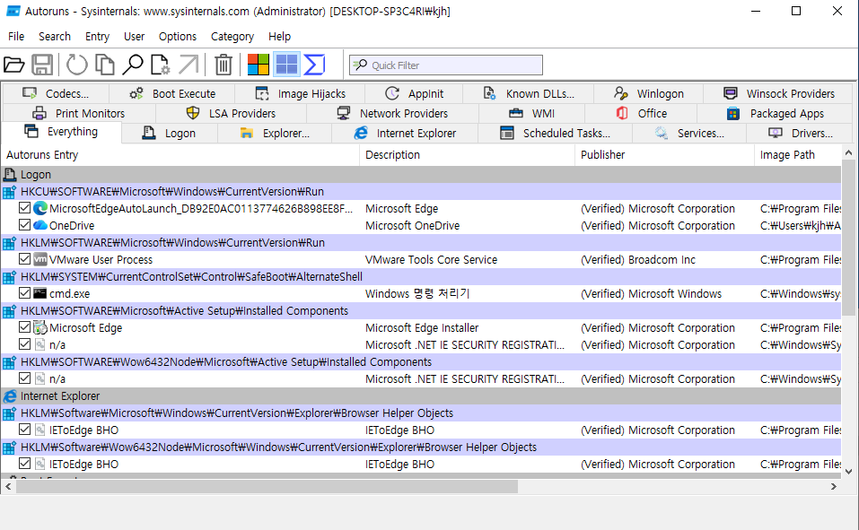
_Autoruns 첫 실행 화면_

| 탭 | 확인 대상 |
| --- | --- |
| Everything | 전체 자동 실행 항목 |
| Logon | 사용자 로그인 시 실행되는 프로그램 |
| Scheduled Tasks | 예약된 작업을 통한 자동 실행 |
| Services | Windows 서비스의 자동 실행 설정 |

- Scheduled Tasks: Windows가 미리 설정된 조건에 따라 특정 프로그램이나 명령어를 자동으로 실행
  - 시간 기반: 매일 오전 9시에 특정 프로그램 실행
  - 이벤트 기반: 사용자가 로그인하거나 컴퓨터가 부팅될 때 프로그램 실행

**화면에 표시된 항목**

- Autoruns Entry: 자동 실행 항목의 이름 및 등록 위치가 계층적으로 표시됌
- Description: 해당 프로그램에 대한 설명
- Publisher: 파일의 게시자 및 디지털 서명 검증 정보
- Image Path: 자동 실행되는 프로그램의 파일 경로
- 체크 박스: 해당 자동 실행 항목의 활성화 여부

**실제 화면에 표시된 자동 실행 항목**

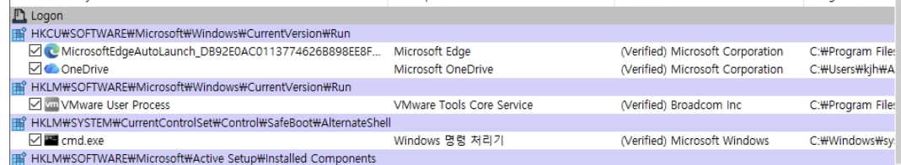
_로그인 시 자동 실행되도록 등록된 항목_

`MicrosoftEdgeAutoLaunch_...`  → Microsoft Edge의 로그인 시 자동 실행 관련 항목

`OneDrive` → 로그인 시 OneDrive를 실행하도록 등록된 항목

`VMware User Process` → VMware Tools 관련 자동 실행 항목

Windows 로그인 시 자동 실행되도록 등록된 프로그램과 해당 등록 위치를 확인할 수 있음.

### 1-5 CurrPorts

#### 1-5-1. 개념

- Windows에서 실행 중인 **프로세스가 사용하는 TCP·UDP 포트와 네트워크 연결 상태를 확인**하는 도구
- 악성코드가 외부 서버와 통신하는지, 어떤 프로세스가 특정 포트를 사용하는지 조사하는 데 활용

핵심: **프로세스별 연결,포트 확인**

#### 1-5-2. 주요 기능

1. 네트워크 연결 및 포트 확인
   1. 현재 사용 중인 TCP, UDP 포트와 연결 상태를 확인 가능
2. **프로세스별 네트워크 활동** 확인
   1. 네트워크 연결을 사용하는 프로세스의 이름, PID, 실행 파일 경로 등을 확인하는 기능
3. 네트워크 연결 정보 분석
   1. 로컬 IP·포트, 원격 IP·포트, TCP 연결 상태(`LISTENING`, `ESTABLISHED` 등)를 확인
4. 연결 필터링 및 관리
   1. 특정 프로세스, IP 포트에 해당하는 연결만 선별하거나 불필요한 TCP 연결을 종료

#### 1-5-3. 실습

실행 화면

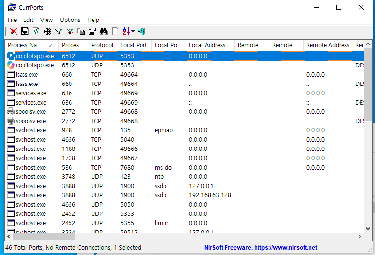
_CurrPorts 실행 화면_

- **화면의 주요 항목**

| 항목 | 의미 |
| --- | --- |
| Process Name | 포트를 사용하는 프로세스 이름 |
| Process ID | 해당 프로세스의 PID |
| Protocol | TCP 또는 UDP |
| Local Port | 현재 컴퓨터에서 사용하는 포트 번호 |
| Local Address | 현재 컴퓨터의 통신 IP 주소 |
| Remote Port | 상대방 컴퓨터의 포트 번호 |
| Remote Address | 상대방 컴퓨터의 IP 주소 |
| State | TCP 연결 상태 (LISTENING, ESTABLISHED 등) |

**실제 화면에 표시된 프로세스 일부**

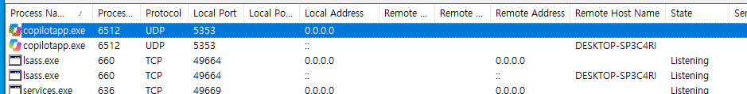
_copilotapp.exe의 UDP 5353 포트 사용_

| 프로세스 | PID | 프로토콜 | 로컬 포트 | 의미 |
| --- | --- | --- | --- | --- |
| `copilotapp.exe` | 6512 | UDP | 5353 | Copilot 관련 프로세스의 UDP 포트 사용 |

> **참고: 네트워크 연결 상태**
>
> | 상태 | 의미 |
> | --- | --- |
> | `LISTENING` | 외부 연결 요청을 기다리는 상태 |
> | `ESTABLISHED` | 상대방과 TCP 연결이 설정된 상태 |
> | `TIME_WAIT` | 연결 종료 후 일정 시간 대기하는 상태 |
{: .prompt-info }

### 1-6. SmartSniff

#### 1-6-1. 개념

- SmartSniff는 **네트워크 인터페이스에서 송수신되는 TCP/IP 패킷을 캡쳐하고 통신 내용을 확인**하는 네트워크 분석 도구
- 악성코드가 외부 서버와 통신하는지, 어떤 데이터를 주고받는지 조사하는 데 활용

> **Wireshark와의 차이**: Wireshark는 다양한 프로토콜의 개별 패킷을 상세하게 분석하는 데 강점이 있고, SmartSniff는 클라이언트와 서버 사이의 TCP 통신 내용을 하나의 흐름으로 확인하는 데 강점이 있습니다.
{: .prompt-info }

#### 1-6-2. 주요 기능

1. 네트워크 패킷 캡쳐 - 네트워크 인터페이스에서 발생하는 TCP/IP 패킷 수집
2. TCP 통신 흐름 분석 - 수집한 패킷을 클라이언트와 서버 간의 통신 단위(하나의 연속된 대화 단위)로 묶어 확인하는 기능
3. 통신 데이터 확인 - 캡쳐된 통신 내용을 ASCII(문자) 또는 HEX(16진수) 형태로 확인하는 기능
4. 패킷 필터링 - 특정 IP 주소, 포트, 프로토콜 등 조건으로 패킷 선별
5. 캡쳐 데이터 저장 - 수집한 패킷 및 통신 내용 파일로 저장 (추후 분석 가능)

#### 1-6-3. 실습

**실습목표**

- 첫 실행  - 캡쳐 인터페이스와 기본 화면
- 패킷 캡쳐 - 네트워크 패킷 수집
- 통신 내용 분석 - TCP 연결 및 송수신 데이터 확인

1. SmartSniff 실행

다운로드>smsniff 실행>File→Start Capture

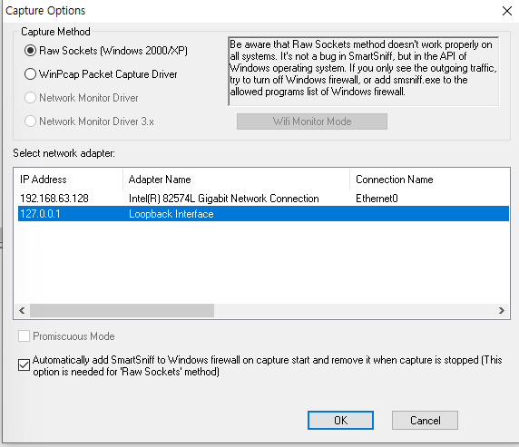
_SmartSniff의 패킷 캡쳐 방식과 네트워크 인터페이스를 선택하는 설정 창_

(SmartSniff의 패킷 캡쳐 방식과 네트워크 인터페이스를 선택하는 설정 창)

- Capture Method (패킷 캡처 방식)
  - Raw Sockets - Windows 자체 기능으로 패킷 캡쳐. 일부 제한 존재
  - WinPcap Packet Capture Driver - 패킷 캡쳐 드라이버를 사용하는 방식. Npcap과 호환
  - Network Monitor Driver - 오래된 MS 캡처 드라이버 방식

  권장: `WinPcap Packet Capture Driver` (SmartSniff 공식 문서 권장)

  - 앞서 Wireshark 설치 시 Npcap을 설치했다면 이를 활용 가능하다고 함
- Select network adapter (네트워크 인터페이스)
  - `192.168.63.128 / Ethernet0` - VMware의 일반 인터페이스
  - `127.0.0.1 / Loopback Interface`  - VM 내부 자기자신과 통신

~~WinPcap Packet Capture Driver, Adapter for loopback traffic capture 선택 > OK~~

위 방식으로 원하는 결과를 얻지 못해 Raw Sockets 방식으로 변경

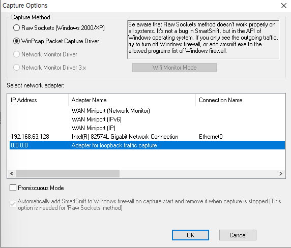
_Raw Sockets 방식으로 변경한 캡처 옵션_

누르면 아래와 같은 화면이 나옴

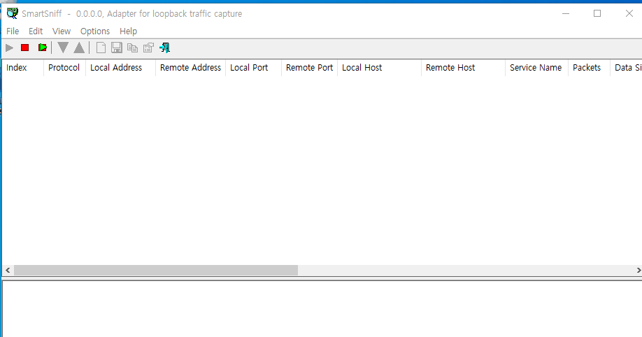
_캡처를 시작했지만 아직 TCP 통신이 없는 화면_

- 캡쳐된 TCP 통신이 없어 현재 비어있음
- 이제 가상환경 내부에서 TCP 연결을 시도해서 테스트 진행

Powershell에 다음 명령어 입력

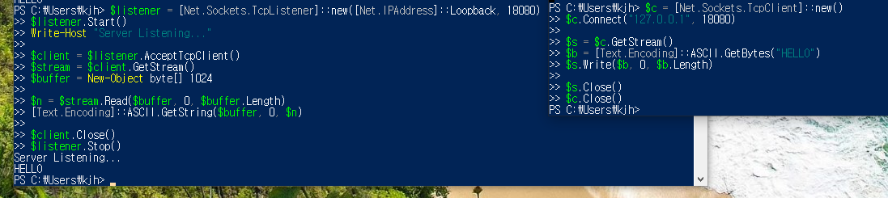
_PowerShell로 VM 내부에 TCP 서버/클라이언트를 만들어 HELLO 송수신_

PowerShell 이용하여 VM내부에 TCP 서버와 클라이언트 생성하고, `HELLO`문자열을 송수신해보았음.

SmartSniff 결과 확인

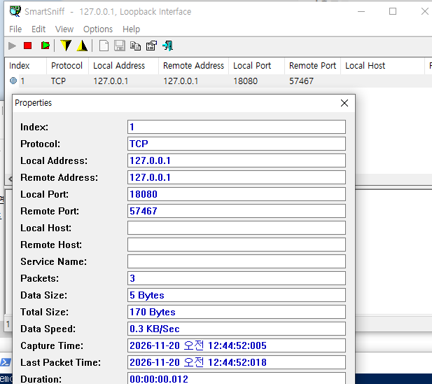
_SmartSniff에 캡처된 루프백 TCP 통신_

**SmartSniff TCP 통신 실습 분석 결과**

- Protocol: TCP 프로토콜 사용
- Local Address / Remote Address: 127.0.0.1 - VM 내부 루프백 통신
- Local Port: 18080 - TCP 서버 포트
- Remote Port: 57467 - 클라이언트 임시 포트
- Packets: 3개 패킷 캡쳐
- Data Size: 5 bytes - 전송된 HELLO 문자열의 데이터 크기
  - 캡쳐된 통신의 실제 데이터(payload) 크기를 나타냄
- Total Size: 170 Bytes - 캡쳐된 패킷의 전체 크기
  - 데이터와 프로토콜 헤더 등을 포함한 캡처 패킷들의 전체 크기를 나타냄

→ TCP 통신에 사용된 IP 주소와 포트, 패킷 수 및 송수신 데이터 크기 확인할 수 있었음.

- 또한 통신 데이터는 ASCII 또는 Hex 형태로 확인할 수 있다고 함.
  - 현재 상태에서는 표시되지 않았으며 추후 원인 분석을 해야할 듯 합니다.

> **참고: 개별 패킷에 대한 확인은 SmartSniff보다 Wireshark가 적합함**
>
> - Wireshark: 개별 패킷의 헤더와 프로토콜 정보를 상세하게 분석하는 데 적합
> - SmartSniff: 동일한 TCP 통신에 속한 패킷들을 하나의 통신 흐름으로 묶어 송수신 데이터를 확인하는 데 적합
{: .prompt-info }

### 1-7. System Explorer

#### 1-7-1. 개념

- Windows에서 **실행 중인 프로세스, 시스템 자원 사용량, 네트워크 연결 등의 정보를 확인**하는 시스템 모니터링 도구
- 악성코드 분석 시 의심스러운 프로세스의 실행 상태와 관련 시스템 활동을 조사하는 데 활용

#### 1-7-2. 주요 기능

1. 프로세스 모니터링 - 실행 중인 프로세스의 이름, PID, CPU/메모리 사용량 및 부모 자식 관계 확인
2. 프로세스 상세 정보 분석 - 프로세스의 실행 파일 경로, 관련 모듈 등의 정보 확인
3. 네트워크 연결 확인 - 실행 중인 프로세스의 TCP/UDP 연결 정보와 통신 대상 확인
4. 시스템 자원 모니터링 - CPU, 메모리 등 시스템 자원 사용 현황 확인

> **Process Explorer와의 차이**: 두 도구 모두 프로세스를 분석하지만, System Explorer는 프로세스·네트워크·시스템 성능 등을 통합적으로 확인하는 데 집중합니다.
{: .prompt-info }

#### 1-7.3 실습

**1. 첫 실행 화면**

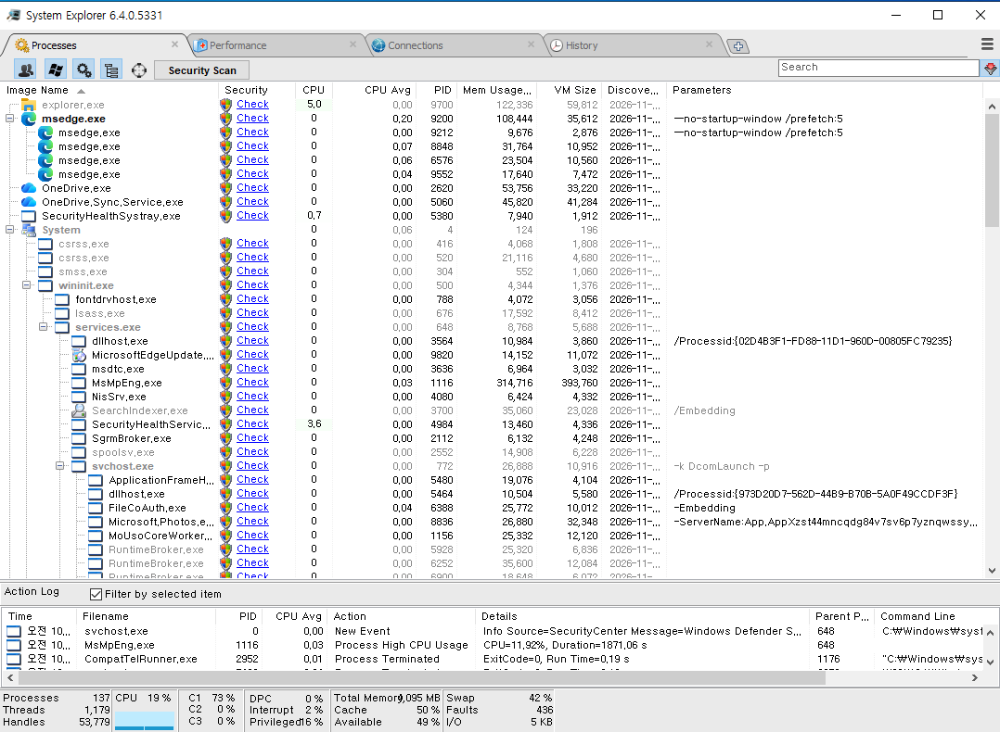
_System Explorer 첫 실행 화면_

**주요 항목**

- Image Name - 실행 중인 프로세스 이름 및 트리 구조
- Security - 프로세스의 보안 검사 기능
- CPU - 현재 CPU 사용률
- Mem Usage - 프로세스 메모리 사용량
- VM Size - 가상 메모리 크기
- Parameters - 프로세스 실행 시 전달된 명령줄 인수

**실제 화면에 표시된 프로세스**

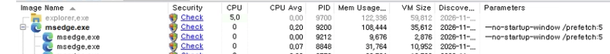
_explorer.exe와 msedge.exe 프로세스 트리_

- `explorer.exe` (PID 9700): Windows 파일 탐색기 및 바탕화면 관련 프로세스
- `msedge.exe` (PID 9200): Microsoft Edge 브라우저 프로세스
  - 아래에 표시된 여러 `msedge.exe`는 하위 프로세스

**하단 Action Log - System Explorer가 감지한 프로세스의 주요 활동 및 상태 변화를 기록하여 보여주는 영역**

- 기록 대상: 프로세스 시작/종료, CPU 사용률 증가 등 프로그램의 주요 활동
- 확인 정보: 발생 시각(Time), 프로세스 이름, PID, 활동 유형(Action), 상세 내용(Details)
- 보안 활용: 의심스러운 프로세스의 실행/종료 이력이나 비정상적인 자원 사용 흔적 조사할 수 있음

**실제 표시된 Action Log**

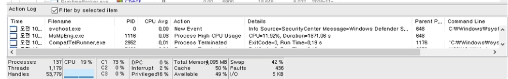
_Action Log — Process High CPU Usage, Process Terminated_

- Process High CPU Usage - 프로세스의 CPU 사용률이 높았다는 기록
- Process Terminated - 프로세스가 종료되었다는 기록

**2. 프로세스 상세 정보 확인**

`explorer.exe` 더블클릭 > 상세정보 창

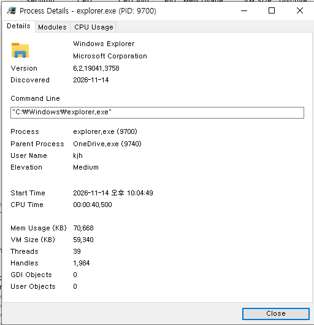
_explorer.exe 상세정보 창_

- 실행 파일 경로, PID, 부모 프로세스 등의 정보를 확인할 수 있음

## 2. 정적 분석 도구

### 2-1. Strings

#### 2-1-1. 개념

- Strings는 실행 파일(EXE), DLL 등 파일 내부에 포함된 **문자열을 추출하여 확인하는 정적 분석 도구**
- 악성코드를 실행하지 않고 파일에 포함된 **IP 주소, URL, 파일 경로, 명령어 등의 문자열을 확인**하여 악성 행위의 단서를 찾는 데 활용

#### 2-1-2. 주요 기능

1. 문자열 추출
   1. 파일 내부에서 ASCII 및 Unicode 문자열을 추출
2. 최소 문자열 길이 설정
   1. 지정한 글자 수 이상의 문자열만 추출하는 기능 (`-n` 옵션)
3. 문자열 검색
   1. 추출된 문자열에서 IP 주소, URL, 파일 경로 등 분석에 필요한 정보를 검색

#### 2-1-3. 실습 : 정상 실행 파일의 문자열 추출

아래 코드 실행

```powershell
strings64.exe -n 5 C:\Windows\System32\notepad.exe
```

- `strings64.exe`: Strings 실행
- `-n 5`: 최소 5글자 이상의 문자열 추출
- `notepad.exe` : 분석 대상 파일

결과

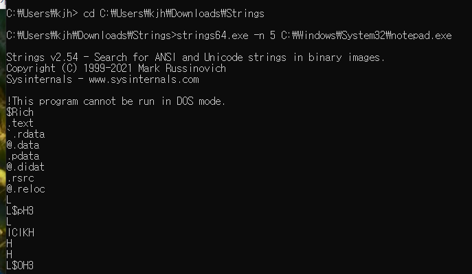
_notepad.exe에서 추출한 5글자 이상의 문자열_

- .text - 프로그램의 실행 코드가 저장되는 섹션 이름
- .data - 초기화된 데이터가 저장되는 섹션 이름
- .rdata - 읽기 전용 데이터가 저장되는 섹션 이름
- .rsrc - 아이콘 등 리소스가 저장되는 섹션 이름

> - 참고: 만약 추출된 문자열이 `192.0.2.10` 라면 통신 대상 ip주소인가를 의심할 수 있음
{: .prompt-info }

Strings를 사용하여 `notepad.exe` 파일에서 5글자 이상의 문자열을 추출했다. 실행 파일의 섹션 이름과 내부 문자열을 확인하였으며, 프로그램을 실행하지 않고 파일에 포함된 정보를 분석할 수 있음을 확인하였다.

### 2-2. BinText

#### 2-2-1. 개념

- BinText는 **EXE, DLL 등 바이너리 파일 내부에 포함된 문자열을 추출하여 확인**하는 정적 분석 도구
- 악성코드를 실행하지 않고 파일에 포함된 URL, IP 주소, 파일 경로, 명령어 등의 문자열을 확인하여 분석 단서를 찾는 데 활용

#### 2-2-2. 주요 기능

1. 문자열 추출 - 파일 내부에 포함된 ASCII, Unicode 등의 문자열 추출
2. 문자열 검색 - 추출된 문자열 중 특정 키워드 포함된 항목 검색
3. 문자열 위치 확인 - 추출된 문자열이 파일 내부의 어느 위치(offset)에 존재하는지 확인
4. 분석 결과 저장

**Strings와의 차이**

| 구분 | Strings | BinText |
| --- | --- | --- |
| 실행 방식 | 명령줄(CLI) | 그래픽 인터페이스(GUI) |
| 핵심 기능 | 문자열 추출 | 문자열 추출 |
| 주요 장점 | 명령어 기반 분석·자동화 | 문자열 목록을 화면에서 쉽게 확인 |
| 실무 중요도 | 높음 | 보조 |

#### 2-2-3. BinText 실습

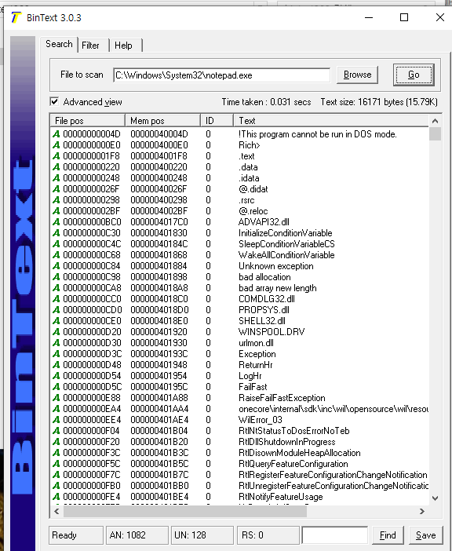
_BinText로 notepad.exe 문자열 추출_

**결과 분석**

`.text` , `.data` , `.rsrc` - PE 파일의 섹션 이름

`ADVAPI32.dll` - Windows의 보안/레지스트리 등 관련 기능을 제공하는 DLL

`SHELL32/dll` - Windows 셸 관련 기능을 제공하는 DLL

`InitializeConditionVariable`  - 스레드 동기화 관련 Windows API 함수

**주요 정보**

- File pos: 문자열이 파일 내부에서 시작되는 위치(Offset)
- Mem pos: 파일이 메모리에 배치되는 구조를 기준으로 표시한 위치 정보
- Text: 추출된 문자열
- AN: 1082: ANSI 문자열 1,082개
  - ANSI는 Windows에서 전통적으로 사용해 온 문자 인코딩 방식
- UN: 128: Unicode 문자열 128개
- RS: 0: 리소스 문자열 추출 결과 0개

**결과 정리**

BinText를 이용해 `notepad.exe` 내부의 문자열을 추출하였다.

PE 섹션 이름, DLL 이름, Windows API 함수 등의 문자열을 확인하였으며, 추출된 문자열의 파일 내 위치와 문자열 유형별 개수도 확인할 수 있었다.

→ Strings와 동일하게 파일 실행 없이 문자열을 분석할 수 있으며, BinText는 GUI에서 결과를 확인하고 검색할 수 있다는 장점이 있다.

### 2-3. Exeinfo PE

#### 2-3-1. 개념

- EXE, DLL 등의 실행 파일을 분석하여 **패커(Packer), 컴파일러(Compiler) 등을 식별**하는 정적 분석 도구
- 악성코드의 패킹 여부를 확인하고, 파일이 분석 난이도와 추가 분석 필요성 판단하는 데 활용
  - 패킹: 실행 파일을 압축하거나 변형하여 원래 코드와 구조 알기 어렵게 만드는 기술

#### 2-3-2. 주요 기능

1. **패커 식별** - 실행 파일에 사용된 패커의 종류를 탐지
2. **컴파일러 식별** - 실행 파일을 제작하는 데 사용된 컴파일러를 추정
3. 실행 파일 정보 확인 - PE 파일 유형, 아키텍쳐(32/64비트) 등 기본 정보 확인

> 주의: Exeinfo PE의 탐지 결과는 시그니처 기반 추정이므로, 패커가 탐지되지 않았다고 해서 패킹되지 않은 파일이라고 확정할 수는 없습니다.
{: .prompt-warning }

- PE(Portable Executable) 파일: Windows에서 실행 파일과 DLL 등을 저장할 때 사용하는 표준 파일 형식
  - 대표 파일: `.exe`, `.dll`, `.sys`
  - 포함 정보: 실행 코드, 데이터, DLL 참조 정보, 실행에 필요한 구조 정보
  - 보안 분석: PE 구조를 확인하여 파일의 유형, 패킹 여부, 의심스러운 구성 등을 조사

    - 간단히 말하자면 ***Windows에서 사용하는 실행 파일 형식으로, 프로그램 실행에 필요한 코드와 구조 정보를 포함함***

#### 2-3-3. 실습

**파일 열고 `C:\Windows\System32\notepad.exe` 열기**

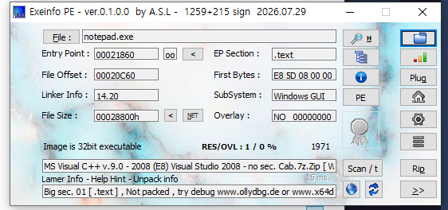
_Exeinfo PE로 notepad.exe 분석_

- 분석 결과 - 핵심은 패킹 여부 확인

| 항목 | 확인된 값 | 의미 |
| --- | --- | --- |
| File | `notepad.exe` | 분석 대상 |
| Architecture | 32bit executable | 32비트 실행 파일 |
| Entry Point | `00021860` | 프로그램 실행 진입점(RVA) |
| EP Section | `.text` | 진입점이 위치한 섹션 |
| SubSystem | Windows GUI | Windows GUI 프로그램 |
| **Compiler** | MS Visual C++ 9.0 (Visual Studio 2008) | 탐지된 컴파일러 정보 |
| **Packer** | Not packed | 패커가 탐지되지 않음 |

- 주의: 컴파일러와 패커 탐지 결과는 시그니처 기반 추정이므로 실제 컴파일러나 패킹 여부 확정 근거로 사용하기에는 한계가 있음.

### 2-4. PEview

#### 2-4-1. 개념

- Windows 실행 파일(EXE, DLL)의 **PE 헤더와 섹션 구조를 확인하는 정적 분석 도구**
- 악성코드를 실행하지 않고 파일의 구조와 특성을 분석하여 비정상적인 구성이나 패킹 의심 흔적을 조사하는 데 활용

#### 2-4-2. 주요 기능

1. PE 헤더 분석 - 실행 파일의 아키텍쳐(32/64비트), 진입점(Entry Point) 등 기본 정보 확인
2. 섹션 구조 분석 -  `.text`, `.data`, `.rsrc` 등 섹션의 이름, 크기, 위치 및 속성 확인
3. Import 정보 분석 - 실행 파일이 참조하는 DLL 및 외부 함수 정보 확인
4. 파일 내부 데이터 확인 - PE 구조에 포함된 데이터를 16진수(Hex) 형태로 확인

#### 2-4-3. 실습

**1. 실행 화면**

File>Open>`C:\Windows\System32\notepad.exe`

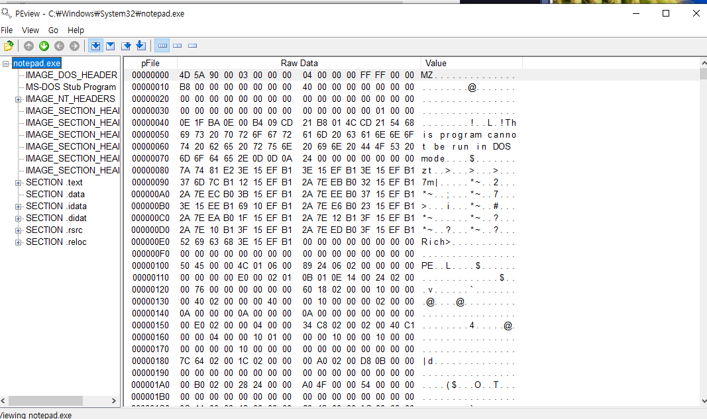
_PEview로 notepad.exe를 연 화면_

- 왼쪽: PE 헤더와 섹션 구조
- 가운데 Raw Data: 파일의 실제 데이터를 16진수로 표시
- 오른쪽 Value: 해당 데이터를 문자 또는 해석된 값으로 표시
- Section: `.text`, `.data`, `.idata`, `.didat`, `.rsrc`, `.reloc` 등 6개 섹션 확인

**2. PE 헤더 분석**

왼쪽의 IMAGE\_NT\_HEADERS 옆 + 클릭 > `IMAGE_FILE_HEADER`

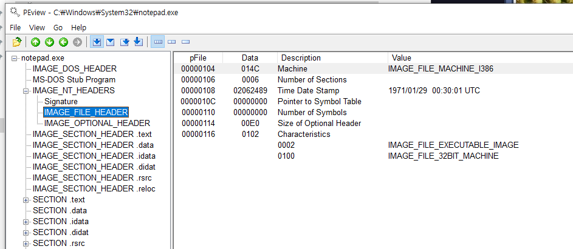
_IMAGE_FILE_HEADER — Machine, Number of Sections, Characteristics_

IMAGE\_FILE\_HEADER 분석 결과

| 항목 | 확인된 값 | 의미 |
| --- | --- | --- |
| Machine | `0x014C` (I386) | x86(32비트) 아키텍처 |
| Number of Sections | `0x0006` | 총 6개 섹션 |
| Characteristics | `0x0102` | 실행 가능한 이미지, 32비트 머신 |

실습 결과: `notepad.exe`가 32비트 x86 실행 파일이며, 6개의 섹션으로 구성되어 있음을 확인

왼쪽 메뉴에서 `IMAGE_OPTIONAL_HEADER` 클릭

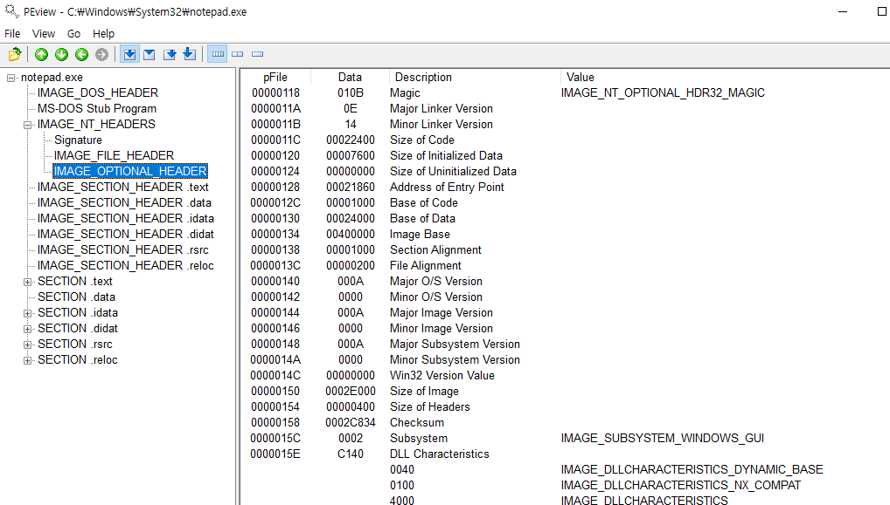
_IMAGE_OPTIONAL_HEADER — Magic, AddressOfEntryPoint, ImageBase 등_

IMAGE\_OPTIONAL\_HEADER 분석 결과

| 항목 | 확인된 값 | 의미 |
| --- | --- | --- |
| Magic | `0x010B` | PE32 형식 (`0x010B`는 PE32 형식에 대한 식별값) |
| AddressOfEntryPoint | `0x00021860` | 프로그램 실행 진입점의 상대 주소(RVA)<br />(프로그램 실행 시작 위치) |
| ImageBase | `0x00400000` | 메모리에 적재될 때 사용하는 선호 기준 주소<br />(프로그램이 적재되기를 원하는 기본 주소) |
| Subsystem | `0x0002` | Windows GUI 프로그램 |
| DLL Characteristics | `0xC140` | ASLR, DEP 등 보안 관련 속성 포함 |

**보안 분석 관점**

- AddressOfEntryPoint: 실행 시작 위치를 파악하여 비정상적인 진입점 여부를 조사하는 데 활용
- ImageBase: 실행 파일의 메모리 주소를 해석할 때 기준으로 사용
- DLL Characteristics: ASLR, DEP 등 실행 파일에 설정된 보안 관련 속성을 확인할 수 있음, 실행 파일이 메모리 공격에 대한 보호 기능을 지원하도록 설정되었는지 파악하는 데 활용 가능
  - ASLR - 메모리 주소 예측 방지 위해 - 프로그램이 적재되는 메모리 주소를 무작위화
  - DEP - 데이터 영역에서 코드 실행 방지 위해 - 실행 권한이 없는 메모리 영역의 코드 실행 차단

왼쪽에서 `IMAGE_SECTION_HEADER .text`를 클릭

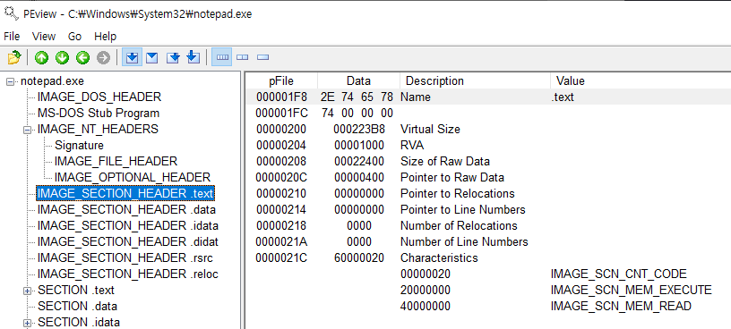
_IMAGE_SECTION_HEADER .text — 크기, 위치, 속성_

IMAGE\_SECTION\_HEADER .text 분석 결과

| 항목 | 확인된 값 | 의미 |
| --- | --- | --- |
| Name | `.text` | 프로그램의 실행 코드가 저장되는 섹션 |
| Virtual Size | `0x223B8` | 메모리에 적재되는 섹션 크기 |
| RVA | `0x1000` | 메모리 내 섹션의 상대 시작 주소 |
| Size of Raw Data | `0x22400` | 파일에서 섹션 데이터가 차지하는 크기 |
| Pointer to Raw Data | `0x400` | 파일 내 섹션 데이터 시작 위치 |
| Characteristics | `0x60000020` | 코드 영역, 실행 및 읽기 허용 |

**보안 분석 관점**

- 실행 권한: `.text` 섹션은 일반적으로 실행 가능한 코드가 저장되는 영역입니다.
- 섹션 권한 확인: 비정상적인 섹션 이름이나 쓰기·실행 권한이 동시에 설정된 경우 추가 분석이 필요할 수 있습니다.

## 3. 실무 분석 주의사항 및 권장 순서

### 3-1. 동적 분석 시 주의사항

1. 분석 대상 필터링 - 분석 툴에는 Windows의 정상적인 시스템 활동도 함께 기록되므로, 분석 대상을 선별해야 한다
2. 정상 활동과 악성 행위 구분
   1. 악성코드 실행 시점에 관찰된 활동이라고 해서 반드시 해당 악성코드가 발생시킨 행위라고 단정할 수 없다.
3. 반복 분석 및 검증
   1. 스냅샷을 활용해 동일한 환경에서 분석을 2\~3회 반복한다
   2. 반복적으로 관찰되는지 확인하여 분석의 신뢰도를 높인다
4. 시간에 따른 행위 변화
   1. 악성코드는 실행 직후와 일정 시간이 경과한 이후의 동작이 다를 수 있으므로 관찰 시점도 고려해야 한다

### 3-2. 악성코드 분석의 권장 순서

예시: 기초분석(Virus Total) → 정적 분석 → 동적 분석

- 기초 분석으로 의심 행위와 분석 방향을 파악하고, 정적 분석으로 관련 단서를 확인한 후 동적 분석으로 실제 행위 발생 여부를 검증한다.

1. 정적분석 진행 시 제일 먼저 확인해야 하는 부분은 Exeinfo 툴을 통해, 현재 악성파일이 패킹되어있는지의 유무를 먼저 파악하는 것 (패킹 시에 언패킹 진행)
2. BinText, Strings 를 통해 내부의 문자열 확인 (주로 BinText 활용)
   1. 문자열 중 IP, URL 주소, 실행파일, 명령어에 대한 사용이력, 가지고 있는 함수 등을 우선순위로 확인 (이를 통해 동적분석의 방향성 결정)
3. 기초분석, 정적분석에서 확인한 내용 바탕으로 동적분석 진행
   1. IP, URL 주소에 대한 문자열 확인 → Wireshark 통해 기존에 확인한 IP, URL이 네트워크적 통신에 관여되었는지 여부 확인
   2. 실행파일, DDL 파일에 대한 문자열 확인 → Process Monitor, Process Explorer, Autoruns 통해 프로세스 쪽에서 동작되는 함수, 실행파일 등을 확인해볼 수 있음.

- 이런식으로 악성코드를 분석함에 있어 순서가 정해진 것은 아니지만, **기초분석을 통해 방향성을 잡고, 정적분석을 통해 동적분석에서 어떤 부분들을 중점적으로 봐야할지 정하고 그 이후 동적분석을 수행하는 방식**으로 대개 흘러간다고 함.

### 3-3. 도구 간 기능 및 활용 방법

#### 3-3-1. 동적 도구 기능

- 동적분석에서는 크게 3가지 영역으로 나눠 분석함

  1. 파일, 레지스트리 - Autoruns, System Explorer
     1. 스냅샷을 통해 악성코드 실행 전후를 비교하여 어떤 부분에 변화가 있는지 파악하기도 함
  2. Process -  Process Monitor, Process Explorer
     1. 악성코드 실행 시 Process Tree 등을 통해서백그라운드에서 돌아가는 프로세스 관련 동작 확인 가능
  3. 네트워크 - Wireshark, Currports (네트워크 상태 분석)
     1. Currports:  현재 네트워크 상태에서, 어떤 프로세스에 의해 네트워크가 연결되어 있는지, 연결을 시도하려 하는지 등의 네트워크 상태 정보 확인 가능
     2. Wireshark: 네트워크 패킷을 확인할 수 있는 대표적인 도구
        1. 기존에 다뤘던 3-way handshaking, 4way handshaking 등 네트워크 기초 정확히 인지해야 어느시점에 통신이 시작되고 마무리되는지 등 악성코드에 대한 정확한 분석이 가능
           1. [TCP 와 UDP 의 특징 및 차이점](https://kjh-independency.github.io/posts/tcp-udp/)

#### 3-3-2. 도구 별 활용 방법

- 정적 분석에서 확인한 문자열이나 파일 구조는 악성 행위의 단서일 뿐, 실제 행위 발생을 의미하지 않는다.
- 동적 분석을 통해 해당 단서와 관련된 행위가 실제로 발생하는지 확인한다.

| 정적 분석에서 확인한 정보 | 동적 분석에서 검증할 사항 | 활용 도구 |
| --- | --- | --- |
| IP 주소·URL 문자열 | 실제 해당 주소와 통신하는가? | Wireshark, CurrPorts |
| 파일 경로 문자열 | 해당 파일을 실제 생성/변경하는가? | Process Monitor |
| 실행 명령어/프로세스 관련 문자열 | 해당 프로세스가 실제 실행되는가? | Process Explorer, Process Monitor |
| 자동 실행 관련 문자열 | 실제 자동 실행 항목을 등록하는가? | Autoruns |

## 4. 요약 정리

1. 동적 분석 도구는 Process Monitor, Process Explorer, Wireshark, Autoruns 등이 있고, 정적 분석 도구는 Strings, BinText, PEview등이 있다.
2. Virus Total을 통한 기초 분석으로 의심 행위와 분석 방향을 파악하고, 정적 분석을 통해 문자열이나 파일 구조를 파악하여 악성 행위의 단서를 파악하고 동적 분석을 통해 단서와 관련된 행위가 실제로 발생하는 지 파악한다. (권장 사항)
3. 정상 활동과 악성 행위를 구분하고 정상 프로세스와 구분 위해 분석 대상을 필터링이 필요하다. 또한 실행 시점이나 환경에 따라 행위가 달라지거나 관찰되지 않을 수 있으므로, 스냅샷을 활용한 반복 분석과 결과 검증이 필요하다.
