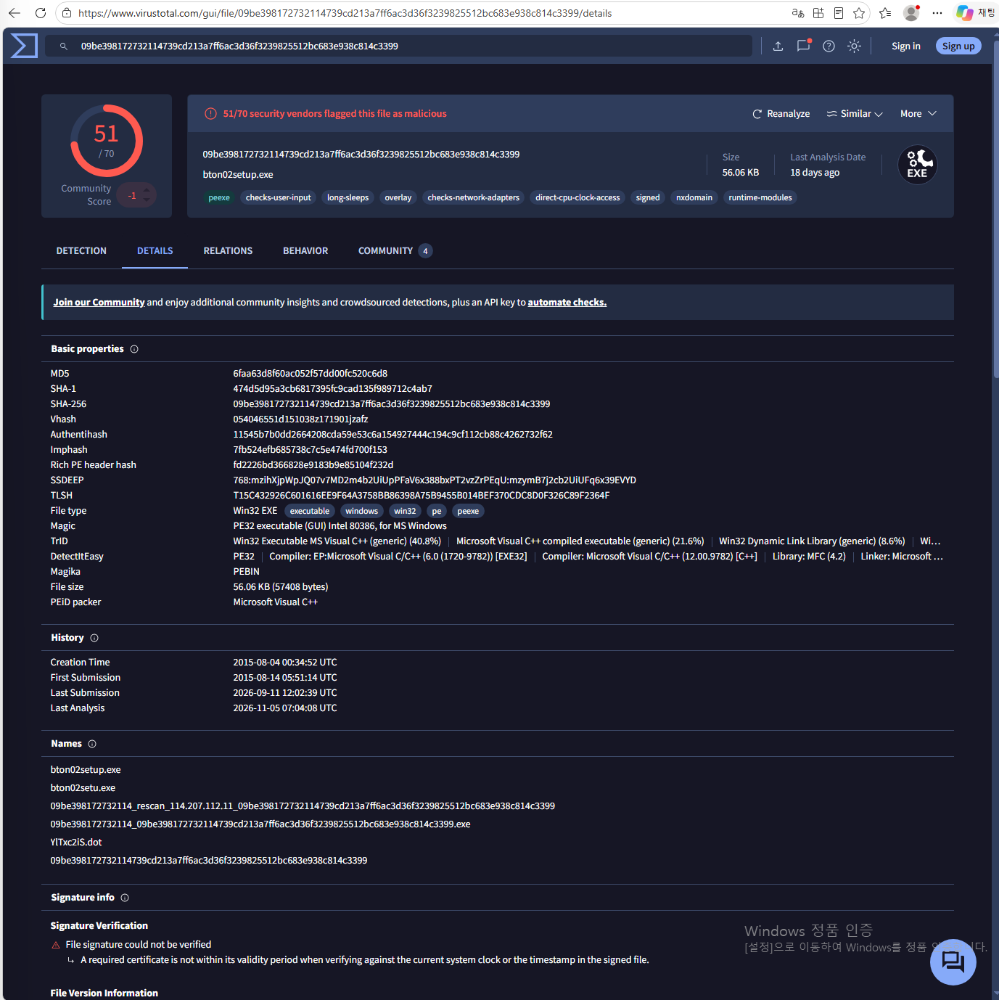
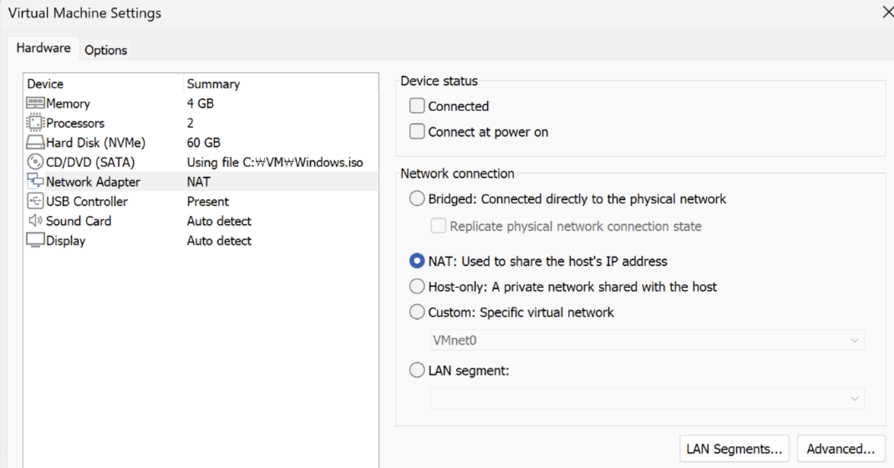
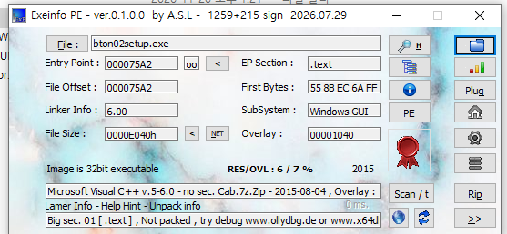
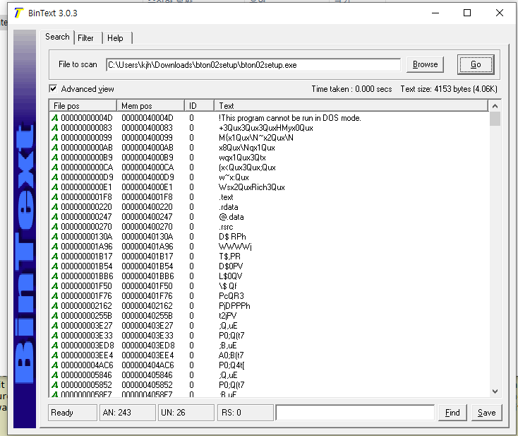
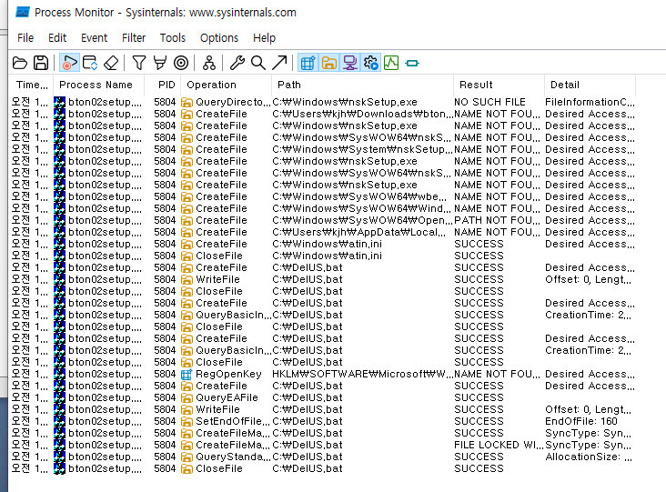

**bton02setup.exe 악성코드 분석 보고서**

분석일: 2026-11-24
분석 절차: 파일 해시 검증 → 분석 환경 준비 → 정적 분석(Exeinfo PE·BinText) → 직접 동적 분석(Process Monitor·Wireshark) → VirusTotal Behavior 교차 검증 → 최종 판단

## 1. 분석 대상 및 파일 동일성

| 항목 | 분석 결과 |
| --- | --- |
| 파일명 | `bton02setup.exe` |
| SHA-256 | `09BE398172732114739CD213A7FF6AC3D36F3239825512BC683E938C814C3399` |
| 해시 동일성 | VMware PowerShell `Get-FileHash` 결과가 VirusTotal 조회 해시와 일치 |
| VirusTotal | 70개 엔진 중 51개가 악성 탐지 |
| 파일 유형 | 32비트 Windows PE 실행 파일 |
| 초기 판단 | 외부 통신·다운로더 관련 단서가 있는 악성 의심 실행 파일 |

### 1-1. 파일 무결성 확인

VMware 내부 PowerShell에서 다음 명령을 실행해 SHA-256을 확인했다.

```powershell
Get-FileHash -Algorithm SHA256 "C:\Users\kjh\Downloads\bton02setup\bton02setup.exe"
```

결과: `09BE398172732114739CD213A7FF6AC3D36F3239825512BC683E938C814C3399` — VirusTotal 조회 파일과 일치.


_그림 1. VirusTotal 탐지 결과 및 분석 대상 식별_

## 2. 분석 환경

### 2-1. VMware 격리 환경 및 실행


_그림 2. VMware 네트워크 연결 해제 설정_

- VMware Windows 10 x64 가상환경, 분석 전 스냅샷으로 복원.
- Network Adapter의 `Connected`, `Connect at power on` 체크 해제(선택된 NAT 모드는 미연결 상태).
- 공유 폴더 비활성화.
- Process Monitor와 Wireshark를 동시에 열어 수집 준비.
- 실행 전 Windows SmartScreen에서 인터넷 연결 없이 앱 안전성을 확인할 수 없다는 경고가 표시됨.
- 샘플 실행 후 원본 파일이 폴더에서 사라지는 현상을 **직접 관찰**함. 삭제 주체 및 실제 삭제 완료 여부는 이 현상만으로 확정하지 않음.

## 3. 정적 분석

### 3-1. Exeinfo PE — 패킹 여부와 파일 구조

| 항목 | 확인 값 |
| --- | --- |
| 파일 형식 | 32bit executable / Windows GUI |
| 컴파일러 추정 | Microsoft Visual C++ v5.6.0 |
| Entry Point | `0x000075A2` |
| EP Section | `.text` |
| Packer | `Not packed` (알려진 패커 미탐지) |
| Overlay | `0x00001040` 표시 |

**판단:** 알려진 패커가 탐지되지 않아 현재 실습에서 별도 언패킹을 진행하지 않았다.


_그림 3. Exeinfo PE 구조 및 패커 탐지 결과_

### 3-2. BinText — 문자열 추출

BinText로 실제 파일의 문자열을 추출하여 저장한 `df.txt` 전체 결과를 검토했다.


_그림 4. BinText 문자열 추출 결과_

| 분류 | 실제 발견된 문자열 | 해석 |
| --- | --- | --- |
| 외부 실행 파일 | `http://a-ton.co.kr/saol/nskSetup.exe`, `nskSetup.exe` | 추가 EXE를 내려받는 기능 가능성 |
| 외부 데이터 | `http://a-ton.co.kr/pcblist.dat` | 외부 데이터 요청 가능성 |
| 설치 로그 | `http://a-ton.co.kr/log/?modeAct=`, `INSTALL`, `&iMAC=`, `&iPID=bton02`, `&iPCB=` | 설치 정보·장치 식별 관련 HTTP 요청 구성 가능성 |
| 프로세스 실행 | `CreateProcessA`, `WinExec` | 별도 프로세스 실행 기능 관련 |
| 파일 조작 | `CreateFileA`, `WriteFile` | 파일 생성 및 쓰기 가능성 |
| 레지스트리 | `RegCreateKeyA`, `RegOpenKeyExA`, `Software\\atreg` | 레지스트리 접근·생성 관련 |
| 삭제 스크립트 | `\\DelUS.bat`, `del "%s"`, `if exist "%s" goto Repeat` | 파일 삭제 또는 반복 삭제 동작 가능성 |
| 설치 파일 | `\\atin.ini` | 설정 파일 관련 단서 |
| 권한 | `level="requireAdministrator"` | 실행 시 관리자 권한을 요청하는 매니페스트 설정 |

**판단:**  `nskSetup.exe`에 대한 URL이 존재하므로 다운로드 관련 의심만 가지고 이후 동적분석에서 참고하여 분석한다.

## 4. VMware 직접 동적 분석

### 4-1. Process Monitor — 직접 확인한 파일 이벤트

Process Monitor의 기본 필터로 정상 수집을 확인한 후, 해당 실행 파일의 프로세스 이름이 `bton02setup...`로 표시되는 이벤트를 확보했다.


_그림 5. Process Monitor — PID 5804의 파일 쓰기 이벤트_

| Process Name | PID | Operation | Path | Result | 해석 |
| --- | --- | --- | --- | --- | --- |
| `bton02setup.exe` | `5804` | `CreateFile` | `C:\Windows\atin.ini` | `SUCCESS` | 해당 경로의 파일 열기/생성 요청 성공 |
| `bton02setup.exe` | `5804` | `WriteFile` | `C:\Windows\atin.ini` | `SUCCESS` | 해당 파일에 실제 쓰기 동작 관찰 |
| `bton02setup.exe` | `5804` | `CreateFile` | `C:\DelUS.bat` | `SUCCESS` | 해당 경로의 파일 열기/생성 요청 성공 |
| `bton02setup.exe` | `5804` | `WriteFile` | `C:\DelUS.bat` | `SUCCESS` | 배치파일에 실제 쓰기 동작 관찰 |
| `bton02setup.exe` | `5804` | `SetEndOfFileInformationFile` | `C:\DelUS.bat` | `SUCCESS` | 파일 끝 위치/크기 설정 동작 관찰 |

> **핵심 검증:** 정적 분석(BinText)에서 발견한 `DelUS.bat`와 `atin.ini`가 실제 실행 중 파일 작업 대상이 되었음을 **Process Monitor로 직접 확인**하였다. `CreateFile`은 기존 파일 열기에도 사용되므로, 그 이벤트만으로 '새 파일 생성'을 단정하지는 않았다. 이어진 `WriteFile`은 파일 쓰기 행위의 직접적인 증거이다.
{: .prompt-tip }

> **관찰 한계:** 현재 제시된 Procmon 화면만으로 `cmd.exe`의 `DelUS.bat` 실행, 원본 EXE의 최종 삭제 이벤트, `nskSetup.exe` 다운로드·실행 여부까지 직접 검증한 것은 아니다. 이 항목은 VirusTotal 샌드박스 증거와 구분한다.
{: .prompt-warning }

### 4-2. Wireshark — 직접 관찰 결과

- Wireshark 4.6.9에서 `Ethernet0` 캡처 시작.
- 표시 필터: `dns || http` (초록색으로 정상 적용).
- 실행 시점의 캡처 화면에서 **일치하는 패킷이 0건**으로 표시됨.
- VMware 네트워크 어댑터가 연결 해제 상태였으므로, **DNS 질의나 HTTP 요청을 직접 관찰하지는 못하였음.**
- VirusTotal Behavior에 기록된 `a-ton.co.kr` DNS 조회 및 HTTP GET 요청은 **외부 샌드박스에서 관찰한 별도 증거**임.

## 5. VirusTotal 샌드박스 동적 분석

> **중요:** 아래 기록은 VirusTotal 샌드박스가 제공한 관찰 결과를 분석한 것입니다.
{: .prompt-info }

### 5-1. 네트워크 통신

VirusTotal의 **HTTP requests** 항목에서 아래 요청이 관찰되었다.

```text
GET http://a-ton.co.kr/log/?modeAct=INSTALL&iMAC=52540027b158&iPID=bton02&iPCB=1
GET http://a-ton.co.kr/log/?modeAct=INSTALL&iMAC=5254005f1abb&iPID=bton02&iPCB=1
GET http://a-ton.co.kr/pcblist.dat
GET http://a-ton.co.kr/log/?modeAct=INSTALL&iMAC=&iPID=bton02&iPCB=1
```

- **확인:** `a-ton.co.kr` DNS 조회, `/log/` 및 `/pcblist.dat`에 대한 HTTP GET 요청.
- **해석:** `iMAC` 값은 MAC 주소 형식으로 보이며, `INSTALL` 문자열은 설치 관련 상태 통신을 시사한다. 다만 전송 목적·서버 응답 내용은 이 목록만으로 확정할 수 없다.
- **미확인:** `/saol/nskSetup.exe`에 대한 실제 HTTP GET, HTTP 응답 성공 여부, 다운로드 후 파일 생성 여부.

> **주의:** Memory Pattern URLs는 메모리에서 문자열 형태로 발견된 값으로, 실제 HTTP 요청 목록과 구별해야 한다. Microsoft·Google 관련 통신과 시스템 프로세스는 샌드박스 배경 활동일 수 있으므로 모두 악성코드가 발생시켰다고 단정하지 않는다.
{: .prompt-warning }

### 5-2. 프로세스 및 삭제 스크립트

VirusTotal의 **Process tree / Shell commands** 항목에서 다음 기록을 확인했다.

```text
"C:\Users\<USER>\AppData\Local\Temp\bton02setup.exe"
  → C:\Windows\system32\cmd.exe /c \DelUS.bat
```

기타 목록에는 `nskSetup.exe`와 샘플 해시를 이름으로 사용하는 실행 파일도 표시되었으나, 제공된 프로세스 기록만으로 `nskSetup.exe`의 다운로드·실행 성공 여부나 부모-자식 관계를 확정하지 않았다.

**확인:** `cmd.exe /c \DelUS.bat` 형태의 배치파일 실행 기록.
**추정:** BinText의 `del "%s"` 및 반복 삭제 문자열과 결합하면 자가 삭제 로직이 의심됨.
**미확인:** 원본 샘플의 실제 삭제 성공 여부.

### 5-3. 생성 파일(Files dropped)

제공된 VirusTotal **Files dropped** 목록에서 다음 경로가 확인되었다.

- `C:\DelUS.bat`
- `C:\Windows\atin.ini`
- `C:\Windows\System32\Tasks\GoogleSystem\...` 등 다수
- `%USERPROFILE%\AppData\Local\Microsoft\Windows\AppCache\...\container.dat` 등 다수

> **주의:** `AppCache·WER·GoogleUpdater` 관련 파일도 다수 발견되었으나, 해당 파일들이 악성코드 실행으로 생성되었는지는 확인하지 못했다.  `nskSetup.exe` 생성은 제시된 Files dropped 목록에서 확인되지 않았다.
{: .prompt-warning }

## 6. 정적·동적 분석 교차 검증

| 분석 주장 | 증거 출처 | 판정 |
| --- | --- | --- |
| `bton02setup.exe` 파일의 해시 및 정적 특성 | VMware PowerShell, Exeinfo PE, BinText | **직접 확인** |
| `C:\Windows\atin.ini`와 `C:\DelUS.bat` 쓰기 | VMware Process Monitor, PID 5804 | **직접 확인** |
| 실행 후 원본 파일이 폴더에서 사라짐 | VMware 파일 탐색기 화면 | **현상 관찰** (삭제 주체 미확인) |
| `a-ton.co.kr` DNS 및 HTTP GET 요청 | VirusTotal Behavior | **샌드박스에서 확인** |
| `cmd.exe /c \DelUS.bat` 실행 | VirusTotal Behavior | **샌드박스에서 확인** |
| Wireshark를 통한 샘플 DNS 질의 확인 | 개인 Wireshark 캡처 결과 0건 | **직접 확인 못함** |
| `nskSetup.exe` 다운로드 성공 및 후속 실행 | BinText URL, VirusTotal 프로세스/문자열 단서 | **미확인** |

## 7. 자료 및 판단 근거

- VirusTotal: 탐지 결과 및 Behavior(HTTP requests, DNS Resolutions, Process tree, Files dropped)
- Exeinfo PE: 32비트 PE 및 패커 탐지 결과
- BinText: 문자열 추출 전체 결과 `df.txt`
- Process Monitor: PID 5804의 `C:\Windows\atin.ini`, `C:\DelUS.bat` 파일 쓰기 이벤트
- Wireshark: 네트워크 차단 상태에서 `dns || http` 표시 결과 0건
- PowerShell: `Get-FileHash -Algorithm SHA256`

> **분석 한계:** `nskSetup.exe` 다운로드 성공 및 후속 실행은 확인되지 않았으며, 외부 DNS/HTTP 요청은 본인 Wireshark 직접 캡처가 아닌 VirusTotal 샌드박스 기록이다.
{: .prompt-warning }
